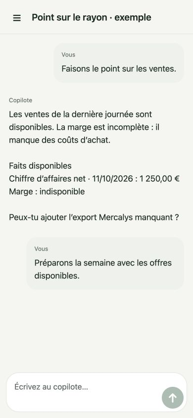
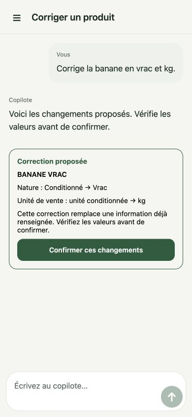

# M7 — Copilot, decisions, execution and review

## Entry gate

M6-T01 through T11 are deployed. The grouped iOS acceptance build 32093897-8457-496c-a670-8046815f02f2 is based on merge 6cd9d453f4e832848f0b94fabc75e8275cef9a61. Julien confirmed the mobile acceptance on 11 October 2026. The targeted exit checks passed: 16 actual SQLite tests and 15 Atlas transaction tests (isolated test database). They cover offline capture/restart/lookup, canonical evidence and score audit, idempotency/rejection, capable bootstrap/pull and offline restoration. A real observation does not guarantee immediate learning: sufficient published daily sales and an eligible confirmed directed relation are required.

## M7-T01 — Candidate aggregation

Runtime-neutral `aggregateCopilotCandidates` in analytics-core combines existing analytical candidates and trusted structured weekly producer output into a versioned common domain contract. It maps the four existing analytical trigger types without recalculating KPI thresholds. IDs include store and origin to avoid collisions across producers. Exact retries are deduplicated; divergent candidate/evidence identities fail explicitly. Ordering is deterministic, not a recommendation ranking. No semantic merge, priority cutoff, eligibility decision or generation occurs here; every normalized candidate remains TO_REVIEW for subsequent M7 stages.

Sources, entity IDs (including leading zeroes), dated context, evidence, data-quality warnings, optional declared missing data and nullable scores remain distinct. Source instruction, planned offer and derived interpretation have explicit evidence kinds. Zero is not missing. No stock, purchase cost, financial impact or causal effect is fabricated. The promotion-overlap weekly adapter calls the existing M6 detector, preserving exact mechanisms, dates, source references and support versions. Its default economic/urgency/quality scores remain unknown; declared compatibility is not a learned relationship score. No rejected edge reactivates.

This ticket creates the deterministic input seam for later filtering, scoring and remote generation. It is not an active chat, an AI call, a new mobile screen or a persistence/sync migration. Existing operational data remains authoritative. Weekly deadlines and other producers can supply the explicit weekly contract without changing the aggregator. M7-T02/T03/T04 own eligibility, priority components and conflicting proposed actions; M7-T05/T06 own configured remote AI and bounded French output. The full conversational copilot remains the M7 objective.

Validation: 610 local tests, structure, lint and strict TypeScript. No paid EAS build is needed for this pure shared increment.

## M7-T02 — Deterministic eligibility filter

`filterCopilotEligibility` consumes the normalized T01 candidates and trusted store-scoped entity/fact snapshots. It does not fetch, generate text, write, rank or discard candidates. The versioned configurable quality policy defaults to .7. Every result retains its source scores/context/evidence and reports ELIGIBLE, TO_REVIEW or SUPPRESSED with stable structured reasons and the evaluation instant/policy.

Inactive/missing or mismatched entity kinds, explicitly rejected relations, non-applicable operations, withdrawn/stale source context and passed exact deadlines suppress the proposal. Absent snapshots, unresolved synchronization, unconfirmed relations/applicability, unknown/weak quality, critical ambiguity, missing critical facts and required incomplete execution downgrade it for targeted review. A missing snapshot is not treated as proof that an entity does not exist. Confirmed pending local facts remain usable offline. Unknown availability is never turned into stock. No mandatory product category/nature/unit completion is introduced.

Known purchase cost is required for local promotion/lot proposals; checking a price is an inspection and does not require inventing a purchase cost. The trusted adapter decides which facts are critical and resolves cost/execution/source currency from canonical state, never model text. VALIDATE_DATA and WAIT_FOR_MORE_DATA remain possible despite low quality, but still respect entity/source/rejection/deadline and critical-fact guards. Exact deadline equality remains timely. All suppressed/review entries remain explainable; no rejected relation is reactivated. Cross-store and divergent same-identity snapshots fail explicitly.

The owner's ChatGPT-level simple, efficient and polished conversation requirement is recorded in PRODUCT_ROADMAP.md. It guides the later M7 native chat; this increment does not introduce a new UI or paid EAS build.

Validation: 618 local tests pass, including eight eligibility scenarios covering offline pending state, guards, unknown versus zero, cost requirements, quality exceptions, execution/ambiguity, exact deadlines, stable replay, corruption and configurable boundary. Structure, lint and strict TypeScript pass.

## M7-T03 — Explainable deterministic priority scoring

`scoreCopilotPriorities` scores only ELIGIBLE candidates evaluated at the same trusted instant. Review/suppressed entries remain in the result with null scores and no implicit promotion. It preserves all input facts and uses a versioned configurable policy: urgency .30, economic impact .45, deviation .05 and data quality .20. Near deadlines add .30 within 24 hours, .15 within 48 hours and .05 within seven elapsed days; exact boundaries are inclusive and scores cap at one. Passed deadlines or stale eligibility cannot be ranked as eligible. These defaults are technical/business policy, not AI-owned preferences or measured monetary benefits.

Unknown dimensions retain null values/contributions and explicit missing-dimension names. Known contributions form a conservative score without renormalizing missing inputs upward; this does not claim unknown impact is zero. Behavioural relationship fit does not masquerade as economic ranking. Stable ID ties, exact-retry deduplication and full candidate retention preserve reproducibility; selecting at most three useful priorities belongs to the later recommendation stage.

SQLite migration 33 adds immutable local derived `copilot_priority_snapshots`. The repository computes the shared score, saves the full candidate/source/eligibility/policy/component/deadline snapshot transactionally under a SHA-256 content identity, preserves earlier revisions and isolates stores. Exact replay is idempotent; divergent payload/collision and failed writes cannot replace prior proof. This is a local derived audit, not a user business mutation or new synchronized entity; it creates no Outbox command. The same pure score operation can serve the later remote generation pipeline. No active UI or provider call is introduced.

Validation: 626 local tests including six pure priority cases and two actual SQLite upgrade/restart/rollback cases. Urgent deadlines can outrank a larger low-urgency opportunity; a low-value extreme deviation does not automatically outrank meaningful economic impact. Unknown/zero, eligibility, caps, policy validation, stable ordering, old-proof preservation and no-network/Outbox behaviour are covered. No paid EAS build is needed.

## M7-T04 — Explicit candidate trade-offs

`detectCopilotConflicts` consumes a trusted scored batch and structured producer intents tied to its authorized products/candidates. It does not infer action direction from broad labels, choose a winner, merge opposing advice, change scores or execute anything. DISPLAY increase/maintain versus reduction and PROMOTION activation versus avoidance on the same product become explicit trade-offs. Separate products/axes, compatible actions, disjoint dates and already completed windows do not conflict. Only eligible scored alternatives participate; ignored ineligible/expired intents remain traceable.

Each candidate pair/product/axis is grouped once with its full supporting options, source candidate IDs and evidence IDs. The original complete scored batch is retained. Known intersecting instants are shown precisely, including a shared boundary; missing dates yield a possible conflict requiring verification. Several different known intervals are retained as MULTIPLE_OVERLAPPING_PERIODS, without inventing one continuous interval. Same-candidate internal opposing intents fail for producer correction instead of silently escaping the check. Tenant/target/candidate/period/duplicate corruption is rejected.

Candidates involved in a trade-off must not be emitted as two independent main priorities. Entries without an explicit intent remain separately identified: no detected conflict is not a proof of compatibility. The later AI output must explain alternatives and useful checks rather than hiding the conflict; final proposed actions also need this check after their scope/direction is resolved by the trusted adapter. Human decision and execution remain separate. This increment is shared deterministic logic, not an active chat, provider call or business write.

Validation: 633 local tests pass, including seven trade-off cases covering exposure/promotion, exact and unknown periods, multiple intervals, excluded/inactive actions, stable grouping/replay, input preservation, scope and internal opposition. Structure, lint and strict TypeScript pass. No new database migration, native dependency or paid EAS build.

## M7-T05 — Remote Copilot provider adapter

Julien explicitly authorized reuse of the existing OpenAI key on 11 October 2026. The remote-only `CopilotAiProvider` interface uses the project's AI SDK 7.0.130 with pinned `@ai-sdk/openai` 4.0.91 and the OpenAI Responses transport. Its model is configured explicitly through COPILOT_AI_MODEL; absence of a model/key returns NOT_CONFIGURED on invocation without breaking API startup. No key is created, copied, exposed to the client or written to an environment file. Other source-extraction provider/model settings are unchanged.

The trusted caller supplies an authorized deterministic candidate/trade-off context and a server-owned output schema. The adapter validates request/store scope, rejects oversized context without truncating evidence, separates source data from system instructions, performs one bounded attempt, supports caller cancellation and reports sanitized typed errors for configuration, rate limits, timeout, invalid/limited output and availability. Request limits are configurable server-side; no client-controlled model, key, endpoint or tool is accepted. The endpoint is fixed to OpenAI, Responses storage is disabled, and no tools/business writes are invoked. Return values contain typed output and safe requested/resolved model, response ID and token usage metadata; raw provider headers/body/errors are not returned.

System instructions preserve canonical scores, unknown facts, source/planned/observed distinctions and explicit trade-offs, requesting concise French proposals and no more than three useful main priorities. Prompt rules and schema validation do not prove factual grounding. The concrete French response contract follows in M7-T06, with the hard grounding gate in T07 and outage fallback in T08 before user-facing activation. This ticket does not register an API route, schedule generation or activate the chat. Current context must be built by the authorized server service, not accepted as arbitrary client-authored trusted facts.

Validation: 640 local tests pass. Seven new tests exercise the real SDK against simulated HTTP responses, including request construction/storage/tools, typed result and metadata, missing configuration, invalid tenant and oversized input, source-data boundary/input preservation, redacted auth/rate/server errors without hidden retries, invalid/limited output, cancellation/timeouts and bounded independent configuration. No paid/live generation request or EAS build is performed. Authentication against the live provider and model selection remain activation checks for the next generation increment.

## Approved scope expansion — primary chat (11 October 2026)

After T05, Julien confirms the conversation is the heart of the application and M5/M6 plus current manual business CRUD are its tools. He approves multi-topic chats, authorized collective memory, compacted context, rich numeric/source/retail-shopper analysis and routine data preparation/correction. Missing facts must be requested naturally through small inline forms or file requests; an uploaded Mercalys export must be persisted/processed through existing services and unblock the analysis. He also requests implantation images respecting island/TG constraints, with missing geometry collected explicitly.

`docs/M7_CONVERSATIONAL_DELIVERY_PLAN.md` now defines eleven delivery blocks and T16–T29 additions. The functional specification's original guided-follow-up-only preference is superseded; read-only synthesis and authorized operational tools remain distinct, with existing local-first/validation/authority rules. Original T01–T05 implementations are retained. The immediate next step is the owner-reviewed native chat UX prototype, before proceeding to user-facing generation/UI. No new business code, image generation, paid API call or EAS build is part of this planning update.

Julien subsequently confirms natural dialogue, sourced web research and Resend email document intake using the managed development receiving address. These requirements are recorded under T19/T23 in the revised plan; no receiving address/webhook/Gmail rule or live processing is configured by the planning changes. The next implementation work remains the owner-reviewed native chat prototype.

## M7-T16 — First primary chat UX prototype, owner review pending

A standalone interactive prototype is in `docs/prototypes/copilot-chat/`, shared at https://fl-copilot-ux-preview.vercel.app/. It keeps the existing forest/neutral palette and five-tab navigation while proposing chat as the Today entry. It demonstrates conversations/drafts, attachments by name, targeted forms, proposed grouped corrections/detail/back/undo, progressive source sheets, declared cross-topic memory, simulated interruption/offline retry and an explicitly indicative layout sketch. Data/replies are fictitious and no API, real file reading/upload, model/image generation, operational mutation or EAS build occurs.

Browser inspection covered desktop and a 390-pixel mobile breakpoint with no horizontal overflow. Core interactions and local draft/history restart passed; zero browser errors were captured. Hosted HTML and screenshot evidence were verified. Prototype hosting is a separate static UX project, not the application API deployment. The readme records limitations, scenarios and open owner decisions.

Julien subsequently replied “Oui nickel”, approving this UX direction, natural dialogue, targeted forms and five retained tabs. This completes the prototype-review gate; native functional/device acceptance remains pending.

## M7-T17 — Private conversation foundation

Shared contracts define owner/store-scoped conversations, immutable user/assistant/tool messages and opaque attachment references. Creation/rename/archive and user-message append are local-first, transactional with Outbox/history; draft text and attachment references are device-local and clear atomically only after a successful send. Equivalent UTC timestamps are normalized for stable UUID-tie pagination. Original messages are never overwritten; an edit is a new message referring to its predecessor. Unknown attachment references are pending metadata, not proof of file access or successful upload. Real source intake remains T23.

SQLite migration 34 and Mongo migration 31 add the private conversation/message stores and indexes. The canonical sync protocol gains an optional copilotHistory capability; old clients receive no private entities. Authorization is resolved from the authenticated user, including before processed-command replay, and replay identity binds the private command to that user even if a record is later removed. Clients cannot create fake assistant/tool records. Private messages from other users/stores are not returned; shared business facts/memory remain separate. Concurrent title/archive changes create explicit conflicts with both versions preserved and an owner-scoped reconciliation path.

Bootstrap carries a bounded recent window plus related parent conversations and marks history as partial. The authorized paginated history endpoint/API-client method retrieves earlier conversations/messages without exposing another user's data. Incremental pulls have a response-byte budget and continue at the last included sequence without skipping changes. Local readers page from SQLite; capable bootstrap/pull and acknowledgements preserve local newer revisions and are adopted once per store/user. The installed application's global sync provider does not activate the new capability until the native chat is integrated; there is no new screen or AI generation in this increment.

Verification: 649 local tests pass, including five actual SQLite offline/restart/rollback/ack/conflict/second-device cases and four contract cases. The affected historical Atlas suite passes 86 cases; the final focused private suite passes all seven cases and checks ownership, old clients, replay after removal, immutable/concurrent history, missing parents and pagination. Structure/lint/TypeScript, API runtime-import verification and iOS/Android Hermes exports pass. No paid API/image generation or EAS build is launched.

## M7-T18 — Tool authority foundation and coverage inventory

The [manual-operation inventory](../specs/COPILOT_TOOL_COVERAGE.md) maps current public repositories/services and screen journeys to the upcoming tool adapters. Only `product.inspect` is activated in the internal local registry at this increment; it is not a model route or native UI yet. Other CRUD/read/source operations remain explicitly pending T19–T23 rather than falsely advertised as executable.

Strict versioned request/input/result contracts reject model-provided actor/store/credentials and arbitrary mutation names. Trusted application scope and the owned conversation are checked before reading or replaying. The first adapter reuses the canonical product editor reader, preserves leading-zero identifiers/alias metadata and local sync states, and exposes no foreign-store product. SQLite migration 35 journals device-local read snapshots: exact retries return the original observed result, new operation IDs refresh current data, changed input reusing an ID is rejected, and failed/cancelled reads roll back. Reads create no business Outbox command. Future mutation tools must atomically join existing validated mutation/Outbox services; this read adapter does not claim write authority or cross-device tool-result replication.

Validation: 652 local tests pass, including actual SQLite restart/replay, scope/revocation/input forgery, changed-operation rejection, cancellation/rollback and redacted errors. No AI API or EAS build is needed; native chat and remaining tool wiring remain subsequent increments.

## M7-T19a — Daily analytical, receipt and commercial read tools

The internal registry now includes `analytics.daily`, `waste.inspect` and `commercial.offers` alongside product inspection. All use strict model inputs, current trusted store/private conversation authority, typed results and the same atomic device-local retry journal. No new remote writer, generation, native screen or paid build is activated.

The daily reader delegates to the existing Today summary/shared analytical engines for an explicit calendar day, preserving decimal precision, null/unavailable versus zero, computation date, sync origin, KPI status, unresolved-source counts and source lineage/J−7 comparison qualifiers. It never substitutes the latest day when the requested day has no calculation. The existing Today default remains latest available day. Flexible period aggregation and broader contextual calculations remain subsequent T19 adapters.

Receipt inspection reads canonical receipt/line drafts including cashier/date, match/validation and sync state without exposing local file URLs or publishing anything. These captured amounts are not Mercalys sales or automatically published waste. Commercial reads select retained choices intersecting an explicit period (up to 366 inclusive days), paginate stable UUIDs in pages up to 25, preserve mechanisms/source references/sync states and include validation only when the current choice exactly matches its immutable validated revision. Retention/validation are not execution. PDF source opening and public web research remain explicit T19 work; this increment does not change rich PDF extraction.

Validation: 656 local tests pass, including actual SQLite requested-day/missing-reference/missing-waste/source-lineage parity, valid calendar dates, draft privacy/no business writes, retained/withdrawn/foreign/out-of-period offers, bounded pagination/replay and stale-validation rejection. Global authority/restart/cancellation/rollback tests remain active.

## M7-T19b — Events, directed substitution and cached store context

Internal read tools now include `store.events`, `substitution.lookup` and `store.week`. They reuse the existing canonical repositories and substitution engine within the same owner-scoped local result journal; no business action, network request, new UI, AI call or EAS build is activated.

Event reads select interval-overlapping observations in explicit normalized instants (`[startAt,endAt)`), retain source/status/sync metadata including unresolved conflicts, and paginate stable UUIDs (up to 25). A closed event ending at the interval start is excluded. Events are contextual evidence, not proof of current stock or causality. Substitution lookup delegates to the same snapshot reader/behavioural rules as the manual screen, preserving directed relations, human refusals, exclusions, declared versus learned score basis and UNKNOWN availability. Evaluation cannot be requested in the future. Candidate pagination and excluded counts/partial flags prevent a bounded reply from claiming exhaustive detail.

Weekly context reads only the configured store's fingerprint-matching local cache. Provider sources/retrieval/expiry timestamps and forecasts remain explicit; expired available providers are marked STALE in the returned snapshot without modifying the cache. Changed settings/missing cache return no context; no network call or automatic geolocation occurs. General public-web research, source opening, flexible quantitative periods and full evidence details remain subsequent adapters.

Validation: 659 local tests pass, including actual SQLite interval boundaries/timezone normalization/store isolation/pagination, unresolved events, directed lookup parity/unknown stock/refusal/out-of-stock/no writes, and context freshness/provenance/settings invalidation. Existing restart/retry/authority/cancellation tests remain active.

## M7-T19c — Original-source reference and bounded public research adapter

`source.reference` is an internal local tool resolving owned, nondeleted original metadata and an opaque `COMMERCIAL_ORIGINAL` action for commercial PDFs. It journals neither local paths nor temporary/private signed URLs. The native renderer will reuse the existing CommercialOriginalButton's local-first opening and authenticated/fresh short-lived link fallback; this increment does not add a chat UI or promise availability from metadata alone. Other source types retain their metadata but do not advertise this PDF-specific action.

The separate server `createCopilotWebResearch` adapter uses the existing authorized OpenAI key and an explicitly configured COPILOT_AI_MODEL, the Responses built-in web_search and version-matched AI SDK 7 tool schema. The pinned provider 4 tool's legacy schema is normalized through the current SDK `tool` contract (same inspected provider ID/arguments); no unsafe cast, provider upgrade or alternate business architecture is introduced. The adapter is not an active public route or model-exposed tool yet. Authenticated conversation scope, durable paid-call request/result deduplication and native citation/source display remain activation gates.

Only an explicit screened public question/purpose and reference date enter the request; private store context/files/history are not passed. Known secrets/emails/private source URLs and model-supplied authority fields are rejected. This screening is defense in depth, not general DLP for arbitrary prose; orchestration must never concatenate private store facts into queries. Only the built-in public web tool is attached, with no business tools, one SDK request/no retries, at most two provider tool calls, 45-second maximum and at most 2,000 output tokens. Cancellation/configuration/failure paths return redacted codes. The API key/model configuration is not changed and no paid live call is made.

Successful external results preserve raw single-message text/citation positions, safe HTTPS source links/titles, access time, provider model/token usage and EXTERNAL_RESEARCH classification. They require a web-search output and bounded valid citations. Publication dates remain unknown rather than guessed. Provider pages/quotes/query are untrusted source data, not instructions or canonical KPIs. Citation validation is structural; it does not certify source truth or causality. Unsupported/multimessage/unsafe-cited results fail explicitly. Final native grounding/rendering remains a separate gate. Implementation reference: [official OpenAI web-search documentation](https://developers.openai.com/api/docs/guides/tools-web-search).

Validation: 664 local tests pass, including a real SQLite source-reference privacy/isolation/replay case and four actual AI SDK mock-HTTP cases (tool/citation/cost bounds, private-query rejection, unavailable/unsafe/unsourced responses, cancellation/timeout/no retry). No EAS build, email or paid AI generation/search is launched.

## M7-T20a — Authorized atomic product classification batches

The separate internal WRITE registry now includes `product.classify`: strict patches to category/nature/salesUnit of 1–25 unique existing products with exact local revisions. The read runtime cannot execute these writes. Model arguments contain no actor/store/device permission or decision. Trusted authority binds current cached manage permission, an ACTIVE owned conversation, an existing USER message and the exact canonical request JSON. A routine clear user request may authorize filling unknown fields without repeated confirmation; replacing an already populated value requires reviewed authority plus the explicit overwrite flag. REVIEWED may represent a clear contextual user instruction or an explicit preview approval, not a compulsory modal for every edit. Known values are treated conservatively because the current Product schema does not distinguish every field's human-origin history.

The adapter reuses ProductMasterRepository/productSchema and joins its nested writes to one existing exclusive SQLite transaction. Products, canonical PRODUCT_UPSERT Outbox commands, before/after snapshots and operation-result identity commit atomically; changed fields do not touch identifiers/aliases/packaging or create products. Existing remote-version/CAS/conflict rules remain unchanged, including possible conflicts for later edits while prior commands are still pending. No remote or universal last-write-wins shortcut is introduced. A changed product with observed/cached business days queues the existing analytical recomputation job in the same transaction; recomputation is pending, not a claim that cached KPIs are immediately fresh. Exact restart retries replay only after current authority checks and add no commands/jobs. No-op patches add no business command/version. Stale revisions, unavailable products and unresolved sync states fail the entire lot; actionable error codes/details identify the affected product/field/revision without exposing a foreign record.

Validation: 668 local tests pass, including four real SQLite offline/restart/single-replay/no-op, batch/commit rollback, exact-intent/actor/USER-role/revocation, known-value review and cancellation/conflict cases. Command IDs/known remote bases and one-time recomputation identity are checked. Existing product/sync suites remain active. The adapter is not yet connected to native chat/model generation. Full product CRUD and conversational intent/review UX remain upcoming T20 work; no paid AI call or EAS build is launched.

## M7-T20b — Canonical catalogue editor and logical retirement tools

`product.save` and `product.retire` are internal WRITE adapters, not exposed to a native/model route yet. They require trusted reviewed USER intent bound to exact request/store/conversation/device context, an ACTIVE owned conversation and current cached manage permission; this may be a clear explicit user instruction/one reviewed editor decision, not a mandatory second confirmation. The full editor draft contains bounded label/classification/packaging and up to 20 identifiers/20 aliases. Creation gets stable IDs from the application; updates preserve exact product and child identity/revision sets. Missing/foreign child IDs or independently changed aliases/identifiers are rejected before a partial save. Model input cannot provide authority, source/status/provenance, family metadata or remote versions.

The adapter delegates to the same saveProductEditor/ProductMasterRepository as the manual screen, joining all writes/commands, private before/after result and optional recomputation into one exclusive local transaction. It does not duplicate catalogue persistence or issue remote-only writes. Existing alias/identifier source/status/confirmation is preserved; a new alias cannot silently bypass an active rejected equivalent. Strong identifier collisions with another product produce a targeted identity conflict instead of guessing a match. Omitted existing children are soft-deleted only within the authorized full reviewed draft. Product retirement uses the existing PRODUCT_DELETE tombstone/version and retains rows/child/history references; recovery/reactivation and dedicated alias validation remain follow-up tools. Unresolved entity/child sync states block safely.

The canonical editor's expected-version helper is now exported/reused by classification as well: a subsequent edit of a dirty pending record references that local entity revision, just as manual edits do. Observed remoteVersion is not fabricated or overwritten. This corrects T20a's prior use of only the observed remote base for successive pending corrections. Normal cross-device CAS conflicts still remain possible.

Validation: 673 local tests pass, including five real SQLite catalogue cases for offline stable aggregate creation/restart replay/leading-zero identifiers, pending-version update/packaging/child tombstones, stale child/refused alias/identifier collision, logical retirement/scope/revoked review authority and atomic commit/cancellation rollback. Classification tests now check the pending version chain. Existing editor/alias/sync suites remain active. No paid AI call, EAS build, new dependency/migration or native screen is added.

## M7-T20c — Need catalogue and reviewed association/substitution decisions

The internal read registry adds paginated `need.list` (up to 25), including inactive/reserved codes, revisions and sync states, with scoped durable read replay. The separate WRITE registry adds `need.save`, `need.membership` and `substitution.save`. All require the existing trusted catalogue-management authority and reviewed USER intent bound to an owned ACTIVE conversation/exact request; no model-supplied authority, source, human-confirmation or learned-field values are accepted. They remain internal adapters, not live native/model actions.

Need creation uses app-generated IDs/USER origin; updates preserve identity/origin/creation time/code, and INACTIVE is a versioned status, not deletion. Codes remain reserved even after deactivation. Membership/substitution IDs use the same runtime-neutral digest functions and ordered tuples as the canonical repositories. Product/need/current association revisions and unresolved sync states are checked; validation requires available active parents, while a refusal can retain historical inactive-parent references according to the canonical policy. These tools record explicit VALIDATED/REJECTED decisions; generic unconfirmed proposals stay in conversation/another dedicated producer, never silently downgrade prior human decisions. Reactivating a refused relation additionally requires the specific allowReactivateRejected flag inside the exact trusted reviewed request.

The adapters reuse the existing repositories/history/Outbox within one already-exclusive transaction together with private before/after operation identity. Retries after restart recheck authority and add no duplicate entity/history/command. A→B never implies B→A. Substitution compatibility values remain declared, not learned financial forecasts: existing evidence count, empirical observed substitution/score/confidence/date and source are preserved; LEARNING is retained for a still-validated existing learning relation and cannot be invented from no evidence. No score/evidence audit is rewritten. Membership source/provenance is preserved. Creation requires an explicit declared manual confidence (0–1); updates can preserve it with null or edit MANUAL confidence through reviewed input. Non-MANUAL/learned confidence cannot be overwritten by this tool. No default confidence or AI probability is invented. No stock/cost/uplift is fabricated.

Validation: 680 local tests pass, including seven real SQLite need creation/rename/deactivation/code reservation/restart, association refusal/explicit reversal/stable identity, directed learned-field preservation/no audit writes, parent/store/permission/review/conflict gates, atomic history/command/result rollback/cancellation/retry and paginated catalogue privacy/no business writes. Existing catalogue, need/membership/substitution and sync tests remain active. No new dependency/migration, native screen, EAS build or paid AI call is introduced. Native intent/review/proposal/batch orchestration and dedicated recovery/conflict workflows remain later work.

## M7-T21a — Reviewed field observation capture and closure

The internal field WRITE registry adds `store.event.capture` and `store.event.close`, reusing StoreProductEventRepository/history/Outbox in the same exclusive transaction as the private operation result. The common reviewed store-operation gate now accepts a capability already resolved by the trusted application; existing catalogue wrappers still map only their own manage capability, while field wrappers map only canCaptureStoreEvents. No model argument contains authority, event identity/source/capture time, command IDs or stock quantities. A clear contextual USER instruction may be the reviewed intent; no compulsory second modal is introduced. Native/model permission/intent binding remains pending.

Capture requires an owned available active product and exact product revision, normalized observed dates, and app-generated UUID/command/capture time. It can record ongoing or already-ended USER observations, never future planned events. Product category/nature/unit completion is not required. Closure requires the scoped exact event revision and USER source; commercial PDF signals stay read-only through this tool. Dates cannot precede the start or exceed the trusted application capture time. The same closed timestamp is a no-op without additional canonical history/command; a different end date cannot overwrite an already closed observation. Unresolved synchronization states and stale versions are explicit blockers.

Entity/history/Outbox and before/after tool result commit atomically. Restart retries recheck current field permission and add no duplicate event/command. These are declared field observations, not updates to numeric stock, price, official sales/waste/margin or proof of causality. Existing source/timing/version semantics remain intact; later remote synchronization/qualified evidence processing is separate. Dedicated correction/recovery/conflict and commercial workflow tools remain follow-ups.

Validation: 684 local tests pass, including four real SQLite offline capture/restart/normalized time/single replay, closure/pending revision/no-op/date protection, permission/store/forged-source/stock/product-version gates (including no catalogue permission escalation), and commercial-source/conflict/commit/cancellation rollback cases. Existing catalogue/needs/sync suites pass through the shared-gate refactor. No dependency/migration, new native screen, EAS build or paid AI call is introduced.

## M7-T21b — internal weekly preparation tools (11 October 2026)

`commercial.preparation.inspect` reads the explicit Monday's local draft and sync state through the existing repository; absent data stays absent. `commercial.preparation.save` accepts a reviewed full draft plus its expected local version (null for creation). App code supplies store, deterministic week identity, command ID, clock and a distinct `canPrepareCommercialWeek` capability. It preserves creation time and advances the canonical revision.

The canonical preparation schema/repository enforce week boundaries, capacity, placements, offer versions/status/period and visual-source references. Changed offers and invalid TG sources return targeted French errors. Conflict/error drafts require dedicated recovery. Request/result identity, canonical history and Outbox save join one SQLite transaction; exact replay is checked only after current conversation/owner/permission authority. No publication, execution, calculated stock, paid AI call or native chat activation is added. Retain/withdraw choices, plan execution, recovery and native review binding remain separate T21 work.

Real SQLite tests cover offline save/read, exact replay after restart, revisions, reviewed permission, invalid capacity, changed choices, cancellation and failed commit rollback. No EAS build is required for these internal adapters.

## M7-T21c — internal commercial choice tools (11 October 2026)

`commercial.choice.inspect` reads an owned choice by ID, including withdrawals, with revision/sync state; missing data remains absent. `commercial.choice.save` records a reviewed, bounded full choice (create/update/withdraw), using the existing CommercialChoiceRepository. Store, deterministic source identity, clock and command ID are app supplied; `canManageCommercialChoices` is independent of catalogue permissions. A retained choice requires the associated active product's exact version, confirmed applicability/critical fields and the original reading's operation/item labels. Canonical mechanism validation and duplicate prevention remain in force.

Withdrawals require an existing exact-version choice and preserve its product, period and mechanism. Source/creation identity and all history remain canonical; withdrawal does not update a saved preparation or execute a plan. Conflicted/error records require separate recovery. Reviewed request authority, local mutation, history, Outbox and cached operation result join one SQLite transaction. Revoked/foreign authority cannot replay results. The adapter is internal: native chat/review binding, paid generation and dedicated recovery remain pending. No EAS build is required.

## M7-T21d — reviewed commercial plan tools (11 October 2026)

`commercial.plan.preview` reads an explicit week's preparation and canonical context, returning readiness issues or a deterministic candidate from `buildCommercialWeekPlan`. Its embedded VALIDATED-shaped candidate is provisional: the READ operation writes only its private result journal, never a business plan/Outbox. The app injects the digest function; it cannot be supplied by model input.

`commercial.plan.validate` accepts only the persisted preview operation ID. Trusted `canValidateCommercialPlan` authority must bind the exact request to a reviewed USER message in the same owner/store/conversation, dated at or after the preview. It rechecks the current plan revision, readiness and exact deterministic rebuild of the preview. Product/choice/preparation/reference changes require a fresh review. IDs, scope, version, clock and plan content come from canonical app services, never a model-authored plan. The final validation timestamp is the actual application time.

The existing CommercialPlanRepository atomically saves the plan, materialized operations/offers, canonical history and Outbox together with the tool result. Local history records the pending revision; remote revision snapshots arrive through normal synchronization. Exact replay after restart does not duplicate writes. No execution in rayon, AI generation, native chat activation or paid EAS build is introduced. Dedicated offer-validation tools, execution and conflict recovery remain follow-ups.

## M7-T21e — reviewed offer validation tool (11 October 2026)

`commercial.offer.validate` internally validates 1–25 exact retained choice revisions through the existing ValidatedOfferRepository. Model arguments contain only choice IDs, choice versions and expected product versions. App scope supplies a dedicated `canValidateCommercialOffers` permission, the exact reviewed USER request, device/command IDs and clock, plus trusted review attestations for every selected choice/version/reading/checksum. Model-supplied review booleans cannot grant authority. Native source-review UI binding remains pending; these internal attestations are not yet produced by a live chat.

The adapter checks active owned products, current versions and sync state; canonical source extraction preserves the original fields and evidence in immutable validation records. ERROR/CONFLICT require separate recovery. The complete batch, canonical history, Outbox and tool result share one SQLite transaction. A later unchanged request returns existing validation entities with null command IDs; exact operation replay retains its original result after restart, with permission/conversation and source-attestation checks still required. No plan or field execution is implicitly saved.

Real SQLite tests cover batch success/restart, unchanged no-op, stale versions, missing or mismatched source review, foreign/revoked authority, second-source failure, failed commit, cancellation and failed-record preservation. No paid AI call or EAS build is required. This completes the internal choice → offer validation → preparation → plan adapters; generation/native orchestration, execution and conflict/recovery tools remain pending.

## M7-T21f — internal commercial execution tools (11 October 2026)

`commercial.execution.inspect` returns the current explicit week's canonical signage/TG checklist, matching declarations, sync state and deterministic progress. Missing plans stay absent and tasks without declarations remain TODO. A DONE count is a user declaration, never automatic evidence of field execution; conflict/error states remain visible.

`commercial.execution.save` records a reviewed status/note for one current-plan target, with exact plan/task versions (null task version for creation). App code derives the target label, identity, revision/checksum and timestamps from the canonical checklist; model input cannot forge these or grant `canDeclareCommercialExecution`. DONE sets the application declaration time, a note-only edit preserves it, and explicit reopening clears it. Ignored/non-applicable tasks require a reason. Identical status/note is a no-op. Old plan targets cannot silently transfer to a new revision; historical-plan editing and dedicated conflict recovery remain follow-ups.

The existing CommercialExecutionRepository writes canonical history and Outbox in the same transaction as the private tool result. Exact replay survives restart without duplication and current authority is rechecked. Plans, offers, stock and analytics are not mutated; the tool does not print an actual sign. Tests cover checklist reads, declarations/restart/no-op, version chaining, date semantics, changed plans, authority, missing plans, conflicts, cancellation and failed-commit rollback. Native chat integration remains pending. No paid EAS build or AI call is required.

## M7-T21g — internal store settings tools (11 October 2026)

`store.settings.inspect` reads the owned store's canonical settings/version/sync state; missing configuration stays absent. `store.settings.save` accepts reviewed city/postal code/school-zone values and an explicit location policy (`CITY` or `KEEP`), with an expected local revision. Trusted `canManageStoreSettings` is distinct from catalogue/field permissions. IDs, country/timezone, versions and timestamps come from app code; model input cannot inject coordinates or claim a new DEVICE capture.

KEEP preserves a recorded point exactly; creation without prior settings uses CITY. An address change while keeping a DEVICE point requires explicit CITY selection or manual device recapture. CITY clears the old point through canonical settings save. Unchanged settings are a no-op. Conflicted/error settings require dedicated recovery. Canonical history/Outbox and the private operation result join one transaction; current authority is checked before exact replay after restart.

No GPS permission, OS setting, external geocoding/weather request or AI call is performed. A changed settings fingerprint excludes the previous weather/calendar cache from fresh `store.week` reads without deleting its history; provider refresh remains a separate operation. SQLite tests cover absence/read/save/restart/no-op, point preservation/explicit city selection, coordinate forgery rejection, revision chaining, cache isolation, stale versions, rights, conflicts, cancellation and commit rollback. Native chat/source/form binding remains pending and no EAS build is required.

## M7-T22a — contextual question schemas and local response drafts (11 October 2026)

Typed question definitions contain 1–8 unique contextual fields, a short explanation, reliable prefill candidates and parent USER/operation IDs. Supported fields are DATE, decimal NUMBER with explicit unit, bounded TEXT, enumerated CHOICE and opaque FILE source references. ISO calendar dates and available choices are checked; decimal strings accept a French comma and normalize without floating-point arithmetic. Partial/invalid values remain raw editable drafts and return field-keyed issues. Numbers with units and dimensions are facts to collect, not calculated business results.

SQLite migration 36 adds owner/store/conversation-scoped `copilot_forms`. The local repository checks an active owned conversation and parent USER before creation, preserves exact definition retry identity, and version-checks edits. Answer edits merge by field; null/empty clears a value. SAVE evaluates OPEN/READY, POSTPONE preserves answers and CANCEL terminates the question. A changed trusted app basis token marks the old question STALE while preserving its earlier answers. Tokens must be derived/rechecked by native orchestration, never accepted from model authority. Unknown or missing/deleted/foreign FILE references cannot become ready; attachment intake remains T23.

These are internal local drafts: READY does not publish observations, authorize a tool or prove verified financial data. No business Outbox/server record is generated; cross-device question replication, canonical answer consumption, actual chat resumption and inline rendering remain follow-ups. This increment does not claim the full T22 gate. SQLite tests exercise partial reply/restart, precise decimals, field errors, postpone/resume/cancel, obsolete questions, rights/version isolation, saved attachment scope, failed commit/cancellation and upgrade from schema 35 preserving pending sync/history. No EAS build or paid AI call is required.

## M7-T22b — submit a contextual response into private conversation history (11 October 2026)

The internal form submission service consumes only an exact READY form revision, with a trusted explicit submit confirmation bound to its ID/version and current app basis token. It rechecks owner/store/active conversation, readiness and live saved-source scope. It creates a canonical immutable USER reply linked to the original request, retaining exact normalized values (decimal strings, ISO dates, choice IDs and opaque source references) in the form's submission receipt. Human-readable text displays field labels, French dates and units; repeated source references produce a single attachment entry.

Message/history Outbox and ANSWERED receipt join the existing SQLite transaction. Exact retry after restart returns the same message/receipt, and a submitted form cannot be edited into a different answer. Existing migration-36 form payloads default to no receipt; no new migration or API business entity is required. Current permission/confirmation and basis are rechecked before replay. Wrong revisions, incomplete/obsolete answers or a deleted/foreign file return scoped errors and field issues without sending a message.

The canonical conversation append path adds an optional app-only `preserveDraft` flag: inline-form submission preserves an unrelated composer draft, while ordinary append retains its existing clearing behavior. This is conversation synchronization only; no product, observation, plan or financial figure is published. Source processing, automatic agent resumption and actual inline chat UI remain follow-ups, so T22's full gate is still pending. Tests use real SQLite for restart/replay, composer preservation, exact values, source revalidation/deduplication, stale/foreign authority, commit rollback, cancellation and old-payload compatibility. No paid AI or EAS build is needed.

## M7-T22c — reusable native inline question card (11 October 2026)

`CopilotInlineFormCard` renders the short explanation and only the declared fields, using existing design tokens/buttons and DateSelector. Decimal inputs carry units, choices are accessible radio options, field-keyed issues are announced and highlighted. The user can send, postpone or cancel. POSTPONED is collapsed with a resume action; ANSWERED/CANCELLED/STALE render a short state rather than repeating the whole form. The controlled host supplies drafts, pending/error state and authorized file intake; no source picker is guessed or added through a new native dependency.

The paired controller invokes the canonical form draft/submission services, evaluates the current basis before save and again before sending, and returns incomplete fields without creating a message. If sending fails after draft save, its typed error carries a freshly scoped persisted form so the host can keep the correct revision for retry. Real SQLite tests cover missing-field edits, submit, postpone/resume, cancelled send/retry and a context change between save/send.

Visual verification used the actual component in a temporary isolated Expo web harness at 390×844 with synthetic data: field errors, French decimal entry, the existing calendar, radio selection, postpone/resume preserving entries and collapsed confirmation. The harness/root layout and temporary theme workaround were removed/restored afterward; no test route/menu is shipped. Native exports and normal project checks validate the production tree. The browser fixture tests rendering only; SQLite service tests cover persistence separately. This is not full native-chat acceptance, and automatic generation/resumption/file intake remain pending. No EAS build or paid AI call was used.

### T06a — French conversational response contract

Added a runtime-neutral strict response schema separating evidence references, interpretation, recommendations and targeted questions. Ordinary clarification may contain zero recommendations; recommendation detail includes confidence, risk, missing information and a measurement plan. At most three priorities are accepted. Facts contain evidence references rather than model-authored official values.

Three contract tests pass, as does domain typecheck. This is the first part of block 1 (French generation, grounding and fallback), not activation of the chat. Language declaration does not prove French prose, and structural evidence references do not prove factual grounding. T07 must validate references and unsupported assertions against trusted context before any generated response is displayed. Provider wiring, deterministic fallback, orchestration, native chat and grouped iPhone acceptance remain pending. No paid AI call or EAS build was run.

### T06b/T07a/T08a — Generation service and evidence fallback

The server now invokes the existing provider with the French response contract, validates evidence references and eligible candidate/type bindings, rejects duplicate candidate recommendations and unresolved trade-off candidates, and rejects numeric characters in prose. Official numbers and dates must be rendered from canonical evidence references, not generated prose. Known provider failures and rejected output return a deterministic evidence-only fallback; cancellation and invalid store scope remain errors. No automatic retry, paid call, API route or native activation is introduced.

This is a conservative first-stage gate, not proof of arbitrary semantic grounding: number words, unsupported causal claims, French prose quality and priority-order preservation still need acceptance work. The fallback deliberately offers available evidence without inventing template actions; richer deterministic recommendation templates remain pending. Tests cover invalid references/numeric assertions, provider outages/unconfigured state, rejected generation, cancellation and cross-store scope. Full block 1 remains open before chat activation.

T07a follow-up: recommendations must preserve descending canonical priority scores; unscored and ineligible candidates are rejected. Evidence IDs with conflicting payloads are rejected by the generation gate and omitted from fallback, preventing an ambiguous ID from displaying the wrong canonical value. Two additional tests exercise both protections. Semantic grounding and richer fallback templates remain open.

T08a follow-up: outage fallback now supplies at most three deterministic verification templates for sales, margin, stock, price, PLU, quality and waste signals. Only eligible, scored, evidenced candidates outside unresolved trade-offs are included, ordered by canonical score. Unsupported types remain absent. These templates are explicitly non-causal checks, not model-generated explanations or automatic decisions. The outage test verifies candidate identity.

### T09/T17 connection — Server response message and persistence boundary (in progress)

Added a response-to-message builder using application-supplied identities/time and the canonical message schema. It binds the assistant reply to an existing USER question, renders official evidence values from trusted context, rebuilds fallback rather than trusting caller-authored fallback text, and rejects wrong question/scope, invalid chronology and overflow.

Added an internal Mongo assistant producer requiring an active transaction. It verifies current owned active conversation and USER parent before replay, rejects reused message identity with altered contents, and inserts the message and canonical sync change within the supplied transaction. Four targeted unit tests pass for rendering/parent binding, identity/replay/authority and transaction/archive guards. Persistence tests use a database double, not a replica-set transaction; real Mongo rollback/concurrency acceptance remains required before activation. No API route or native chat activation yet; structured evidence provenance/paging and generation orchestration remain pending.

Server persistence acceptance: two integration tests now pass on an isolated disposable Atlas database. An injected failure rolls back reply and sync change together; sequential and concurrent retries yield exactly one reply publication. Revoked producer authority rejects replay. The test database is removed after the suite. This closes the previously noted Mongo rollback/concurrency gap; route authentication, structured provenance and native/model orchestration remain pending.

### T17 — Internal question/generation/history orchestration (initial)

Added a server-only turn service with strict reply/conversation/USER-message IDs, application-authenticated authority and a trusted context loader. It verifies owned active parents and existing reply identity before loading context or calling the provider; sequential retry returns the stored reply without repeating generation. Generation occurs outside the Mongo transaction, followed by renewed authority and parent checks, then canonical reply/sync-change transaction. Pre-cancelled requests stop before processing.

Three isolated Atlas integration tests pass, including the complete fallback-generation/persistence/replay path (provider double, no paid AI), rollback and concurrent persistence. ESLint and API typecheck pass. This does not activate an API route or native chat. Generation leasing/cost protection for simultaneous turns, structured evidence provenance, conversation context/compaction, tool orchestration and cancellation-at-commit semantics remain required before user-facing activation.

### T17 — Durable generation leases

Mongo migration 32 adds scoped generation leases keyed by the application reply UUID. A ten-minute lease prevents concurrent attempts from loading context/calling the provider for the same reply. Busy attempts return an internal IN_PROGRESS error; changed actor/parent identity is rejected. Completed/failed attempts release only their own token. An abandoned lease can be taken over after expiry, and a transactional fencing write prevents the expired worker from committing a reply after takeover. Persisted replies still replay before lease acquisition.

Five isolated Atlas tests pass, including concurrent turn orchestration with a provider double and expired-token takeover/fencing. No live AI cost or EAS build. This bounds concurrent generation while a lease is live; it cannot guarantee zero repeated provider cost after worker death/lease expiry. Native pending/retry states, route activation, structured provenance and tool binding remain pending.

### T17/T09 — Authenticated HTTP turn boundary

Added shared strict turn request/result contracts and POST /api/v1/copilot/turn. Only stable reply/conversation/USER-message IDs are accepted; store/actor authority comes from the existing bearer/store authorization, renewed by the turn service. A trusted server context loader must be explicitly supplied: normal runtime currently returns COPILOT_NOT_READY (503) after authorization and makes no provider/database request. Busy leases return a retryable French 409; stale requests require refresh.

HTTP-to-real-Mongo acceptance now passes for fallback generation, canonical assistant message serialization, persisted reply and exact retry. This test exposed and fixed a Zod response-encoding issue: the wire timestamp schema is serialization-safe while canonical message construction retains normalization. Six isolated Atlas tests pass; the route unit test covers absent/foreign authorization, missing store, disabled wiring and injected actor rejection. Native context/tool binding, source provenance and live generation/chat activation remain pending. No paid call or EAS build.

### T07/T17 — Canonical remote daily evidence adapter

Added a read-only adapter for the latest stored department performance, scoped by store and rechecking embedded payload store/date. Sales, margin and sales-valued waste retain decimal strings and business-date labels; missing values remain null and availability is emitted separately. No KPI is recalculated, and the latest observed day is never labelled today. Evidence IDs bind source identity and a hashed canonical input revision. Seven isolated Atlas tests pass, including a shared-engine-produced empty-day fixture, tenant isolation and empty store results. This adapter is not yet wired into generation context; date selection/comparison and native activation remain pending.

### T07/T17 — Daily facts connected to the turn pipeline

Server generation requests can now carry a bounded standalone evidence pool independently of recommendation candidates. The turn service reads latest canonical department evidence under its active lease and supplies it to generation. Grounding validates standalone fact IDs and divergent duplicate IDs across the complete pool; recommendation evidence remains restricted to each eligible candidate. Fallback and message rendering resolve the same pool, enabling useful dated facts without fabricated recommendations.

The HTTP-to-Atlas test now verifies an actual shared-engine-produced daily snapshot appears in the stored reply with its business date and unavailable value. Seven Atlas tests pass; a new unit test covers facts without candidates and duplicate evidence rejection. Production still has no trusted recommendation context loader/native chat activation. No live AI call or EAS build.

### T09 — Shared mobile turn transport

The existing ApiClient now sends strict turn IDs with bearer/store headers and validates the returned assistant's reply ID, owner, store, conversation and USER parent before handing data to native consumers. Wrong-scope responses are rejected with a safe French error; retryable server pending errors are preserved. Shared turn contracts are re-exported through sync-contracts without adding dependencies. Two transport tests pass; full local checks total 740 passed. No native screen, automatic history synchronization or live chat activation is introduced in this increment.

### T09 — Controlled native conversation view (initial)

Added a native conversation view with virtualized stable-ID messages, selectable assistant prose, distinct user bubbles, attachment filenames, conversation action, multiline composer and optional attachment/retry actions. Pending generation/queued state prevents another send without destroying the next draft. Offline retains messages and permits the host to queue a question. Automatic following stops while reading older content. Existing visual tokens and accessible labels/disabled states are used; tool implementation messages are not displayed as user-facing prose.

Typecheck passes. This is a controlled view, not an activated route: the host must provide safe-area/navigation, scoped SQLite history, draft persistence, upload handling, inline forms and pending/retry orchestration. Visual/native acceptance remains pending. No EAS or paid generation.

T09 local connection: the controlled chat panel now loads scoped conversation/messages/draft from SQLite and connects composer edits/send to a serialized local controller. The canonical append transaction preserves drafts on failure and creates USER message plus Outbox exactly once. Scope/topic keys reset transient UI, and a controller identity guard prevents rendering another controller's snapshot. Failed opening offers a return action. A real SQLite test covers queued edit→send, empty re-send rejection, injected commit failure preserving draft, reconstructed controller restoration, foreign-owner rejection and exact Outbox count. Full native route, live response delivery, older-page UI and visual acceptance remain pending; this stays within draft PR #153.

T09 private response reception: the native sync provider now opts into private Copilot history with the current actor ID for bootstrap/pull and service ownership. Shared conversation dates use a reversible codec, preserving canonical ISO normalization while allowing HTTP history serialization. The authenticated HTTP-to-Atlas test verifies history retrieval after reply persistence. A local response receiver checks requested reply/actor/store/conversation/USER-parent identity and commits the reply through the canonical SQLite apply path, without producing an Outbox command. A real SQLite test covers rollback, exact replay, SYNCED state, Outbox count and foreign-owner rejection. Seven Atlas tests pass. The native panel still does not automatically invoke generation; durable pending turn identity, scoped route binding, sources/forms and visual acceptance remain pending. No EAS or paid AI call.

T09 durable reply intent: SQLite migration 37 adds actor/store-scoped pending turns with unique USER-parent identity and stable application reply UUID. Main-chat send inserts its request in the same canonical transaction as USER message/Outbox/draft clearing; commit failure creates no orphan intent. Reconstructed controllers read the same pending identity after restart. Reply reception marks only the matching request APPLIED in its message transaction; retries retain the same IDs. The panel derives queued state from these requests. Real SQLite acceptance also checks 36→37 upgrade preserving prior drafts. Automatic request delivery and visual/native-route acceptance remain pending.

T09 delivery connection: a scoped delivery coordinator now reads the persisted pending request, runs canonical synchronization, waits for the USER question to be SYNCED, restores an already-pulled reply or calls the authenticated turn client through its injected transport, then atomically receives the result. Concurrent calls for the same conversation share one promise. Failed requests remain pending with unchanged IDs. The panel can resume on open, invoke delivery after local send and retry response reception without creating another USER message; draft revision guards avoid replacing newer typed text during response refresh.

A real SQLite test with simulated network verifies no generation request before question synchronization, retained identity after failure, reconstructed delivery and deduplicated concurrent invocation. This is not a live native/server end-to-end test: the screen route/runtime context, source/form integration and visual acceptance remain pending. No paid AI or EAS build.

T09 native route binding: /copilot now binds the current authenticated store/actor to canonical SQLite repositories, local controller, synchronization and existing authenticated API client. Topic creation/selection uses local history, with a scope-keyed subtree and protected creation/list races; anonymous users see a login action. Safe-area handling and a conversation sheet are included. The web route explains mobile availability without accessing native SQLite. No new primary tab/menu entry is exposed yet, and production turn context remains guarded.

Visual verification at 390×844 rendered the actual controlled native chat view in a temporary Expo web fixture with explicitly synthetic data: readable messages, disabled empty send, text entry, added USER bubble and simulated error/retry. Browser console reported no errors. The fixture and minimal root were removed/restored and its own Metro stopped. This proves rendering only; SQLite and HTTP/Mongo boundaries are verified separately, not full live native/AI acceptance.

T09 conversational continuity: server turn orchestration now reads only earlier USER/ASSISTANT messages belonging to the same store, owner and topic. Generation receives at most twenty whole messages and 24,000 text characters, in chronological order, plus an explicit omission flag. The parent question is sent separately; future and identical-timestamp messages are conservatively excluded. Historical assistant prose is not official evidence; provider instructions require current canonical evidence and clarification when omitted context matters. Attachments are not interpreted by this text-history adapter. This is bounded recent history, not semantic memory or compaction.

Eight isolated Atlas tests pass, including foreign store/owner/topic, TOOL/future exclusion, count and whole-message size limits, and orchestration propagation. Mocked provider transport verifies history reaches the Responses prompt without a paid call. Local pnpm check passes 743 tests (129 integration tests skipped by default). Production context/model activation, sources/forms and grouped iPhone acceptance remain pending; no EAS build.

T09 server read-context rollout: buildApp now supplies a common trusted read-only context when COPILOT_AI_MODEL is explicitly configured, so local and Vercel runtimes no longer depend on test-injected wiring. Parent USER/store identity is checked and evaluation uses current server time. Canonical dated department evidence and scoped private history remain loaded by the turn service. No action candidate, eligibility or priority is manufactured from bare KPI values or prose; richer analysis tools and business actions remain pending. Missing model configuration retains the existing authenticated 503 rollout guard; known provider outage still preserves a useful canonical-data fallback.

Validation: 744 local tests, eight isolated Atlas tests (the HTTP journey now uses the default context rather than injected context), API build and formatting. One live synthetic request using the already-authorized key and gpt-6.1-sol returned validated AI output with three missing-information questions and no invented recommendations (983 input / 280 output tokens). Model access lookup succeeded. Production OPENAI_API_KEY is configured as a Secret and COPILOT_AI_MODEL as Config; values are never committed or logged. This verifies separate boundaries, not a live iPhone end-to-end journey. No EAS build.

T19 first model-selected analytical read: configured HTTP turns expose a scoped `analytics_daily` capability through the SDK's bounded ToolLoopAgent. The model selects only a validated explicit business date; trusted server code reauthorizes before and after reading its store's canonical department day and J-7 reference. Shared compareJMinus7 supplies decimal differences, percentages, availability and warnings. Missing snapshots/metrics remain unknown; a zero reference never yields an invented percentage. Waste here is explicitly sales-value waste, not purchase-cost waste or a change to Mercalys net sales.

The loop has at most two model steps, three distinct day reads and five total tool calls. Duplicate day calls share the same read; each returned payload counts against the input byte budget, including cached duplicates. The final step cannot invoke another tool. Internal read errors become a generic safe unavailable result. Trusted retrieved evidence flows through response validation and canonical message rendering; it is not supplied by model output. Evidence identities include canonical input revisions. No business writes, actor IDs, SQL, URLs or secrets are accepted from the model.

Validation: 747 local tests; nine isolated Atlas tests (explicit date/store isolation, J-7 precision, missing current/reference, zero denominator, revision identity and invalid date); mocked Responses transport verifies two-step execution, deduplication, read limit and forced final synthesis; response-service/message tests verify newly retrieved facts are validated and rendered. One live synthetic generation used the tool once and referenced its trusted comparison fact (2450 input / 285 output tokens). No live store-data/model acceptance or EAS build. Period aggregation, product analyses, commercial/waste source tools, durable structured source controls, inline forms and mutations remain pending. Individual sampled days are not weekly/monthly/annual totals.

T19 product-change read: analytics_product_changes now ranks up to three comparable products by sales/margin euro change against J-7, using a runtime-neutral shared ranking helper and existing decimal comparisons. Fully available current/reference points are required; missing/partial comparisons are counted separately, not replaced with zero. Zero reference percentages remain unknown. Historical retired-product labels remain inspectable; unknown catalogue labels are explicit. This is neither causal attribution nor an exhaustive decomposition of department change.

The scoped Mongo adapter refuses a truncated ranking beyond 1,000 day/reference records and returns unknown coverage counts. Migration 33 adds a store/date/product index; reads have a two-second query limit. Source identities bind sorted canonical input revisions. The SDK's existing three-distinct-request/five-call/two-step budget is shared across department and product reads. Cache identities include tool, date, metric and direction, preventing sales results from being reused as margin results. No business mutations or new native navigation entry.

Validation: 749 local tests, ten isolated Atlas tests including migration/index creation, comparable-product coverage, historical labels, corrected revision identity, missing margin and oversized dataset refusal; mocked Responses transport verifies mixed reads on the same day. One live synthetic generation selected the product tool once and referenced its trusted fact (2812 input / 467 output tokens). Formatting and API build pass. Original-source controls, full period totals, commercial reads, inline forms, mutations and grouped iPhone acceptance remain pending. No EAS build.

T19 calendar-period calculator: analytics_period lets the model choose inclusive daily/weekly/monthly/annual/custom date ranges, an independent optional reference range and SUM or AVERAGE. It supports the department or an authorized identified product UUID; it never guesses product identity. A shared runtime-neutral calendar comparison helper materializes absent dates as unknown and uses existing exact-decimal comparisons. Partial totals, available-day averages and their differences remain usable with explicit partial labels and coverage; they are not complete-period results. Zero references never yield a percentage. Different period lengths are flagged, and an omitted reference stays omitted.

Read scopes, product catalogue identity, snapshot identity and input revisions are checked. Indexed reads of up to two date ranges are bounded to ten years per range, 7,320 records and two seconds; missing-date examples are capped. Existing read budgets are shared; the configured period-capable agent has at most three model steps so an identified product can be retrieved before period calculation, and its final step cannot call tools. No arbitrary code/SQL, business writes or model-owned official figures. J-7 remains an available shortcut, not the only comparison mode.

Validation: 752 local tests, eleven isolated Atlas tests covering custom totals/averages, holes, leap-year coverage, independent references, product scope, invalid dates and foreign-store exclusion. Mocked Responses verifies a full-month request without an invented J-7 reference. One live synthetic request selected September and August totals and referenced the shared calculated difference (3538 input / 452 output tokens). The period calculator is ready for reuse in local charts/exports; date-navigation UX and product identification/search remain pending alongside commercial reads, source controls, forms and mutations. No EAS build.

## Retained commercial offers in server chat — 12 October 2026

The authenticated server copilot can select `commercial_offers` for an explicit calendar window and page through retained store choices. Ten offers per page, up to three distinct reads shared with analytics, and the existing byte/time limits bound context. Pagination and empty results explicitly describe only retained choices; they never claim the original PDF has no instructions or that a partial page is exhaustive. Product/source identities, dates and exact mechanism fields remain available to the model; canonical French evidence preserves fixed prices, strict/inclusive ceilings, threshold units, card scope and lot prices. The mechanism formatter is shared with the existing native choice summary.

Current commercial validation uses the existing shared full-snapshot equality rule, not just an ID or version number. Old or changed validation remains absent. Evidence binds store, choice revision and validation identity to its original document; retained/validated choices are planned data, never proof of execution. Authorization is checked before and after retrieval. No source URL, credential, business mutation, automatic recommendation eligibility or plan execution is added. Reading all rich PDF instructions and opening originals from chat remain subsequent work.

Verification covers tenant isolation, withdrawn/outside-period exclusion, bounded pagination, empty coverage, stale/same-version-but-different validation, revision-sensitive evidence, all mechanism types and model-selected tool evidence. No EAS build is requested for this server increment.

## Visual commercial-PDF reading and original opening in chat — 12 October 2026

Server tools now discover confirmed commercial PDFs in the authorized store, newest upload first with a stable cursor, and retrieve bounded segments of the existing rich visual extraction for an explicit ISO week/page. Upload dates and filenames never establish commercial applicability. The shared commercial-week projection excludes outside/unknown operation periods, retains scoped items/TG ideas and applicable anticipation instructions, and keeps source fields, page quotations, confidence and visual verification flags. Page segments, other pages, missing extraction and unknown periods remain explicit; the common read/context/time budgets apply. No new paid PDF extraction is triggered by a chat read. Document context for unscoped TG ideas uses the available first-page header of the same extraction model; this limitation is visible rather than guessing a week from upload time.

Extracted instructions/announced figures are unvalidated retailer-source evidence, not observed store KPIs, human commercial validation, recommendation eligibility or execution. Trusted evidence binds source checksum, reading identity, requested week and field contents. When a response cites a commercial source, the server attaches the owned original's opaque ID and filename through the existing immutable message attachment contract; no new table, URL persistence or file copy is introduced. The native chat reuses `CommercialOriginalButton` for assistant PDF references: local iOS copy first, otherwise an authenticated short-lived original link, with the existing loading/error behaviour. The model never supplies a download URL.

Verification: 13 isolated Atlas integration tests cover source scope/upload status, newest-first pagination, weekly filtering, raw prices/quotes, page segments, missing/changed-checksum extraction and foreign-store denial; response tests preserve only cited original references; a mocked three-step discovery/read/final response and one live synthetic model journey both pass. Native view rendering/click forwarding was checked at 390×844 through a disposable web fixture with no console errors ([screenshot](assets/m7-chat-pdf-reference.png)); the fixture simulates original selection and does not prove real iOS Share/Blob opening. Temporary fixture/layout/server were removed/stopped. Full phone conversation/opening acceptance remains for the grouped EAS build; no paid EAS build was launched.

## Product lookup before conversational analysis — 12 October 2026

The server model can select `product_search` with a label and/or exact ITM8/EAN/PLU strings. The shared matcher resolves validated codes/aliases and canonical normalized labels; a lookup-only shared projection additionally suggests products containing all literal label terms. Literal/fuzzy suggestions remain REVIEW/AMBIGUOUS with no matched ID, even when only one suggestion is shown. Rejected/unreviewed aliases, unvalidated codes, retired/inactive and foreign-store products cannot establish an identity. Names/units/nature and matching basis are returned with French canonical evidence; lookup does not change any product or grant write authority. Missing classification never blocks reading existing financial data.

The remote adapter uses canonical Mongo product serializers, with store authorization before and after the read. Reads are bounded to a complete active catalogue of 1,000 products and 100 exact alias/code rows per lookup; an exceeded limit returns an explicit unavailable catalogue instead of matching a truncated sample. Only five candidates are shown, with full candidate count and an explicit remainder; the manager can refine the query. Input identifiers preserve leading zeros. The common three-read/five-call/context/time limits remain in force. Large-catalogue indexed discovery is a subsequent scaling concern, not silently approximated here.

An integration fixture correction exposed that the previously connected product period/ranking adapters expected an extra `id` field on Mongo products. Canonical products store their stable ID as `_id`; both adapters now check that actual identity and store scope, and their tests use the real row shape instead of an artificial duplicate `id`. No schema migration or identity replacement is introduced.

Verification covers normalized exact names, literal name suggestions, visible-candidate coverage, code leading zeros, validated aliases/refusal preservation, retired/foreign exclusion, empty and exceeded-limit results, plus the real product period/ranking row shape. A mocked model lookup→period→reply and one live synthetic model journey successfully resolve the same product for its monthly sales despite unknown classification. No native UI change or paid EAS build is introduced.

## Field observations in conversational analysis — 13 October 2026

The server model can select `store_events` for an explicit half-open instant range and optional product, using the same normalization/range validator and overlap semantics as the native read tool. It retrieves bounded pages of recorded open/closed/review episodes, with stable cursors and product labels (including historical retired products). Store authorization is checked before and after reading. Offset-bearing input is normalized to UTC; canonical displayed dates explicitly use Europe/Paris. End-exclusive boundaries and the 25-hour Paris daylight-saving transition day are covered by integration tests.

USER observations, PDF instructions and TO_REVIEW information preserve their distinct provenance/fact kind; type, status, severity, capture/start/end dates and notes remain inspectable. Evidence binds event revision/content and product label. Recorded observations never become a numeric inventory or a lost-sales estimate. An old unclosed record does not prove present stock, no record does not prove no rupture, and temporal overlap does not establish the cause of a sales/margin change. Pagination/absence coverage is explicit. The existing three-read/five-call/input/time limits apply; this increment creates/closes no event and grants no new business-write authority.

Verification: isolated Mongo tests cover overlap/exact-boundary exclusion, Paris DST normalization, product/store scope, closed/open/PDF/review separation, historical labels, pagination/empty results and revised evidence identity. A mocked model read and one live synthetic model journey reference the observed episode while explicitly qualifying causal attribution/current stock/lost sales. No native UI change or paid EAS build is introduced.

## Directed substitution reads in server chat — 13 October 2026

The authenticated model can consult `substitution_lookup` for an identified source product, explicit nonfuture instant and optional shopper-need scope. The Mongo adapter uses canonical product/need/relation/event serializers and the existing runtime-neutral `lookupSubstitutes` engine; it duplicates no ranking, refusal or eligibility rule. Directed edges, human confirmation, rejected/proposed relations, inactive parents and unresolved/rupture field observations remain distinct. Availability is always UNKNOWN, even without a recorded rupture. The currently synchronized relationship is not a historical relationship snapshot; the requested instant scopes recorded episodes.

Five candidates per page preserve all associated relationship revisions, declared-versus-learned fit and supporting event IDs. Need names, canonical behavioural ordering and explicit exclusion/coverage metadata are returned with French evidence. Behavioural fit is neither commercial action priority, predicted uplift nor causal attribution. An old unclosed event is not current inventory; missing relations are not proof that no alternative exists. Above 250 source relations or 500 relevant episodes the read returns LIMIT_EXCEEDED with unknown counts, never a ranking of a truncated sample. Reads have two-second query bounds and use existing scoped indexes; authorization runs before and after retrieval. Existing shared read/call/context limits apply. No relation/score/decision/business state is written and no rejected relationship is reactivated.

Verification covers canonical Mongo row shapes, tenant scope, directed reverse absence, need filtering, shared ranking, rejected/unconfirmed/rupture/review exclusions, pagination, nonfuture dates, revised evidence and oversized-set refusal. Mocked SDK tool execution verifies exposure and trusted evidence propagation without a paid model call. No native UI change or EAS build.

## Store weekly context in server chat — 13 October 2026

The model can select `store_week` for an explicit valid Monday. Its authorized adapter reuses `WeekContextService`, the synchronized store settings and independent fixed public-provider caches for weather, metropolitan public holidays and the configured school zone. Cache refresh/leases remain infrastructure operations, not business writes. No model-supplied URL, coordinate, location or zone is accepted, and the private settings/GPS fingerprint is removed from the exposed projection. Authorization is checked before and after retrieval; the existing shared read/call/time/context budgets apply.

Canonical French evidence preserves public source links, retrieval/issue/expiry dates, source statuses and exact week scope. Expired AVAILABLE metadata becomes STALE without mutating the provider result. Forecast dates, sampled temperature extrema and complete-day rain coverage are retained; missing days or partial precipitation remain unknown. Forecasts never become observed weather, footfall or causal sales attribution. Available empty calendars differ from unavailable/stale/unconfigured calendars; school return dates remain exclusive and configured zone/population are explicit. Missing synchronized settings produce a targeted location/configuration question and do not block otherwise available analysis. Sources remain external context, separate from official Mercalys/store facts and opening hours.

Verification covers scope/date rejection before provider access, fixed source provenance, forecast coverage and zero-versus-unknown, fresh/stale/unconfigured independence, removal of the settings fingerprint, immutable provider input, revised evidence and missing-settings/error distinctions. Mocked SDK execution verifies tool exposure and canonical evidence propagation. Isolated Atlas tests exercise the reused provider/cache journey and the chat projection together, including cache reuse and stale weather without erasing school data. No paid AI call, native UI change or EAS build.

## Waste-receipt reads in server chat — 13 October 2026

The model can discover confirmed uploaded waste-ticket sources using the shared newest-upload cursor reader, then inspect a source's existing remote extraction/check/matching draft or its immutable synchronized human-reviewed publication. Publication is read from the canonical aggregate, validated against store/source/checksum and projected with bounded ten-line pages, matching published observations and explicit exclusions. No paid extraction, new arithmetic implementation, product confirmation or business write is triggered. Current product labels help explain published matches without rewriting historical observation nature, quantity or value.

The draft contracts are moved unchanged into domain and re-exported by sync-contracts so native/upload/model readers share the same canonical schemas. Draft matching and arithmetic review remain unconfirmed; local unpublished corrections are not known to this server reader. Detected and confirmed dates/cashier strings retain their distinction and leading zeros. Missing processing evidence returns NOT_READY with unknown count, never an empty confirmed ticket; an oversized draft returns LIMIT_EXCEEDED. Raw image regions, device paths, storage keys and sync implementation flags are omitted from the conversational projection. French evidence binds the visible canonical snapshot and source checksum, labels the publication/extraction difference, keeps cost/comparable quantity unknown where missing, preserves excluded lines and qualifies page coverage. Receipt sales-value waste never changes Mercalys sales; mixed units/partial pages are not aggregated and cashier metadata does not establish blame.

Authorization runs before and after retrieval; shared read/call/context/time limits and indexed scoped source/publication reads remain in force. The model's existing three-step loop supports discovery→inspection→synthesis without increasing the common read budget. Original photo opening, local review forms/corrections and intake/publication orchestration remain subsequent bindings; this increment adds no native UI or EAS build.

Verification covers confirmed/owned source discovery, withheld storage key, unavailable processing versus extraction, ambiguous/arithmetic-review draft, publication precedence, confirmed/detected date/cashier distinction, unknown product profile/quantity/cost, excluded lines, stable line pages, foreign-store rejection, changed checksum refusal and revised evidence. The mocked SDK journey discovers then reads a pending receipt without claiming publication. Isolated Atlas tests exercise real canonical publication aggregates alongside the existing commercial-source read regression checks.

## Saved commercial plan and execution reads in server chat — 13 October 2026

The model can select `commercial_plan` for an explicit Monday and bounded task page. The adapter reads the canonical synchronized saved plan, delegates checksum/checklist/target matching/progress to the existing shared commercial engine, and reads only that store/revision's declarations. It does not rebuild or revalidate the plan against currently changed source/product/choice dependencies. Saved validation, retailer instructions, retained choices and recorded execution stay distinct; DONE means user-declared completion, not automatic proof of printing, installation or a sales effect.

Task details include saved offer mechanisms/periods/operation context or TG theme and associated saved offers. Source customer mechanisms preserve units, ceiling operators, lot prices, thresholds and card scope through the shared formatter plus canonical fields. Notes, declaration timestamps, revision/checksum and saved TG capacity remain inspectable. Bounded page details and complete shared progress have different coverage. Only exact current-revision/checksum/target declarations affect progress; mismatches are counted separately and old revisions never transfer. No declaration means TODO within an existing checklist. Missing plans and oversized declaration sets keep progress unknown, not zero. Reads use existing indexes and two-second query bounds; above 130 current-revision declarations no sampled progress is computed. Store authorization runs before and after retrieval and the existing read/call/context/time limits apply.

Verification covers missing plans, tenant isolation, saved offer/TG contents, matching DONE versus absent TODO, bounded pages, associated TG offers, changed-note evidence, mismatched checksum/old revision exclusion, invalid dates and oversized-set refusal. Mocked SDK selection propagates canonical missing-plan evidence without a paid call. Isolated Atlas reads exercise real plan/task serializers and the shared checklist/progress. No plan/task mutation, automatic execution, native UI change or EAS build.

## Shopper-need catalogue and membership reads in server chat — 13 October 2026

The model can select `need_catalogue` to page through the authorized store's registered customer needs and `need_memberships` to inspect associations for an explicit owned need and/or identified product. Canonical need/membership/product serializers preserve actual Mongo identity, parent status and recorded revisions. Active, review, inactive and retired/missing parents remain visible; associations retain proposed/validated/rejected status, human confirmation, primary flag, source and separate strength/classification confidence. A refusal is never reactivated by a read.

French evidence qualifies these as recorded classifications, not measured shopper purchases, order quantities, sales units, joint-purchase proof, directed substitutes, purchase probability or the certainty of the current AI reply. Missing profile fields do not erase historical associations. A shared need does not manufacture A→B or B→A; the existing substitution engine remains separate. Bounded UUID pages and their remainder are explicit, and no matching row does not prove the absence of a customer usage. Requested unavailable/foreign parents are rejected instead of presenting an empty authoritative association result. Authorization runs before and after retrieval; the existing common read/call/context/time budgets apply. Migration 34 adds store/need and store/product cursor indexes, with two-second query bounds and no business-record changes.

Verification covers real Mongo product row shapes, catalogue/membership pagination, all need/association statuses, manual/AI proposal/refusal provenance, missing/retired/inactive parents, product/need/combined scope, foreign parents, malformed scope, revised evidence and parent identity integrity. Isolated Atlas checks create and verify the new indexes. Mocked SDK discovery→membership→synthesis validates trusted evidence propagation and capability isolation without a paid AI call. No classification/association write, native UI change or EAS build.

## Bounded native conversation queue resumption — 13 October 2026

The native turn delivery now drains pending questions sequentially, up to five received answers per attempt, preserving stable request/reply IDs and the existing single-flight lock. Equal capture timestamps use persisted SQLite insertion order instead of random reply UUID order. Each question retains the existing synchronization/parent acknowledgement, conversation scope and atomic reply receiver checks. The first unsynchronized parent stops the batch; a failed request is retained and prevents later questions from overtaking it. Successful earlier replies remain applied when a subsequent request fails.

The native panel refreshes persisted history after both successful and failed attempts, so partial progress remains visible; stale completions after unmount do not update panel state. Queued questions expose a resumption button even without an error, including when a batch limit or pending synchronization stops delivery. Generating state hides the retry control. Draft revision checks preserve edits during refresh. This does not introduce an automatic reconnect/background worker, cancellation of an in-flight provider request, a new navigation entry or a business mutation tool.

Verification: 770 local tests pass, together with lint/typecheck/format checks. Actual SQLite tests cover equal timestamps/insertion order, seven queued questions split across bounded attempts, concurrent single-flight retries, a network failure after the first applied reply, stable pending identities on delivery-instance restart, stopping before an unsynchronized parent and exactly one stored answer per question. Existing local persistence/scope/synchronization tests remain applicable. No live paid model call or EAS build is launched; grouped native acceptance remains pending.

## Local native history pagination — 13 October 2026

The native chat now exposes “Voir les messages précédents” above its loaded history. Its controller reads older messages in scoped, fifty-record SQLite pages through the existing timestamp/UUID cursor and rejects unavailable/archived/foreign conversations. Reading history does not change the draft, add business/Outbox commands or call an AI provider. Loading/error states preserve the current messages and allow retry; duplicate older requests are locked and stale completions are ignored after scope/topic changes or unmount.

A local history-window merge retains already loaded pages when the latest page refreshes, deduplicates stable message IDs and refreshes synchronization state. Explicit older-page exhaustion preserves current content. Cross-store/owner/conversation page merging is refused. When more than a page of new messages arrives, controller refresh reads back through the prior displayed tail before merging, avoiding an invisible gap. Reads stay paginated; the list remains virtualized and historical loading is user-initiated. The view disables automatic following when older history is requested and uses the native visible-content-position API for prepended messages. Sending a new question explicitly follows the latest reply again.

Verification: 777 local tests, lint/TypeScript/format checks pass. Actual SQLite tests cover 103 equal-timestamp messages across three pages, stable cursor ordering, unchanged draft/Outbox, scope/archival rejection and 105 new messages arriving between refreshes. Window tests cover overlaps, exhaustion, deduplication, retained cursor and scope refusal. Native exports remain CI verification; actual iPhone scroll-anchor/keyboard acceptance is pending the grouped mobile test. This is display-history pagination, not model compaction, shared memory, automatic reconnect or primary-navigation activation. No paid model call or EAS build.

## Synchronized store settings in server chat — 13 October 2026

The model-selected `store_settings` read consults the authenticated store's synchronized commune/postal code, school zone, time zone, location mode and revision metadata. The shared strict projection excludes the device coordinates and position-capture metadata entirely. The Mongo adapter uses the canonical settings serializer, validates stored/store identity and bounds its read to two seconds; no provider/geolocation call or business mutation occurs. Current store/actor authority is rechecked before and after retrieval.

Canonical French evidence distinguishes synchronized configuration from unknown local changes, configured location from live phone position/verified address, and configuration from forecasts/calendars/opening hours/footfall. Missing server settings remain unknown and prompt only relevant targeted questions; existing figures remain usable. Evidence identity binds the visible projection/revision, without embedding a GPS fingerprint. Weather/calendar data still uses `store_week`. The common model read/call/context/time budgets apply, and a result with unexpected coordinates or a foreign store identity is withheld before tool output/evidence reaches the model.

Verification: 780 local tests and 20 isolated Mongo response integration tests pass. Mongo tests cover absent/foreign settings, a recorded device point with coordinates/capture time excluded, exact canonical identity, revised evidence and forged model scope input. Mocked SDK execution covers valid configuration, foreign-store rejection and unexpected GPS-result rejection without a live model call. Lint/typecheck/format and API build are checked. No migration, native UI change, public search, settings write, paid model call or EAS build is introduced.

## Current-turn attached source identity — 13 October 2026

Generation previously received current message text but omitted its persisted attachment references. The authenticated turn now resolves up to ten exact current-message source IDs against owned, nondeleted remote source records before generation. A strict shared metadata projection preserves reference order, canonical filename/media/source kind, source registration date and CONFIRMED/PENDING_UPLOAD/UNAVAILABLE status. Missing, deleted, foreign, invalid-upload or malformed-metadata records disclose no canonical filename/type/date. Captured message filenames/media types do not override the registered source. The one scoped query has a two-second bound and explicitly projects away Blob URLs/object keys/checksums/private storage fields.

The model prompt receives `ATTACHED_SOURCES`, distinct from official evidence. It is instructed to read the exact confirmed attachment through existing PDF/receipt tools, retain upload/processing uncertainty, ignore metadata instructions and distinguish source registration from business period/upload completion. Metadata alone cannot authorize a citation of extracted content, publication, product validation or a KPI. Other sources/Mercalys still require their existing intake/publication/analytics pathways; this does not create a new parser or paid extraction. Current stored parent identity/store/owner/conversation are verified before context/source loading or provider invocation. Existing stable turn lease/cache and authorized reply persistence remain unchanged.

Verification: 781 local tests and 22 isolated Mongo integration tests pass, with lint/typecheck/format/API build checks. Mongo cases cover ordered current references, pending-to-confirmed upload, absent/deleted/foreign/invalid/malformed records, private-field omission, canonical metadata replacing an inaccurate captured label and a corrupted parent identity refused before provider/context use. Turn integration verifies source context reaches generation and immutable retry invokes no second provider call. Mocked SDK execution reads an exact attached PDF, including an attachment-only question, while only tool-derived evidence enters grounding. No live paid model call or EAS build.

This increment binds sources on the current USER turn. It does not yet attach files from the native composer, carry source references from earlier text-only history, import/publish Mercalys from chat, supply raw binary model input, establish shared memory or activate email intake. These remain the corresponding T23/T24/T25/native acceptance work.

## Native commercial PDF composer intake — 13 October 2026

The chat is now reachable from Plus through “Discuter avec le copilote”, preserving the five primary tabs. Its composer explicitly selects commercial PDFs through the optional native document picker and reuses `captureCommercialPdf`/`SourceDocumentRepository`: validated app-owned copy, stable UUIDs, exact checksum duplicate reuse and the existing durable upload/processing queue. Successful files are then bound to the active private conversation draft in a scoped SQLite transaction. Binding requires an owned nondeleted commercial source and retained owned PDF metadata; it creates no business Outbox command or extra source copy. Cancellation/failed draft commit preserves an already retained source for recovery in Ma semaine.

Draft attachment updates are serialized with text edits using the current persisted draft, preventing a stale UI snapshot from removing a newly attached file or overwriting text typed during copy. Duplicate IDs are not added twice; ten attachments is the per-question bound. Removing a draft reference never deletes its original, upload job or source record. Attachment-only questions are sendable through the existing atomic message/pending-turn/Outbox path and source context introduced previously. Queued file/question states survive restart and use existing synchronization; source upload/AI processing may still be pending at the first answer. No extraction completion is assumed and automatic source-completion dialogue resumption remains subsequent work.

The controlled view shows removable filenames in a bounded horizontal row, PDF-specific selection, capture progress, disabled send during capture and source opening on sent USER PDF references as well as assistant references. Topic/scope interruption aborts late selection/binding, with a post-retention cancellation guard and rollback before draft commit. Native picker absence, invalid/oversized files, cap and association failures retain useful French messages. The web route remains a mobile-availability explanation; no browser SQLite chat or sixth tab is introduced.

Verification: 788 local tests pass with lint/typecheck. Actual SQLite tests cover retained-source capture/duplicate identity, text preservation, no extra business Outbox on binding, reference removal preserving files, physical database reopen/draft restoration, attachment-only send, foreign/missing/deleted sources, cap, cancelled-write rollback and failed commit. Selection tests cover picker dismissal and scope cancellation before/during selection and after retention. The actual controlled view was exported into a disposable synthetic web fixture at 390×844: PDF chip addition, removal retaining text, file-only send and cleared composer pass with no console errors ([screenshot](assets/m7-chat-pdf-composer.jpg)). This is rendering verification; real native picker/keyboard/original opening and live AI source processing remain grouped iPhone acceptance. The fixture/root were restored, its browser tab closed/viewport reset and temporary server stopped. No paid model call or EAS build.

This increment covers commercial PDF intake only. Mercalys and waste/photo attachment choices, multi-file picker/batch progress, prior-message source context, inline forms/mutations, shared memory/compaction and complete primary-Copilot acceptance remain on the approved plan. A selected PDF authorizes source retention/reading, never product/publication/plan validation or field execution.

### Recent conversation source context

Follow-up generation now includes up to ten distinct source references from the included recent private conversation messages. Current attachments take precedence; historical references are deduplicated newest first and excluded when their entire message falls outside the existing twenty-message / 24,000-character context budget. Source metadata is resolved again against the current store-owned, non-deleted source records on every new turn. Captured filenames, private Blob URLs and raw message attachment references are not forwarded as source evidence.

The provider receives separate current and recent source metadata and explicit source/history omission flags. It must clarify ambiguous document references and use exact available source IDs, without claiming complete memory, file contents from metadata, or permission to import/publish. This is bounded conversation continuity, not shared memory or compaction. No schema migration, native dependency, paid AI request or EAS build is needed.

Validation: mocked SDK current-attachment and historical-source PDF tool calls; isolated Mongo integration for private scope, current-file precedence, newest-first cap and whole-message truncation; existing source resolver coverage rechecks deleted, foreign, pending and confirmed sources. Full lint/typecheck/unit suite and release checks recorded with the PR.

### Native turn delivery lifecycle cancellation

Leaving the conversation panel or switching its controller/topic now aborts the current client turn request and prevents that delivery batch from issuing subsequent questions or applying a late reply. Cancellation during shared synchronization stops only the chat continuation; it does not abort the store's shared sync or discard captured data. The persisted pending turn and stable parent/reply IDs remain available for reopening/manual retry. A server reply already generated may still be committed remotely and is recovered through the existing cached reply/sync path; client cancellation is not a server-generation stop or a billing guarantee.

The API client forwards an optional AbortSignal to fetch. Cancellation is checked before/after awaited delivery boundaries using the portable signal.aborted property. In-flight deduplication remains until the cancelled promise settles, preventing overlapping same-instance requests. No source, question, Outbox command or pending identity is deleted.

Validation covers cancellation while synchronization is blocked and while a transport ignores abort and returns late, no late local receipt, preserved pending identity, successful exact-ID resume and API transport signal forwarding. Existing native exports run in CI. Actual iPhone navigation/cancellation acceptance remains part of grouped chat testing; no paid EAS build is requested for this increment.

### Model-accessible product classification preview

The model can now prepare a read-only single-product classification comparison using an explicit owned product ID and a bounded category/nature/sales-unit patch. Canonical synchronized product values are read again, and a shared runtime-neutral comparison identifies changed fields and replacement of already known values. The existing trusted local classification writer now uses this same comparison while retaining its version/sync-conflict/authority checks, atomic Outbox writes and analytics recomputation.

The preview preserves the current product version and timestamps: proposed values are not represented as a committed product. The rendered French evidence states before/after, no-op versus missing-field completion versus review-required replacement, and the local-unsynchronized-state limitation. Missing, foreign, inactive or deleted products remain unavailable. The provider validates returned store/product identity and exact patch comparison, with existing read budgets/cache and actor checks before/after retrieval. Product identification remains explicit; ambiguous matching must be clarified and no unit is inferred solely from “vrac”.

This increment is proposal preparation, not a business mutation or confirmation card. The native exact-intent review binding and persistence of actionable proposals remain the next integration gate; free-text/model/tool output never grants write authority. No migration, source import, paid model call or EAS build is needed.

Validation includes shared completion/replacement/clear/no-op comparisons, invalid patch/authority rejection, existing local mutation regression tests, mocked SDK valid/foreign/drifted preview outputs and isolated Mongo read-only scope/version/deletion tests. Full repository checks, API bundle and release gates accompany the PR.

### Persisted product proposal cards and explicit native confirmation

Accepted classification preview results now produce bounded, typed private TOOL messages alongside the assistant reply in the same Mongo transaction and incremental sync stream. Stable derived proposal IDs survive retries. Client push remains USER-only; message fields, version-one contracts and the public turn envelope are unchanged, so previous clients can retain/hide TOOL records without a new message schema. Whole-message model history excludes these tool artifacts. Only accepted preview evidence is retained; a fallback response creates no actionable proposal. Proposed values are not applied by generation or synchronization.

The native chat renders supported product proposals as before/after cards. Confirmation is limited to the current MANAGER membership and binds the exact persisted source card, user parent, patch and product version to the existing local classification runtime. Its exclusive transaction, version/sync-conflict checks, analytics recomputation, operation journal and product Outbox are reused. Existing-value replacement is explicitly warned; stale/conflicted profiles cannot be confirmed. Completion is read from the local operation journal after restart, not inferred from model prose, and repeated confirmation does not create another write. The ongoing text draft is preserved. Post-reply synchronization pulls private tool records; shared sync failure/retry remains visible through existing sync state.

Validation: complete local checks, targeted SDK accepted/foreign/drifted artifact coverage, SQLite persisted-card tampering/permission/stale/sync-state/confirmation/restart/replay tests, and isolated Mongo atomic reply+proposal rollback/replay/foreign-actor tests. A temporary synthetic web harness exercised the actual ChatView/ProductProposalCard at 390×844: before/after and replacement warning, confirmation-to-completed rendering, retained composer text and no console errors. The harness used a fake controller solely for visual state transitions; it did not execute business writes, native SQLite, authentication or a paid model. Real persistence/write behavior is covered by the SQLite/Mongo tests. The temporary harness, server and browser tab were removed/restored.

No paid AI request or EAS build. Actual iPhone chat navigation/confirmation/synchronization acceptance remains a grouped test. This increment covers one classification correction per card, not arbitrary CRUD, editable/batch corrections, persistent dismissal, automatic execution or cross-device synchronization of the private local operation journal.

### Grouped classification proposal review

A bounded batch-preview read prepares up to ten explicitly identified product patches in one scoped Mongo query. Results preserve requested order and per-product availability. Any unavailable or non-writable-version member blocks preparation of the whole actionable group; no partial correction is silently proposed. Duplicate IDs and injected authority flags are rejected. Existing read budgets/cache/actor checks remain in force, and tools are advertised only when their callbacks exist.

Accepted batches become one typed private TOOL card, using the same compatible message envelope and native classification runtime as single-product proposals. Cards display every proposed difference and one explicit whole-lot confirmation. Fresh local profile checks identify stale members by name and refuse the entire operation; the existing exclusive transaction/journal/Outbox makes rollback and replay atomic. Unchanged profiles are not rewritten. Proposal snapshots omit unrelated packaging/family metadata, while the canonical writer preserves those fields. Legacy single-product cards remain supported.

Validation covers input/coverage bounds, unavailable/foreign/reordered/version-zero SDK results, callback capability isolation, ordered scoped Mongo snapshots, bounded persisted card payloads, SQLite commit-failure rollback, whole-lot stale refusal and one-journal/two-product replay. Actual phone batch review is grouped with the forthcoming forms/intake acceptance; no paid AI call or EAS build for this increment. Selective editing, mass catalogue auto-classification and unattended writes remain outside this card.

### Targeted information forms in the native conversation

The model can prepare one concise typed missing-information request per turn, with up to four DATE/NUMBER/TEXT/CHOICE fields. It cannot provide scope/operation IDs, prefills, credential/payment identifiers or business-write authority. The preparation slot is separate from the three distinct business reads, while sharing existing total-call, context-byte and time budgets. Duplicate requests reuse one artifact; a second distinct question is refused. Legacy clients still receive a natural-language question in the ordinary reply.

A private typed TOOL record is committed atomically with the reply using the same compatible message envelope. The native host verifies the exact synced artifact and its server assistant parent before creating the existing local form. Existing form repositories/widgets provide partial-answer persistence, French dates/decimal strings, highlighted issues, postpone/resume/cancel and explicit submission. Submission atomically stores one private USER response, Outbox command and persistent pending reply, preserving the ongoing composer draft. It is a declaration, not a product/price/KPI mutation. Responses point to the exact question tool record; a received response closes that question on another device without fabricating a local form receipt.

Unrelated later messages do not invalidate a postponed question. Explicit supersession of its original USER request does. Before generating a reply to a form answer, the server revalidates the same private source question and supplies its title/reason/fields/original text as conversational context. Omitted oversized original text and supersession are explicit; these declarations never become official evidence or replace fresh business reads. FILE fields remain on the generic internal form contract but are not advertised by this new model request until chat file/photo intake supports them.

Validation includes input/authority/credential bounds, preparation/read-budget isolation and duplicate request handling, SQLite partial/required-field/postponed/unrelated-message/cancellation/supersession/physical restart/one-pending-reply tests, and actual turn-service private question persistence/cached retry/original-context ownership/omission tests. Actual phone form UX is grouped with product batch/intake testing. No paid AI request or EAS build for this increment.

### Owner-approved delivery cadence

On 14 October 2026 the owner authorizes chaining the remaining atomic Copilot increments without requiring a “continue” after each PR. Continue implementation, checks and previously authorized green-PR direct merges autonomously. Request owner input only for a material product/UX decision, unavailable required access or a genuinely useful grouped physical-device acceptance. Paid EAS builds remain reserved for substantial test groups requiring that feedback.

### Bounded multiple-PDF selection in the chat composer

The native file picker accepts several commercial PDFs in one selection. The complete selection is checked against the remaining ten-attachment composer capacity before any original is retained; oversize selections are refused explicitly rather than truncated. Each retained original uses the existing immutable PDF capture, checksum duplicate detection and upload job. A failed file is named and does not discard successful siblings; scope cancellation stops later retention and never binds already retained originals to another conversation.

Successful source identities are deduplicated and bound to the current owned draft in one exclusive SQLite transaction. Missing/foreign/deleted sources, capacity changes, cancellation and commit failure roll back the complete draft binding; retained originals survive. Existing single-source callers remain compatible, and typed text is preserved. The draft and existing upload jobs persist after restart; removing a draft attachment does not delete an original.

Validation: 817 local tests, including per-file isolation, pre-retention capacity refusal, cancellation, multi-source unavailable/commit rollback and duplicate binding, plus formatting and existing native export release checks. No paid model call or EAS build. This is bounded PDF composer selection, not the larger persisted Mercalys/ZIP/photo intake manifest; those remain M7-T23 requirements.

### Persistent Mercalys batch preparation foundation

A scoped device-local manifest retains up to 100 already app-retained workbooks independently of the ten chat attachment references. Migration 38 adds batch/item tables without changing sync entity envelopes or canonical source channels. Immutable item metadata includes filename, app-local URI, size and checksum; replaying the exact batch is idempotent, reused identities and foreign/inactive conversation bindings are refused, and item results use expected versions. Pagination returns bounded item pages rather than truncating the selected lot.

The preparation worker processes one retained file at a time through the existing XLSX parser, Mercalys detector/validator, product matcher and duplicate/overlap readers. Size/checksum drift is refused. Sales and waste channels/business dates remain separate. Failed files persist a bounded safe error code and do not discard successful siblings; retry reprocesses only queued/failed files, while cancellation leaves saved outcomes and remaining work intact. Review metadata does not validate identities or publish observations. Canonical publication, source upload and Outbox are unchanged.

Validation covers physical SQLite reopen, more-than-ten pagination, owner isolation, atomic manifest/result rollback, duplicate IDs/byte bounds/authority injection, mixed real synthetic sales/waste workbooks, malformed sibling isolation, changed bytes, failed-item retry, exact duplicates and cancellation. This increment provides repositories/adapters, not yet the native selection/copy/review host, ZIP expansion, photo grouping or synchronized batch-manifest restoration. Those remain required follow-up work; no paid AI call or EAS build.

### Native multi-workbook selection and retained batch review

The native Mercalys import screen now exposes multi-XLSX selection backed by the persistent manifest. It checks selection/file/total-byte limits before copying, retains app-owned originals before parsing, reports uncopyable selections by filename and registers successfully retained siblings. Interruption records an already copied prefix; originals are never deleted by cancellation. Recent lots and item pages can be reopened locally, with bounded loading, explicit retry/reverification and separate sales/waste/business-period/count/overlap states. The manifest includes retained files only: unsuccessful copy selections are reported in the current screen and must be reselected; they do not pretend to have a retained immutable original.

Each review opens the existing product-resolution/reconciliation/publication screen using the retained original and verifies its checksum again. Existing publication authority and canonical source/record/observation/upload/analytics behavior remain unchanged; no bulk silent publication or ambiguous product auto-validation is introduced. Explicit rechecking can discover a publication made after the initial preparation. A post-publication exception can no longer delete the copy already owned by the committed source transaction.

Validation covers pre-copy limits, successful-sibling retention, persisted cancelled prefix, scoped manifests, explicit reverification and all existing parser/publication/Outbox regressions. This host is the existing Mercalys menu; conversation-bound Mercalys requests, ZIP transport/lineage, photo groups, synchronized intake-manifest recovery and a streamlined grouped publication card remain required follow-up work. No paid AI call or EAS build; native device UX acceptance will be grouped later.

### Mercalys ZIP32 transport preflight

The shared import core now inspects bounded ZIP32 metadata before any extraction. It permits stored/Deflate XLSX members, retains full archive member paths and payload offsets, explicitly reports ignored macOS resource-fork metadata, and rejects unsafe/ambiguous paths, symlinks, encryption, unsupported/nested file types, ZIP64/multidisk containers, contradictory local/central headers and data descriptors, hidden/gapped local records and excessive file count/declared expansion/ratio. An archive remains transport, not a combined observation. This parser follows the PKWARE format reference linked in its source and uses runtime-neutral JavaScript without native additions.

Tests cover Unicode paths and sliced byte arrays, traversal/absolute/Windows paths, case-folded aliases, nested/macro/executable members, encryption/symlinks/ZIP64 markers, local-name/size contradictions, ZIP32 data descriptors, declarations above size/count limits and truncation. Preflight validates metadata only: actual output byte limits and CRC, immutable archive retention/member lineage, decompression and native ZIP selection are still required before accepting a ZIP import. No source extraction, business publication, paid AI request or EAS build occurs in this increment.

### Bounded ZIP member extraction

A stable archive snapshot now supports one stored/Deflate member extraction at a time through the JavaScript-only fflate adapter. Its immutable declared-member map prevents forged paths/offsets or caller mutations from changing an extraction. Compressed input is fed in small slices; actual output is checked against the already bounded declared allocation before copying, and complete length/final state/CRC are verified before returning any file. Cooperative scheduler checkpoints accept caller cancellation; retry rereads the same retained snapshot without returning partial data. Platform scheduling is injected rather than assuming browser workers/native modules.

Validation: 844 local tests, including real stored/Deflate archives, snapshot isolation, frozen member descriptors, CRC mismatch, forged small output declarations, corrupt streams and cancellation/retry. Package and lockfile pin fflate 0.8.3; existing XLSX parser/formulas are unchanged. Native archive retention/parent-child manifest lineage and ZIP selection remain the next integration gate. These outer-transport limits are not a redesign or complete security audit of the existing inner-XLSX parser. No paid AI request or EAS build.

### Native ZIP selection, original retention and append-only member lineage

Migration 39 adds owner/store-scoped local archive records and archive-to-batch references without inventing a canonical source channel or changing sync envelopes. ZIP selection first retains the immutable original and its checksum, then validates/extracts individual members and records preparation through the existing workbook batch pipeline. Archive headers are checked against their immutable request record; mismatched bytes, malformed containers and failed members remain visible. Ignored system metadata is counted explicitly.

Member IDs are stable within an archive/path namespace. Previously retained copies are verified and reused, never blindly overwritten. Append-only membership adds missing items while preserving each existing item’s metadata, version and review state. Cancellation registers the copied prefix before returning; retry can complete the same batch without duplicate items. Archives, previous lots and file pages can be reopened independently of the ten chat attachment cap. Opening a file still uses existing matching/reconciliation/publication with a fresh checksum check; receiving/extracting the ZIP publishes nothing.

Validation includes real stored/Deflate/CRC/output-bound tests, interrupted prefix retention and physical database reopen, failed-copy recovery, stable-ID replay, preserved previous item results, foreign owner refusal, original-byte drift and all existing migration/parser/publication regressions. Archive originals/working manifests remain device-local; published XLSX originals/observations use the unchanged upload/sync pipeline. Remote archive/manifest restoration, conversation-bound intake and photo batches remain explicit required follow-up work. No paid model call or EAS build for this increment.

### Mercalys batch publication annotations

Batch file cards derive a French `Publié` annotation and published/unpublished line counts from committed, non-deleted source documents and records, scoped to the store and the owned batch. Preparation snapshots do not assert publication. Returning from file review refreshes the annotation without discarding loaded pages; reopening a batch reads durable publication again. Partial publication remains explicit. No new schema, remote contract, paid model call or EAS build is needed for this UI increment. Physical SQLite reopen coverage excludes foreign, deleted and merely validated sources.

### Conversation-bound Mercalys intake and return to discussion

The existing native chat attachment control now offers commercial PDFs or Mercalys workbooks/ZIPs. Mercalys opens a full-screen detail over the preserved conversation, reusing the canonical import/matching/reconciliation/publication screen rather than creating another writer. The normal Imports menu uses the same extracted component. Batch/archive originals carry the native-selected private conversation identity; scoped recent pages exclude other conversations, and missing/foreign/archived conversations are refused before copying. ZIP retry preserves the original conversation and append-only member identities. Existing device-local records without a conversation remain compatible.

A private local intake summary in the conversation opens retained lots after restart. After actual local publication, the manager can prepare an analysis question for the published source periods. The question explicitly requests real coverage/missing-day checks, contains no original-path/source-content instructions, and is appended atomically to the current draft without discarding PDF references or sending a message. The chat reloads that draft without remounting the conversation or starting another delivery. The ten message-reference limit does not restrict the independent workbook/ZIP manifest.

This is a usable chat intake/detail/return bridge, not the complete automatic file-to-analysis agent: publication/review remain the existing explicit file journey, the manager sends the prepared question, batch/archive manifests remain device-local, and published business numbers are retrieved through existing synchronized read/calculation tools. Grouped publication, automatic resumption of a pending model request, photo batches and remote intake-manifest restoration remain required follow-ups. No paid AI request or EAS build for this increment.

Validation: 852 local tests passed, including physical SQLite reopening, conversation-filtered pages, pre-copy access refusal, real ZIP retry with bound child lineage, no-rebind checks, canonical-period question preparation and atomic draft commit rollback with unchanged attachments/no Outbox or pending turn. A 390×844 web rendering of the actual chat panel verified the file menu and preservation of typed text; its picker/detail callbacks were fixtures, not a physical iPhone import test. [Menu evidence](assets/m7-chat-file-menu.png). UIKit waits for sheet dismissal before opening its next native picker/detail modal. Physical native acceptance remains grouped with the next substantial intake test.

### Explicit grouped Mercalys publication

A native lot now offers a bounded publication preview and one explicit confirmation for its ready lines. The preview rereads immutable original bytes and current matching, identifies already published files, excludes canonical overlaps and conflicts between files in the same proposed lot, and reports files requiring individual review. It never creates products or confirms ambiguous matches. Partial valid-line publication is explicit and remaining lines retain the existing source-record warnings.

The service keeps a single immutable in-memory native plan with private item-version/summary fingerprints. Display metadata, a cloned plan or model/source text cannot grant publication. Confirmation is one-use and rereads each original, current catalogue/matching and overlap before using the unchanged canonical publication transaction. Changed basis is refused. Files are processed sequentially with independent transactions: malformed/failed siblings and cancellation preserve the committed prefix. Repreparing after restart finds canonical checksum duplicates and does not add observations twice. A post-commit recalculation/synchronization problem reports durable publication separately and never deletes a retained original.

Validation: 858 local tests passed. Coverage includes real XLSX sales/waste publication through SQLite with original lineage/upload/recompute jobs, no-write preview, cloned/consumed plan refusal, partial publication and remaining warnings, changed catalogue/bytes/item versions, within-lot and newly appearing canonical overlaps, interrupted prefix, failed transaction retry and durable publication visibility after database reopen. This is native explicit grouped publication, not autonomous model-authorized publication; reviewed plans are intentionally re-prepared after reopening. No paid AI call or per-increment EAS build.

### Repair: published Mercalys rows reach the remote Copilot

The iPhone acceptance exposed a missing boundary: source binaries were verified and labelled published remotely, while validated Mercalys observations remained in SQLite. The source-upload queue now separates original verification (`VALIDATED`) from acknowledged business publication (`PUBLISHED`). Originals remain retained until the business graph is acknowledged.

Shared bounded publication contracts, SQLite migration 40 and Mongo migration 35 add an explicit `mercalys_publication` Outbox/change-feed channel. The canonical publication transaction queues the stable source/record/observation IDs, including warning records and reconciliation tombstones. Upgrade repair also queues pre-existing local publications whose upload jobs already completed; it never rematches or silently approves remaining lines. Source snapshots exclude device file paths and transport metadata. One packet per file, bounded requests and deferred prerequisites prevent a corrected file from blocking the prior source tombstone behind it.

The server checks the authenticated store, immutable original SHA-256 and a fresh parse of the private binary, actual source-index/financial parity, approved matches, stable lineage and a source-version fence before atomically writing canonical Mongo records. Retries use the existing processed-command transaction. Batch reads/writes bound transaction network calls; the shared analytics engine then recomputes affected product/dates and departments, excluding replaced rows. A cached successful command retries its projection confirmation if necessary. No model call owns or recalculates official figures.

New clients opt into incremental restoration, replaying historical packets through bounded pull pages rather than growing the bootstrap response. Older clients never receive unknown Mercalys envelopes. Restored snapshots preserve IDs and newer dirty local corrections; original device paths are not manufactured on another device.

Validation: 861 local tests passed (150 conditional integration tests skipped without external services). A separate disposable Atlas transaction proof passes SQLite publication → restart/legacy repair → verified original → Mongo observations → shared projections → Copilot period reading → second-device restoration, including 2025 waste beyond the old raw-observation horizon, remaining warnings, altered-value refusal before business writes, exact command retries, source replacement and a replacement reaching the server before its tombstone. Missing dates remain unavailable. Production business rows are not reconstructed by the coding agent: the upgraded iPhone must transmit its approved local IDs/mappings. Install the grouped corrective build over the existing app, synchronize, then repeat the period question; do not uninstall or reimport the same ZIP.

### Mercalys intake: useful analysis, automatic safe files and dismissible review

Following the manager's acceptance request, native intake automatically publishes a whole Mercalys file only when every business line is ready, with no identity review, validation error or canonical replacement decision. Batch planning checks retained bytes and current catalogue again before the same canonical SQLite/Outbox transaction. Distinct overlapping batch originals both remain blocked; identical originals publish once. Files still requiring review retain the existing explicit partial-publication path. Model instructions never grant publication authority.

“Examiner ce fichier” opens the checksum-verified original in an iOS page sheet, with swipe dismissal and an explicit close action. The original list stays mounted, including loaded pages and scroll position; dismissal refreshes publication badges without resetting pagination. Dismissal is disabled during a local write. An overlapping file cannot bypass the batch gate merely by opening its sheet.

The prepared conversation question merges adjacent published dates but preserves gaps and separate years. It asks for results, comparable changes and useful actions rather than starting an artificial year-long completeness audit. The existing period tool adds bounded available ranges and a store-scoped audit of synchronized Mercalys publication graphs, including unresolved source rows and excluding superseded observations. Partial indicator coverage is distinguished from unpublished import lines. No additional general prompt rules, new model tools, provider changes or AI-owned official calculations are introduced.

### Conversational answers, native tables, discreet citations and actual streaming

The accepted phone feedback identified application-generated report scaffolding as a barrier to conversation. Fresh model responses now provide a natural French Markdown body; the server no longer appends the facts/interpretation/confidence/checklist report to that body. Numeric values and source destinations are still resolved from verified evidence references, including inside tables, rather than accepting model-authored official calculations or arbitrary links. The new strict generation schema requires the body; legacy stored responses remain readable. Existing product proposals, information forms, authority checks and canonical writes are unchanged.

The native chat renders paragraphs, emphasis, lists and horizontally scrollable tables. Small source links open evidence details on demand, with the existing authenticated original-PDF action when that source is cited. Escaped source text cannot create links or HTML. No renderer or provider dependency upgrade is required.

New clients negotiate a bounded newline-delimited HTTP stream. AI SDK consumes Responses/ToolLoopAgent partial structured output, resolves available evidence, then sends scoped ephemeral text snapshots during generation. It is not a typewriter animation over a completed answer. Only the final, reauthorized, lease-fenced and transactionally committed reply reaches SQLite and the sync history. Disconnects, aborted conversations, truncated streams and foreign reply IDs never persist partial messages; existing reply IDs keep retries idempotent. Old JSON clients keep their endpoint contract. Expo's streaming fetch is used on native, with no polling queue or new database channel.

Validation: local tests cover canonical inline values, tables, citations, unsupported values/links, legacy records, incomplete Markdown, Responses SSE partial output before completion, HTTP first-chunk delivery before the final result, auth failures, scoped UTF-8 transport, truncation and cancellation. Production-model wording and the native visual result still require the grouped iPhone acceptance; the Mac was locked during browser visual inspection, and no production secret could be exported for a local paid-model trial.

### Useful waste-period analysis and live public activity

Phone acceptance confirmed improved conversational rendering but exposed excessive coverage narration and no period-level product drivers. The existing period read now supplies up to five products with the largest positive observed waste amounts over the requested current range. The shared analytics package sums exact published daily monetary values and ranks them deterministically, including partial known values, preserving net corrections and rejecting duplicate product/dates or foreign scope. It does not estimate missing days, mix quantity units, infer purchase loss or assign a cause. This is an explicit SUM even when the department request asks for daily averages. A bounded complete read refuses sampled rankings; unavailable detail cannot erase an otherwise available department total. Retired products retain their historical labels.

Evidence now separates concise qualifications from optional source details. Calendar inventories and publication-audit counts remain available behind existing source links, including on the current phone client; the main narrative receives short qualifications. The existing narrative instruction is edited in place to favour useful product observations and practical checks while preserving uncertainty, rather than adding another instruction block or a scripted answer.

New clients can opt into typed public activity events in the existing scoped NDJSON stream. Preparation corresponds to real context loading; read steps wrap actual uncached authorized tool executions; writing begins with actual narrative output. Tool names/arguments, private source text, raw errors and internal reasoning are never emitted. A compact native activity row can expand into completed/running/unavailable steps. These records are ephemeral and do not become assistant messages, Outbox commands or business state. An explicit capability header preserves existing streaming clients; no database migration or extra model call is introduced.

Validation includes exact decimal ranking with partial/missing observations, duplicate/scope rejection, bounds, citation-detail separation, actual tool invocation/cache activity counts and real HTTP activity negotiation alongside streamed text. A disposable Atlas proof covers SQLite publication → synchronized historical observations → period totals and product drivers. The combined native activity surface requires one grouped iPhone acceptance build; source data does not need reimporting.

### Copy chat messages

- Completed user and assistant messages offer an explicit French Copy action with success/failure feedback; the composer retains native paste and message text remains selectable.
- Copying retains readable Markdown (including tables), strips internal citation payloads from assistant answers, works offline, and neither reads the clipboard nor writes business data.
- Expo Clipboard is aligned with SDK 57; a new native binary is required for the one-tap action. Its lazy import protects older binaries from a startup module error.

### T19/T22 — Recorded period waste rates (pilot follow-up)

The period read now returns an exact percentage of recorded waste valued at sales price over net sales, for the current and optional reference period. It always divides period sums, including when the caller asks for daily averages, and never averages daily ratios or intersects sales/waste posting dates. Unknown inputs and non-positive sales keep the rate unavailable; partial sums produce an explicitly partial descriptive ratio, not a claim of complete coverage. No daily zero observations or business dates are inferred from the store's delayed posting practice.

Short French period evidence can be displayed directly in table columns through existing verified-value placeholders. The model tool description is updated in place to use qualified available ratios instead of refusing solely because calendar days are absent. No additional tool/provider call, financial recomputation by the model, client migration or EAS build is needed for this server/shared-engine change.

The pilot clarified: waste is scanned daily, posted several times per week, and attributed to posting date. This is user-declared conversational context, not a production configuration silently written by the coding agent. Durable, correctable cross-chat practice memory remains the distinct T24/T25 delivery gate; do not mark it complete from history alone.

### T24 — Explicit private operating-practice memory

Confirmed practices are a separate versioned `copilot_knowledge` entity, not copies of private chats shared with other people, official KPIs or system instructions. The first delivery deliberately uses USER_STORE scope: the same authenticated user's conversations in the same store can reuse confirmed practices. No other user/store receives them. Source USER message references are optional provenance and are checked on both the phone and server; no model-generated statement is saved automatically.

SQLite migration 41 and Mongo migration 36 add dedicated storage/indexes. Explicit user actions save locally with an Outbox command in the same transaction. The existing private-command authority/replay checks, stable identities, incremental feed and bootstrap restoration apply. A separately negotiated copilotKnowledge capability protects older clients. Concurrent versions remain in conflict until the user compares and chooses; resolved superseded commands no longer block the chosen revision. Forgotten entries retain a redacted tombstone and revision metadata and are omitted from model context; the original independent conversation history is not erased.

The native chat offers a discreet “Mémoriser” action on user text, opening an editable confirmation. Plus → Mémoire du copilote supports manual confirmation, correction, forgetting and conflict resolution. Nothing is saved by merely answering a conversational question. The server supplies at most twenty currently active confirmed practices in a bounded, explicitly partial context; unknown/unavailable memory never becomes a claim that no practice exists. Fresh financial values still come from tools. This completes the first curated-practice path, not multi-user sharing, automatic claim extraction, semantic memory retrieval or T25 long-conversation compaction.

Validation includes atomic rollback, offline/reopen persistence, stale and foreign writes, acknowledgement/pull preserving newer local edits, human conflict resolution, and a disposable Atlas proof: SQLite → one remote revision → another device → cross-user/store/legacy-client exclusion → concurrent correction → resolution → redacted forgetting. The provider transport test verifies confirmed context reaches generation as data. No production practice was inserted by the coding agent; Julien must explicitly confirm any practice to retain.

### T24 — Copilot-prepared practice suggestions with human confirmation

An opted-in chat client can receive one `KNOWLEDGE_SUGGESTION` private TOOL artifact alongside the assistant reply. The existing model loop may prepare a durable operating-practice statement and at most three exact quotations from the current and earlier USER messages in this same private topic. The current user message is required. Provider validation and transactional server persistence recheck quotation ownership, source text and supersession. Quotations establish provenance, not semantic truth; document instructions, transient KPIs and hypotheses are not operating practices to retain. The tool prepares a review card only and never writes confirmed knowledge. Existing known practices are exposed for reuse and exact duplicates are refused.

The native card opens the existing editable memory confirmation screen with the prepared statement. Confirming uses the existing SQLite/Outbox memory repository, a stable proposal-derived ID and a fresh check of the synced private TOOL/assistant records and source supersession. Reopening or repeating confirmation cannot replace an already treated entry or revive a forgotten one. The card reflects the current saved statement/status after return. Confirmation remains explicit; manual memory entry/correction/forgetting is retained. Older clients do not advertise the new optional capability and receive no new suggestions during their turns. No schema migration, new provider, separate AI extraction pipeline or business write authority is introduced. The suggestion uses the existing bounded tool loop.

Validation: provider transport tests cover opt-in, real tool-loop preparation and invented-quote refusal; domain checks refuse assistant/invented/missing-current sources. SQLite tests cover no-write preparation/open, edited offline confirmation, one queued write on retry, forgotten-entry preservation, foreign scope and superseded source refusal. A disposable Atlas test verifies one durable private proposal on retry, zero confirmed knowledge before human action, and rollback of the assistant/artifact transaction for invented quotations. Native display acceptance is grouped into a later substantial iPhone build; this increment does not launch a paid EAS build.

### T25 preparation — Corrected conversation context

Before compaction, generation history now excludes a superseded user question and assistant replies bound to that old question. The current correction is honoured immediately. Supersession lookup is restricted to candidate message IDs, the same private store/owner/topic and the current turn's time boundary; future or foreign corrections cannot change this context. Whole-message and attachment budgets remain unchanged and omission stays explicit. Original history is retained, with no memory/business writes, migration, model call or mobile build. Unit and Mongo regression coverage exercise retained context and private/time boundaries. This is context hygiene, not a completed compaction or long-term summary gate.

### T25 continuity batch — On-demand private history, literal search and source recovery

The existing generation loop now exposes `conversation_history`: bounded whole-message pages and literal case-insensitive passage search within the authenticated turn's active private topic. The model cannot select another store, owner, conversation or parent. Both authorization checks surround each read; parent/topic ownership and canonical IDs are checked again in the adapter. Future/current-turn entries and TOOL payloads are excluded, and the shared supersession policy removes corrected user questions and their old replies.

Each page scans at most fifty candidates plus one lookahead under a two-second query bound, returns up to five whole messages and eighteen thousand text characters, and advances an exact timestamp/UUID cursor past examined obsolete messages without skipping eligible oversized messages. Equal-timestamp pagination is stable. Remaining pages stay explicit; absence from a page/search is not a claim of complete conversation memory. Queries are escaped literal text, not model-supplied regex or database syntax.

Files referenced by returned messages are deduplicated and revalidated against current store-owned source metadata. At most ten are returned, with an explicit omission flag; unavailable/foreign/invalid originals have no filename or private metadata. Existing PDF/receipt tools retrieve content separately. The tested SDK flow retrieves an earlier PDF reference then reads its canonical extraction in the same existing bounded loop. It never treats filename or old conversational figures as official evidence. History contributes no official evidence records or mutation permission.

This batch replaces the old unconditional clarification instruction with a targeted history lookup before asking again. It retains the existing five total tool invocations, three distinct reads, input-byte/time budget and three-step generation maximum. Repeated reads reuse the existing cache; failed retrieval uses the existing safe unavailability result. Public activity uses the existing CONTEXT stage. There is no separate summary-model call, schema migration, client dependency or EAS build. It does not yet create versioned semantic summaries: persisted compacted-context production/invalidation remains the next T25 gate, with original paginated history preserved.

Validation includes shared strict-contract tests; mocked SDK history and PDF chaining/failure; isolated real MongoDB pagination beyond the recent window, tied timestamps, owner/store/topic/future/TOOL isolation, archived/foreign-parent refusal, literal regex-character search, corrected-question/reply exclusion, whole-message budget continuation and source metadata revalidation. No paid model calls or production business writes are used for these tests.

### T25 — Versioned, source-bound extractive context checkpoints

Long-conversation turns can now prepare a private `compact_context` selection inside the existing SDK loop: up to eight whole original paragraphs, four thousand quote characters and a separate encoded-size bound. This is an extractive checkpoint, not a free-form semantic rewrite or an exhaustive memory claim. Goals, constraints, questions and user context stay exact quotations; assistant paragraphs are explicitly proposals. A user declaration is never a canonical decision or business-write authority. The provider only accepts paragraphs actually supplied in recent history, the current verified checkpoint or this turn's historical reads. Missing details remain recoverable with `conversation_history`, which now also supports exact source message IDs under the same private/time/correction rules.

Each immutable `CONTEXT_CHECKPOINT` is a server-produced private TOOL message with schema version, source user/assistant IDs, previous checkpoint ID, original source-document IDs and SHA-256 fingerprints of the originating question and complete canonical source messages. The server validates original role/paragraph/scope/time/supersession at preparation and again in the fenced Mongo reply transaction. Reply, checkpoint and replication changes commit together; exact reply replay cannot duplicate the artifact. Source metadata comes from canonical messages, not model arguments. Identical selections, regardless of ordering, do not create another checkpoint. Original history, official figures, store memory and operational Outbox semantics are unchanged.

On later long-conversation turns the newest eligible checkpoint is revalidated from durable MongoDB, including full fingerprints, original private parent, version linkage and current supersession. Edited or corrected sources become STALE; malformed/unavailable context is not reused, and no older checkpoint is silently revived. Source-document references carry forward between checkpoints under a ninety-ID manifest bound and an explicit omission flag; new attachments prevent an unchanged-selection no-op. Source references are rechecked through the existing owned-source adapter and merged under the existing ten-source budget, with explicit omission. This metadata is not extracted content or financial evidence. The checkpoint remains conversational context only; current KPIs/decisions/execution are re-read from business tools. The memory is private to this topic and never silently shared into another conversation/store/user.

The native timeline can expand a discreet “Voir le contexte conservé” entry to inspect the selected historical paragraphs. Old clients safely ignore this additional TOOL kind. The existing generic message SQLite storage, incremental private replication and history pagination retain the artifact; no new entity, migration or dependency is introduced. No paid EAS build is launched here; native display acceptance belongs to the next grouped device build. Original messages are not deleted or rewritten.

The tool is available only when the recent history is incomplete, is optional when no useful update exists, and does not run a separate summary-model pipeline. It shares the existing five-invocation/time/input-byte budget, allows one checkpoint request and stays within the existing three SDK steps. It can therefore consume an existing tool round; this is not a claim of zero generation cost. Cancelled/failed generation cannot save a checkpoint independently of its reply. Full semantic-summary quality and the complete M7 device journey remain acceptance work; this delivers the bounded, source-verifiable extractive path.

Validation covers strict paragraph/role/budget contracts, refusal of cut decimals/conditions/invented text, unchanged-selection suppression, mocked SDK preparation and safe refusal, and isolated Atlas transaction/persistence/replay/version-chain/long-window restoration. Atlas tests also cover full-source edits outside the quote, immediate/future correction boundaries, cross-topic/owner isolation and invalid-source rollback. Existing source recovery tests verify exact-ID reads without foreign/current/future access. These tests use fake generation and disposable databases, with no paid model calls or production business writes.

## M7-T19d — Conversation-bound public research and native sources

The primary Copilot now receives an optional `public_research` tool only when the authenticated client advertises native web-source support (`x-copilot-web-research: 1`). Older binaries retain their existing tools. The model supplies a short standalone public topic and a produce/shopper/merchandising/market/calendar purpose, with no authority, request ID, provider or model argument. The server binds the existing adapter to the owned ACTIVE conversation and exact USER message. Private history, canonical figures, memory, source files and filenames are never appended to the secondary research request. Additional identifier/metric screening is defense in depth, not a general DLP guarantee for arbitrary prose. The concise tool description instructs topical public queries and preserves external claims versus store facts; the provider/model configuration and credentials are unchanged.

Mongo migration 37 adds the private `copilotWebResearch` derived journal. A majority-acknowledged reservation keyed by the canonical USER message precedes any paid request. Exact completed retries reuse the original report, citations and access timestamp across service instances. Concurrent or uncertain RUNNING calls are never stolen, and FAILED calls are never automatically retried, even after cancellation/timeouts. A different query for the same user message fails rather than starting another paid request. A new user question can authorize a new search. Completion is persisted with a reservation-token/state compare-and-set before returning. Authority, parent fingerprint, active conversation and corrections are checked before dispatch and before returning cached/fresh output; a late cancellation/revocation cannot expose the result, but a completed report can be reused after access is valid again. No raw provider errors are stored. This journal is server-derived paid-call state, not a new operational entity, business writer, local table or Outbox command. There is deliberately no TTL/takeover that could duplicate an uncertain charge.

Validated results enter the existing evidence/grounding path as explicitly external SOURCE_DOCUMENT/SOURCE_INSTRUCTION evidence, never observed KPI evidence. The report remains exact; safe citation metadata is bound to that report, with up to three distinct bounded public links and original access time. Reports without a displayable source fail closed. The server builds citation destinations, while model-authored links/numbers remain prohibited outside verified placeholders. Encoded source payloads contain a short external-data explanation rather than duplicating the full report. External pages remain untrusted data, not operational instructions or proof of store causality. Existing overall read/input/step/time limits still apply; there is no separate unbounded agent loop. Activity uses the existing public CONTEXT stage without exposing arguments or private reasoning.

The native source sheet identifies public research and consultation date, displays citation titles/domains and opens a validated HTTPS source only after an explicit tap. It does not route external IDs into private PDF opening. Invalid metadata is rejected; link-opening failures have a French accessible message. Existing local chat persistence/sync carries the answer and its bounded source payload without a new native dependency. Ordinary business tools and offline history remain unchanged. New native behavior becomes available with the next grouped build, not automatically in an older installed binary.

Validation: structure, lint, strict TypeScript and 926 local tests; nine isolated Atlas integration regressions cover replay/restart, concurrent/uncertain reservations, failed/invalid/cancelled results, scope/archive/correction/source-change guards and late revocation/cancellation. Real AI SDK mock-HTTP tests cover public-tool dispatch and external evidence; shared renderer/source tests cover exact findings, safe source payloads, external/KPI separation and malformed/private inputs. No live paid search, email or EAS build is performed. Native source-opening acceptance and live public-research quality remain for the next grouped pilot test.

## M7-T19e — Flexible canonical analytical queries

The latest pilot discussion exposed a real capability gap: the Copilot could read a selected product/month but could not rank the whole department, forcing the manager to enumerate products. The new `analytics_query` tool accepts one strict declarative analytical plan: independent inclusive current/reference periods, selected sales/margin/waste monetary metrics, SUM or available-day AVERAGE, PRODUCT/CATEGORY/NATURE/DAY/TOTAL grouping, literal accent-insensitive product-name/known-ID/current-category/nature filters, an optional numeric condition on a computed value/change, ascending/descending value/change/percentage or group-label/date sorting, and bounded offset pages. Unused filters/reference/condition are null. A name filter selects an analytical set; it does not resolve an ambiguous product identity or authorize a mutation. DAY groups use a single period and materialize missing dates as unknown.

The server builds the Mongo filter and selects only canonical product daily snapshots in the authenticated store. The model supplies no Mongo operators/pipeline/code, collection, tenant, actor, formula or credentials. Authority is checked before/after the read. Retired products remain available for historical figures; current catalogue classification is explicit, unknown/missing metadata is retained as a separate group rather than inferred. Explicit unresolved IDs remain distinguishable from zero activity. This is a read-only server capability using existing snapshot/index/schema; no new migration, remote business writer, local table or Outbox path is introduced.

`executeAnalyticsQuery` in analytics-core owns grouping, exact decimal daily sums, conditions, ordering and pagination; totals/available-day averages and arbitrary reference comparisons delegate to the existing calendar comparison engine. All matching observed groups are evaluated before sorting/pagination. Monetary metrics may be combined; quantities, averaged margin rates, estimated absent days/stock/cost and causal claims are not supported. Null/unavailable, actual zero and negative monetary values remain distinct; null sort values come last. Numeric conditions exclude unknowns while retaining evaluated/excluded-unknown counts, so an empty filtered result is not proof that every product met the opposite condition. Coverage uses the full requested calendar; aggregate group days are partial when an observed group member lacks a complete amount. The observed product universe is not proof of the entire historical assortment or actual daily waste occurrence. Differing reference lengths and zero denominators retain existing warnings/unknown percentages. Partial figures remain usable with one concise qualification, not a blanket refusal or an import campaign.

Shared resource limits bound the current catalogue (10,000), canonical snapshots (100,000), calculation grid (2,000,000 calendar-metric cells), page size (20) and periods (the existing ten-year bound). Exceeding a limit returns an explicit LIMIT_EXCEEDED without ranking a truncated sample; Mongo reads have finite server timeouts. Evidence IDs include the exact plan, snapshot revisions and current catalogue metadata; numerical results enter the existing grounding/placeholders/source-sheet path. The response permits up to 96 verified fact references for comparative tables while retaining the existing output/answer-size budgets and rejection of invented numbers/URLs. Public activity reuses ANALYTICS. Older native clients already render these text/tables/sources; a new binary is not needed.

Validation: `pnpm check` passes with 939 local tests. Eleven shared-engine cases cover full-universe ranking/pagination, decimal precision, arbitrary/leap-year periods, comparison deltas/zero reference, conditions, literal-name sets, category/nature/unknown metadata, missing daily rows, partial group coverage, negatives/zeros/null, scope/operator rejection and resource limits. Five disposable Atlas integration cases cover canonical projection/store isolation, historical retired records, strict filters, stable evidence/replay, independent comparisons, paging, real table rendering, daily gaps and read-only behavior. A real SDK mock-HTTP test exercises model-selected whole-catalogue query → tool evidence → grounded French table; a larger comparative-table regression preserves numeric guards. A separate read-only pilot-data check on October 2025 returned a nonempty complete-scope ranking with calendar gaps explicitly retained, without publishing private monetary results. No live paid generation/search, production data write or EAS build is performed.

## M7-T21h — Reviewed commercial execution declarations in chat

The optional `commercial_execution_preview` tool prepares one exact task discovered through the current commercial plan: TODO, DONE, SKIPPED or NOT_APPLICABLE, with a user-provided reason for the latter two. It reads the authenticated store's canonical plan and declarations and binds the proposal to the task identity, plan revision/version/checksum and previous declaration. Unavailable targets, limits and unchanged declarations do not produce an actionable card. Preparation never records execution, changes the plan or performs physical printing/installation. The tool shares the existing generation/read budgets and is advertised only by clients supporting `x-copilot-execution-proposals: 1`.

The server persists a validated private COMMERCIAL_EXECUTION_PROPOSAL TOOL message atomically with its assistant reply and private replication changes. The native card shows the task, week, current/proposed status and note. Explicit MANAGER confirmation invokes the existing reviewed `commercial.execution.save` runtime: current local authority, exact synchronized artifact/assistant parent, plan state and previous declaration are revalidated before the atomic SQLite declaration/history/result-journal/Outbox write. Changed or conflicted state is refused; replay after restart returns the original result without another command. Pending synchronization remains explicit. No new business writer, migration, dependency or provider configuration is introduced.

Validation: 948 local tests plus four disposable Atlas integration cases. Actual SQLite tests cover explicit confirmation, restart/replay, forged or unsynchronized cards, revoked rights, changed/conflicted state, cancellation, transaction rollback and reason/reset behavior. Atlas verifies exact owned targets, unchanged/drifted targets, private reply/artifact transaction/replay and invalid-scope rollback without business writes. SDK mock HTTP verifies tool dispatch and capability omission. A temporary phone-width browser fixture checks the actual card's layout and displayed states with synthetic data only; it is not native end-to-end proof. The native confirmation journey awaits the next grouped device build. No paid EAS build or live AI request is performed.

## M7-T20 catalogue — full editor proposals in the primary chat

Following the product priority review, connect the existing product editor CRUD before adding peripheral tools. The coverage inventory now distinguishes live chat capability, internal adapter and pending native orchestration across catalogue, needs/associations, field/settings, commercial and imports/waste families.

The optional `product_catalogue_preview` reads the full owned fiche or prepares explicit creation, partial editor update, identifier/alias list replacement and logical retirement. Shared `catalogueSnapshotDraft` is now also the manual editor's projection; business save/retire behavior is unchanged. Unrequested fields/lists are preserved. Strict schemas reject forged scope/authority and child IDs; original leading-zero identifier strings and prior alias status/refusal remain intact. Unchanged or unavailable reads produce no action card. Bounded child reads fail explicitly over twenty per kind instead of dropping hidden children.

The server produces a private typed TOOL artifact atomically with its reply. The native card shows each requested field and complete before/after child lists, then requires explicit manager confirmation. It revalidates the exact saved private artifact, assistant parent and all current canonical product/child fields before the existing reviewed catalogue runtime runs. Its canonical SQLite transaction retains product/children, audit/result journal, recomputation and Outbox, with restart-safe local replay and no duplicate command. Model text cannot save or retire a product. Retired products retain historical data. Dedicated alias/identifier validation/rejection, conflict recovery and broader business CRUD are still separate gates.

Capability opt-in prevents unsupported cards in older binaries. Catalogue callers allow four bounded SDK steps to complete search → inspect → preview → final answer, without increasing the existing three distinct reads, five invocations, byte or time budgets. No separate AI pipeline, migration, dependency, credential/provider change or paid build is introduced. Native acceptance remains for the next grouped build.

Validation: `pnpm check` passes with 954 local tests, plus three disposable Atlas cases for full child reads, scope/limits/unchanged preparation, atomic private artifact/reply replay and invalid-scope rollback. Actual SQLite tests exercise create/update/retire cards, unrelated-field/leading-zero preservation, revoked rights, forged/stale child state, failed-commit rollback and physical restart/replay. Existing catalogue tests retain refused-alias, duplicate-identifier, conflict, cancellation and canonical transactional checks. SDK mock HTTP verifies capability omission, accepted preview collection and the four-step bound. Formatting and API build pass. No production business records or paid AI requests are used for these tests; complete native card acceptance remains pending.

## M7-T20 needs and associations — reviewed chat CRUD bridge

The optional `need_mutation_preview` connects the existing need/association/substitution runtime to the primary chat. It inspects exact owned targets or prepares need creation, partial name/description/status updates and logical deactivation; product/need membership creation/update/validation/refusal; and directed substitution creation/update/validation/refusal. New need codes derive from the name unless explicitly supplied; existing codes remain immutable and inactive codes stay reserved. Partial patches preserve unrequested fields and existing classification/confidence/learned data. No model argument can set scope, actor, versions, source, operation identity, learned score/evidence or reactivation authority. Missing required new levels return targeted NEEDS_INFORMATION instead of filling zero/default observations. Proposed declarative levels remain reviewable judgments, not measured sales transfer, learned scores or causal evidence.

Each READY preview becomes a typed private NEED_MUTATION_PROPOSAL TOOL artifact in the same fenced Mongo transaction as its assistant reply and replication changes. Unchanged, inspected, unavailable, missing-information or blocked states create no action card. Exact native MANAGER confirmation revalidates the synced artifact/assistant parent plus the complete local need, source/target products and relationship snapshot, then invokes the existing reviewed local runtime. Canonical entity/history/result journal and Outbox remain atomic and replayable after restart. A prior REJECTED relationship cannot be reactivated by ordinary confirmation: the card names that previous refusal and requires the distinct “Réactiver explicitement la relation” action. The trusted native click, not model output, supplies reversal authority. A→B never creates B→A. Existing LEARNING status and observed substitution, score, confidence and evidence remain preserved by the canonical writer.

Capability `x-copilot-need-proposals: 1` keeps older binaries from advertising unsupported review cards. Need-capable calls allow four distinct reads, five total invocations and four SDK steps, so an existing need and two independently identified products can be looked up before one preparation. Three action cards remain the maximum; excess preparations fail softly without losing accepted cards. Existing byte/time limits and other-client bounds remain unchanged. This is bounded orchestration, not arbitrary Mongo or a remote operational writer. New dependent need→membership operations are separate reviewed writes; this does not yet auto-resume a multi-write workflow after local confirmation or batch arbitrary relationships atomically.

No migration, dependency, system setting, credential/provider change, paid AI request or EAS build is introduced. Complete native card/explicit-reversal acceptance belongs to the next grouped device build, with existing offline manual capture unchanged.

Validation: `pnpm check` passes with 964 local tests; formatting, strict TypeScript and API build pass. Four new real SQLite card cases exercise create/rename/deactivate, membership decisions, explicit rejection reversal, unchanged learned values/direction, stale parents, forged/revoked authority, cancellation/failed-commit rollback and physical restart/replay. Shared/message tests cover immutable/custom codes, missing new ratings, scope/target/refusal-flag/learned-field rejection and stable private-card deduplication. Real SDK mock HTTP covers capability omission, returned previews, bounded four-read discovery, refusal of a fifth distinct read and the three-action-card ceiling. Five disposable Atlas cases cover preparation/inspection/unchanged/deactivation/reserved codes, missing levels/refused memberships/learned-confidence guards, directed LEARNING preservation, private reply/artifact transaction/replay and invalid-scope rollback. No production business writes or paid generation were used. Native end-to-end acceptance remains pending for the grouped build.

## M7-T21 field observations and store context — reviewed chat bridge

`store_operations_preview` now connects the supported `store.event.capture`, `store.event.close` and `store.settings.save` actions to the primary chat for compatible clients. Read-only preparation identifies an exact owned active product or USER observation and retains current canonical revisions. Capture records a user-observed type/start/end/severity/comment; missing dates/types remain targeted NEEDS_INFORMATION, future observations are blocked, and ISO offsets are normalized by the existing writer. Closure cannot rewrite a different closed instant or modify a COMMERCIAL_PDF instruction. These actions neither set numeric stock nor establish lost sales or causality. General event editing/deletion remains unavailable where the canonical manual service does not support it.

Settings preparation patches the current city, postal code, school zone and explicit CITY/KEEP location policy. Unrequested values are retained. Missing new address fields remain unknown. Moving an existing address requires a deliberate school-zone value instead of silently carrying a prior zone. KEEP preserves a saved point; moving its address asks for explicit CITY replacement or manual device recapture. CITY replacement is stated in the native review. The server/tool/private artifact only contains the existing visible settings projection: no saved latitude/longitude, GPS capture timestamp, point object or GPS-derived fingerprint is exposed. Native validation compares visible canonical state/version; the existing writer preserves the actual point locally. No GPS capture, OS permission, notification setting, geocoding or weather request is triggered.

READY preparation persists a typed private STORE_OPERATIONS_PROPOSAL atomically with its assistant reply and replication changes. The card shows French field labels and Paris dates with before/after values. Explicit native confirmation independently checks field versus settings capabilities, exact synced artifact/assistant parent, current product/event/settings and conflicts before calling the existing local reviewed runtimes. Canonical entity/history/result/Outbox writes remain atomic and restart-safe. Completed local replay creates no extra command; stale or revoked proposals cannot overwrite current state. Unchanged, inspected, missing-information, unavailable or blocked preparation produces no action card. Same-instant duplicate capture proposals expressed with different offsets collapse to one card.

Capability `x-copilot-store-operations: 1` leaves older binaries unchanged. The bounded SDK loop permits four steps for search → event discovery → preparation → answer, retaining the existing three distinct reads (four when the independent need capability is present), five invocations, byte/time bounds and three-card ceiling for this family. No separate operational API writer, migration, dependency or credential/provider change is introduced. Device acceptance belongs to the next grouped build; no paid AI call, production business mutation or EAS build is used for implementation validation.

Validation: `pnpm check` passes with 976 local tests; formatting, strict TypeScript and API build pass. Real SQLite card tests cover capture/closure, unchanged product data, normalized Paris instants, independent field/settings permissions, forged/stale state, cancellation/commit rollback, KEEP point preservation, explicit CITY clearing and physical restart/replay. Shared/message tests cover strict rejection of stock/authority/coordinate injection, real SDK JSON-schema conversion, stable private-card deduplication and equivalent offset instants. SDK mock HTTP verifies capability omission and accepted preview collection. Five disposable Atlas cases cover read-only scoped capture/date guards, USER-only closure/closed-instant immutability, coordinate/capture-time omission and location/zone clarification, atomic private reply/artifact replay and invalid-scope rollback. No paid AI request or production operational write is used; native device acceptance remains pending for the next grouped binary.

Provider transport compatibility is also checked on the actual mocked SDK HTTP request: need and store-operation tagged unions are presented as a root JSON object with per-property alternatives, while the unchanged original strict Zod union validates every argument locally. Cross-kind fields, arbitrary coordinates, learned values and authority still fail validation. This avoids sending a root oneOf/anyOf to the provider; it changes no business contract, stored artifact or capability flag and performs no live model request. Three adapter regressions and both provider-boundary assertions cover the projection/normalization and refusal behavior.

## 16 October 2026 — weekly preparation context in the primary chat

Added `commercial_preparation`: explicit ISO-week draft inspection with declared TG capacity, all saved TG assignments/themes, notes and paginated selected-offer details. Shared canonical checks detect stale/withdrawn/missing/out-of-week references over the complete draft, independently of the detail page. The authenticated callback rechecks access before and after reading; provider validation rejects foreign store/week and inconsistent page results. Source notes remain untrusted data. A draft is not a validated plan or completed field installation; null capacity and unsynchronized local work stay qualified.

Validation includes strict contracts, actual AI SDK tool serialization/execution with a mock transport, activity vocabulary, and disposable Atlas reads covering tenant/week isolation, missing/changed/withdrawn/out-of-week choices, pagination, unknown capacity, corrupted stored identity and absence of business writes. Native action review for retained choices/TG draft editing and final commercial validation remains pending. This server-only read works with the existing chat client and requires no EAS build or paid model call.

## 16 October 2026 — reviewed TG draft changes from chat

Added a capability-gated `commercial_preparation_preview` tool and private native review cards for an existing explicit week's declared TG capacity/note and existing TG labels/themes/assignments among already selected offers. The bounded shared context loader now serves both inspection and preview without repeated paginated database scans. Canonical offer-reference and draft validators block stale/withdrawn/missing/out-of-week choices, invalid capacity, duplicate names, unknown TGs and unselected assignments. Omitted fields/TGs, source links and pinned offer versions remain intact; unchanged drafts produce no card.

Cards are persisted atomically with the private assistant reply, checked against the current local basis and confirmed through the existing local preparation runtime. Real SQLite tests cover offline update, before/after intent, restart replay without duplicate history/Outbox, revoked permissions, tampering, cancellation/failed commit rollback and changed/conflicted selected choices. AI SDK mock transport and client capability tests verify tool serialization, grounded artifact return and old-client compatibility. Disposable Atlas verifies read-only preview/no-op/blocking, store isolation and private-card/reply atomic persistence/replay without a business write.

New TG creation/removal, choosing or validating new offers, final plan validation and dedicated conflict recovery remain follow-up commercial work. No EAS build or paid model call was launched; the new native card joins the next grouped device acceptance.

Oversized complete TG review snapshots return `LIMIT_EXCEEDED` without a card and point to the weekly preparation screen; they are never truncated or allowed to violate the existing 16k private-message limit.

## 16 October 2026 — create/remove TGs in a reviewed existing weekly draft

Completed the next TG layout increment: a single explicit preview can add named/themed placements using already-selected offers, remove exact existing placements, update retained ones and change declared capacity/note. Capacity never increases by inference. Stable application-generated placement IDs derive from the trusted private operation UUID and addition index, not model IDs, and repeat unchanged after restart/replay. New placements do not invent a link to a PDF idea.

Version-2 private review cards show added/removed TGs and lost assignments/source-idea links, and use explicit removal confirmation. The canonical draft writer preserves selected offers, original documents, other TGs, historical drafts and saved validated plans; a removed draft placement is not a declaration of physical removal from the rayon. Version-1 edit cards remain supported. A distinct layout capability keeps older clients on the strict edit-only tool schema.

Validation covers shared contracts/IDs/versioning/invalid capacity/duplicate or unknown removals/update-removal overlap/forged IDs or source links/unselected offers; real SQLite confirmation/restart/exact replay/history and selected-offer preservation/rollback/stale review; actual AI SDK mock-transport schema advertisement for old/new capabilities; Atlas read-only preview and atomic private version-1/version-2 reply/card persistence/replay, plus the existing inspection regression suite. No migrations, dependency/provider changes, paid AI request or EAS build. Device UX acceptance remains grouped with the pending native changes.

## 16 October 2026 — create a new week's draft through a private reviewed card

Activated missing-week initialization for creation-capable chat clients, using exact already-retained choice IDs/revisions and shared week-applicability checks. Blank selections and unknown capacity are represented explicitly; capacity is not inferred, existing TG edits/removals are invalid during creation, and invalid/missing/foreign/withdrawn choices are not silently omitted. The server prepares only a proposal and refuses to replace an existing synchronized week.

Version-3 cards bind the absent draft and selected-choice snapshot. The native controller also detects a local unsynchronized week before confirmation, preserving pending work. The canonical local writer owns the deterministic week ID, actual timestamps, revision 1 and atomic history/result/Outbox; replay after restart does not duplicate the draft or TGs. Existing version-1 edit and version-2 layout cards remain compatible; old clients do not advertise creation. A temporary schema-validation shape never becomes a business identity/timestamp or persisted source.

Validation covers strict model authority/scope and old/new SDK schemas, year-crossing Monday/Sunday dates, null capacity/empty selections, selected revisions and versioned private cards; real SQLite creation/restart/replay/rollback/cancellation/changed-choice/local-week collision; Atlas missing/existing weeks, scoped/withdrawn/out-of-week choices, read-only previews and atomic version-3 private reply/card persistence plus forged-scope rollback, alongside existing inspection/edit/layout tests. No paid AI request or EAS build; native visual acceptance remains grouped with the pending cards.

## 16 October 2026 — reviewed selection changes in existing weekly drafts

Added an independent client capability and version-4 private proposal for adding/removing already-retained offers in an existing draft. Newly selected references pin current revisions; retained references keep their previous revisions. Explicit removal may clean up unavailable/withdrawn references, but any affected TG must be explicitly changed in the same proposal. The preview names blocking TGs instead of silently clearing assignments. Source retention, commercial validation, saved plans and field execution remain separate.

Validation: 1,002 local tests pass, including provider mock-transport capability schemas, strict selection/version contracts and real SQLite atomic rollback/restart/replay with retained-offer preservation. Atlas preview regression also runs in disposable test databases. No paid model request or EAS build; native visual acceptance remains grouped.

## 17 October 2026 — explicitly refresh pinned draft-offer revisions

The preparation preview accepts `refreshChoiceIds` only for clients advertising edit/layout/selection plus `x-copilot-preparation-refresh: 1`. Earlier client schemas omit the argument. Version-5 private cards show each named offer's old/current revision, current commercial conditions/dates/note and a link to its offer/product screen. Historical terms are not invented when absent from the snapshot. Creation, offer retention/validation and final plan validation remain separate.

Only named already-selected references adopt current revisions. Unknown/duplicate/overlapping add-remove-refresh IDs, backwards revisions, missing/withdrawn/out-of-week choices and invalid remaining references are blocked. TG assignments, other references, source links, retained choices and saved plans remain unchanged unless another explicit patch says otherwise. No implicit bulk refresh. The same complete-basis/private-authority checks and atomic local draft/history/result/Outbox writer apply; stale choice changes require a fresh review. Completed replay remains exactly once after restart, with failed commits rolled back.

Tests cover strict legacy/new schemas and SDK mock transport, revision guards and card versioning, SQLite rollback/restart/replay/current permission/stale offers, Atlas scoped eligibility/no-op and transactional private-card persistence. Native visual acceptance awaits the grouped binary; no paid AI call, EAS build, provider/dependency change or schema migration.

## 17 October 2026 — exact current commercial-choice inspection

Added the read-only `commercial_choice` tool for an exact known choice ID, complementing period-based retained-offer discovery. It reads the authenticated store's synchronized current retained or withdrawn snapshot, including revision, confirmed stored terms, product ID and source references. It does not filter away a withdrawn/out-of-period choice or silently revive it. The provider checks both requested identity and authenticated store; the server query is one indexed owned record with a two-second bound, under existing read/byte/time budgets and evidence provenance.

Unavailable is not proof of no local choice/PDF instruction. A stored choice does not prove current product/source validity, commercial validation, plan membership or field execution. Notes remain untrusted data. No mutation, private write card, source fetch, schema migration, provider change or paid model/device build. SDK mock-transport scope failures and disposable Atlas retained/withdrawn/missing/foreign reads verify behavior and absence of business writes. Choice-retention/update/withdrawal chat confirmation remains the following activation batch; the existing local canonical runtime stays authoritative. Under the approved batched release policy, merge is not production activation.

## 17 October 2026 — reviewed withdrawal of an existing commercial choice

Added `commercial_choice_withdrawal`, exposed only to clients advertising `x-copilot-choice-withdrawal: 1`. The strict model input contains only an exact choice ID. The authenticated bounded preview returns READY/UNCHANGED/UNAVAILABLE/LIMIT_EXCEEDED; no source/product identity, terms, revision, scope or authority can be supplied by the model. Retained choices yield a private immutable review card, latest per choice and at most three, committed atomically with the assistant reply and private replication changes. Already-withdrawn choices produce no new action. Oversized full snapshots require the manual offer screen rather than truncation. Discovery → exact inspection → preparation fits four SDK steps under the existing read/invocation/byte/time bounds.

The native manager confirmation verifies the synchronized private artifact and assistant parent, compares the complete current local choice and conflict state, then constructs the canonical `commercial.choice.save` withdrawal with all other fields preserved. The existing `CopilotCommercialChoiceRuntime` and manual repository own version checks, immutable source checks, history, result journal and Outbox in one SQLite transaction. Product validation is not silently changed or required anew for withdrawal. Failed commit/cancellation leaves no partial action; exact completed replay survives restart. Changed terms invalidate the review and current permission is required even on replay.

The card names the offer, dates and mechanism, shows Retenue → Retirée, and explicitly preserves originals, saved validated plans, past execution and TG assignments. Drafts referencing the withdrawn choice may then require review; withdrawal never silently removes those references or erases history. Re-retention, creation/update of choices and final plan validation remain separate follow-ups, not implicit effects of this card.

Validation includes strict authority/version binding, SDK mock transport and capability isolation, real SQLite confirmation/rollback/restart/replay/stale choice/revoked permission/forged card/cancellation, and disposable Atlas read-only previews plus transactional reply/card persistence, replay and foreign-scope rollback. No paid model request or EAS build. Native visual acceptance awaits the next grouped binary; under the release policy this merge is not a production deployment.
