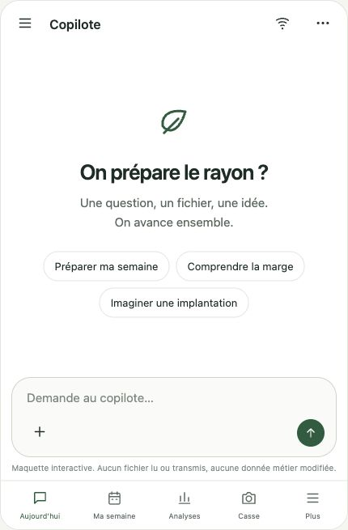
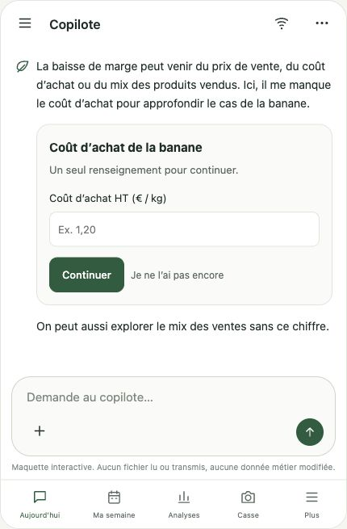

# Primary Copilot chat — UX prototype 1

Owner-review artifact for M7-T16, not the production application or an AI/business acceptance result.

[Open the interactive prototype](https://fl-copilot-ux-preview.vercel.app/).

The standalone HTML has no dependencies, network/API calls or real business data. It uses the existing forest/neutral palette. Messages, drafts, demo preferences and corrections are stored only in this browser's localStorage. Selected attachments contribute their names only: no file content is read, stored or uploaded. Replies, research, receipt, import, mutation and layout are predefined demonstrations; no AI request or real synchronization occurs. Public reference links open real documentation, while the commercial PDF preview is explicitly fictitious. The layout sketch is not to scale and no image model is called.

## Journeys to review

1. **Natural entry:** start from an ordinary question or one of the three suggestions; use the plus button for files/photos.
2. **Missing file:** Préparer ma semaine → add an export name or use the demonstration → continue; alternatively advance without sales while retaining missing-data qualifications.
3. **Small form:** Comprendre la marge → enter one purchase-cost value → Continue or postpone; completed forms become history summaries, and the supplied fact stays distinguishable from an unknown comparable price.
4. **Batch correction:** Parcours → Correction produits → select corrections and optionally clarify melon → Apply → inspect the product detail → return → Undo. Only demo state changes.
5. **Sources:** the source chip opens a detail sheet; close/back preserves conversation state. Web research and email receipt scenarios are explicitly simulated.
6. **Topic/memory:** open conversations with the header menu on mobile; declare dimensions in Implantation and explicitly choose memory sharing → inspect that memory from another topic. Private demo history is still separate per conversation.
7. **Interruption/restart:** stop a pending demonstration, toggle the simulated network mode, retry without duplicating the user message, and reload with a draft/history intact.

## Validation performed

Manual browser inspection at 390 CSS pixels confirms no horizontal overflow. Core interactions verified: answered form retirement, correct source detail, grouped edits/detail/back/undo, shared declared dimensions across two topics, simulated offline queue/retry with exactly one original user message, draft/history after reload, selected synthetic CSV name without file reading, and zero captured browser errors. Desktop and mobile-frame views were visually inspected. The published site was opened and verified.

Snapshots below are screenshots of this mock, not evidence of live AI or production business writes:

## Decisions still needed from Julien

- Entry/navigation: chat inside Aujourd’hui with the five existing tabs, or a different approved arrangement?
- Density: welcome prompts, small inline forms and source sheets natural enough on the iPhone?
- Composer/history: visibility of attachment controls and access to topics/memory sufficient?

T16 UX approval is pending; do not treat the prototype as approval to ship the native chat. Adapt the existing app only after the owner reviews the proposed journeys.

The static hosting project `fl-copilot-ux-preview` is separate from the application's API project. The CLI's first deployment created its production alias; it did not change `fl-copilot.vercel.app`, application environments, native code, schemas or EAS builds. Only the single demo HTML was published, without source files or credentials. Source copy lives here in Git so the preview can be reproduced or retired independently.
