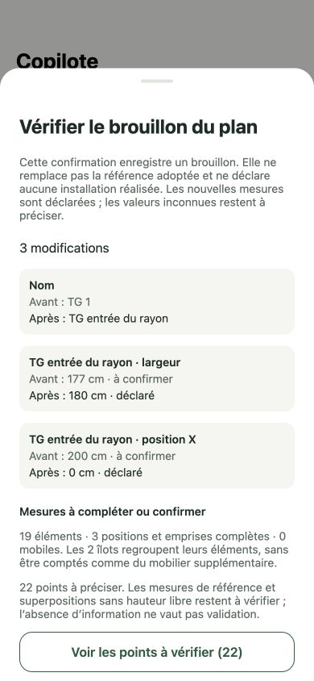

# M7 — reviewed physical-plan edits from chat

Workstream **6**, PR 271. Depends on PRs 266–270. Same single Copilot, canonical store plan, local SQLite/history/Outbox, remote authorization/CAS and incremental synchronization. No new database, migration, native module, provider/model or credentials.

## User flow

The Copilot reads `store_layout`, then prepares **one explicit physical intent per turn** with `store_layout_edit_preview`. The compatible native client advertises `x-copilot-layout-edits: 1`; older clients do not receive this new proposal capability. The authenticated store reader remains server-owned. The model supplies no store/actor/rights, Mongo query, new-record IDs or surveyed-measurement flag.

- Edit an exact island, furniture item or independent selling surface; null target means department width/depth. Only relevant fields are accepted. Partial patches preserve other values, stable identities, provenance and surface ownership. Centimetres normalize to integer millimetres; zero coordinates are valid, zero dimensions invalid. Explicit null clears to UNKNOWN. Repeated declared/measured values keep their qualification; explicitly supplied reference values become DECLARED, never MEASURED.
- Parent moves use the existing shared descendant transforms exactly once. Missing geometry needed for a rotation refuses the whole change without materializing drawing fallbacks. Dimensions are patched before an explicitly combined rotation; resizing alone does not scale children or surfaces.
- Explicit optional-mobile addition creates server-assigned stable furniture/surface IDs and may include user-provided initial dimensions/placement. Association/detachment changes habitual host only, not position or fit. Removal affects only that mobile and its surface in the new draft. No fixed/TG structural CRUD is invented here.
- Prepare against the exact current head. If a newer saved draft exists, preserve its content. After a discarded draft, edit the adopted reference against the current head CAS; never revive abandoned furniture. Missing synchronized source, stale revision, invalid/foreign target and unsupported fields do not create a card or write.
- The reply and private immutable card commit in the existing Mongo transaction and pull to the device. No physical data is written by preview/generation. Only input, small base metadata and new-mobile IDs are stored in the card; full canonical snapshots and actors never enter model context or private proposal payloads.
- **Examiner les modifications du plan** opens the existing dismissible comparison and geometry components. Closing does not save. **Confirmer et enregistrer le brouillon** rechecks the exact persisted private card, active conversation, user parent, owner/store, current local head/reference and permission. One exclusive SQLite transaction saves draft/history/operation/Outbox plus private tool result. Failed/cancelled work rolls back all of them. Duplicate confirmation and restart replay do not duplicate commands or identities. Distinct offline devices confirming the same card use distinct command IDs while retaining proposed mobile identities; normal canonical version-conflict resolution applies instead of accidental command-ID reuse.
- A new draft preserves the adopted reference. Known geometry incompatibilities remain visible and do not prohibit saving incomplete work; the existing local/remote adoption guard still blocks adopting an incompatible plan. This card does not adopt a reference, record a field realization, allocate products or render an illustration.

The native comparison/qualified-measurement formatter is now shared by the preview and editor, not duplicated. The card imports the small comparison component rather than the whole map/editor. Native async results are guarded across controller/role changes; errors are visible inside the review sheet as well as on the card.

## Verification

**23 additional local tests**: eight shared patch cases, nine actual SQLite controller cases, six installed-SDK cases with simulated transport. They cover partial qualified edits, room/surface/furniture boundaries, zero/unknown/measured/reference distinctions, active/abandoned drafts, island descendants, optional mobile IDs/initial dimensions/association/removal, impossible saveable geometry, strict non-authority inputs, absence/staleness/foreign scope, role loss, deleted/archived conversations, tampered/unsynced cards, cancellation, rollback, offline file close/reopen and exactly-once replay. SDK tests cover ready edit/addition, stale source, foreign private snapshot, byte budget, disabled capability and proposal activity. Existing API-client enabled/disabled tests verify the new capability header.

Full structure/lint/typecheck/unit suite: **2 106 passed**, 488 environment-dependent cases skipped locally. **Two real transactional Mongo cases** on a disposable database verify reply/card atomic creation, immutable replay, private pull publication, no plan/history write and rollback for forged store scope. The **nine existing canonical plan synchronization cases** also passed on a disposable Mongo database during this lot. Formatting, API build and iOS/Android Expo export remain required before merge. No paid AI call, EAS build or deployment is initiated.

## Visual evidence and limits

At **390 × 844**, production card/comparison/geometry components were exercised in a compiled Expo web export with a temporary in-memory controller: open three changes (TG name, width, X=0), close without save, reopen the same proposal, confirm and observe completed status/reference-preservation wording. The initial dev-only shell hit a NativeWind stylesheet initialization error; the compiled visual path was used and no production configuration was changed. The temporary routes, server and Expo tsconfig rewrite were removed. This screenshot proves component rendering, not SQLite/Mongo persistence; persistence/authority are proven separately by the tests above.

Real-model selection/wording, native sheet gestures, accessibility/large text, two-device conflict review and measured pilot acceptance remain part of the grouped delivery. New cards require the future compatible binary and API; merge is not delivery. Reference adoption/discard/history restoration remain deliberate actions in the store plan editor. Direct fixed/TG structural editing, obstacles/passages/load/usable-surface checks beyond the existing scope, repair of refused commands and physical-revision-bound allocation/schematic/illustration remain open. Physical reads/previews still yield explicitly incomplete recommendation freshness verification; no full feasibility or field-execution claim is made.
