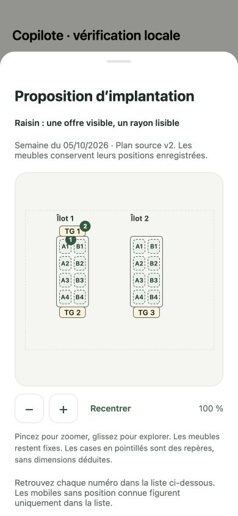
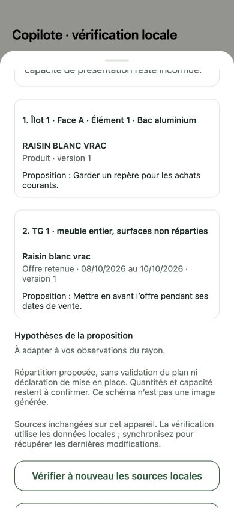

# M7 — source-bound allocations and conversational schematic

Workstream **6**, PR 272. Depends on the canonical physical reference, private reply artifacts and native map delivered in PRs 266–271. Same single Copilot, SDK catalogue/discovery, store authorization and private message synchronization. No migration, alternate plan store, new provider, native dependency or business mutation.

## User flow and boundaries

The compatible client advertises `x-copilot-layout-scenarios: 1`. `store_layout_allocation` prepares one proposal per turn against the **exact adopted reference**, not a newer unadopted draft. The assistant reads the existing plan and canonical active products/retained offers. The native read ceiling allows four distinct reads for reference/targets/sources/allocation; the existing total-call, byte and step limits remain bounded. A synchronous per-generation gate also prevents two concurrent proposals from being produced.

- Up to eight exact furniture/surface targets and sixteen distinct product/offer references, four per target. No model-supplied store, actor, write permission, geometry, capacity or quantity. Invalid/duplicate/contradictory targets are refused, never truncated or silently reassigned.
- Bacs, upper shelves and separately recorded selling mobiles keep their identities. `surfaceId: null` explicitly means **whole furniture, surfaces not distributed**. This lets a TG with unknown surface composition remain useful without inventing a surface, fourth TG or usable capacity. Whole-furniture and surface allocations cannot be mixed on that same furniture.
- Resolve source identities and versions server-side. Offers must be retained and intersect the selected Monday–Sunday week. Preserve their original sale dates and document lineage; an offer valid for three days is not extended to the full week. Unknown product nature/unit is preserved, not guessed or used to calculate stock/volume.
- Exact bounded Mongo reads are store-scoped and rechecked for source changes before projection. Full physical/product documents and actor metadata stay private. The card contains resolved labels, versions, dates/lineage, reference identity, proposed reasons/assumptions and qualified geometry counts. A card exceeding the existing message budget is refused as a whole.
- Reply and immutable private TOOL card commit atomically through the existing producer and sync change. Replaying the turn creates neither a second card nor furniture/commercial changes. This is **PROPOSED**, not an approved commercial preparation or recorded field execution.
- **Voir le schéma et les affectations** opens one dismissible native sheet with the existing map, numbered furniture markers and a readable assignment list. No coordinates are changed. Existing schematic fallback rectangles remain visibly qualified and are never persisted as measured geometry. A mobile without a recorded position stays in the list. Original offer PDFs use the existing authorized local/remote original-file action.

## Offline source verification

The native reader verifies the exact persisted private card, active/nondeleted conversation, parent reply and owner/store inside a short exclusive SQLite transaction. It loads the **historical physical revision** by ID; it never substitutes the current plan if history is missing. Source products/offers are reread locally and the shared scenario is rederived.

Unchanged local sources are described as unchanged **on this device**, not remotely certified. A new unadopted draft does not invalidate the adopted reference. A different adopted reference, relevant product/offer version/applicability change, or source sync conflict/error requires review while preserving the original diagram and labels. Missing local history/head/product/offer is unverifiable, not proof of deletion or zero. Refresh failure preserves the previous view and displays feedback beside the refresh action in the open sheet. General recommendation fact-trace freshness still remains incomplete for unsupported physical dependencies; this lot does not declare that wider workstream complete.

## Verification

**32 additional local cases**: twelve shared/model/card cases, eleven actual SQLite reader cases, nine installed-SDK transport cases. Coverage includes strict input limits, independent targets/mobile identity, exact ownership, unknown geometry, retained/withdrawn/out-of-week offers, private scope/tampering, stale/missing reference, no authority fields, byte budget, disabled capability, concurrent proposal refusal, four-read flow, proposal activity and evidence preservation. SQLite tests close/reopen an actual file offline, compare the immutable result, verify source drift and missing cache without fallback, and assert no Outbox, physical history or tool-result write from consultation.

**Four real transactional Mongo cases**, on a disposable database, passed: scoped source/history reads, missing canonical product/history refusal, atomic reply/card/sync-change creation and replay without business writes, and rollback for foreign proposal scope. No real model, provider or production business record is used. Full structure/lint/typecheck/unit suite: **2 138 passed**, 492 environment-dependent cases skipped locally. Formatting, API build/import and iOS/Android Expo exports passed.

At **390 × 844**, production view/map components were exercised through a compiled Expo web export with a temporary in-memory fixture: opening, target labels and markers, exact original offer dates, zoom preserved after closing/reopening, new-reference warning with the old schematic retained, and failed-refresh feedback inside the sheet. Temporary routes/server were removed. This is component-rendering evidence; actual persistence/privacy are covered separately by SQLite/Mongo tests. Native gestures, large text/VoiceOver, the real-model conversation and the measured pilot remain to accept on the grouped binary.

## Remaining scope and delivery

The proposal has no commercial approval/edit/execution lifecycle in this lot. Linked image generation, image cost/provider activation, richer useful-surface/load/passage constraints, fixed/TG structural editing, refusal repair and measured pilot acceptance remain open. Historical cards are immutable; a discussion can produce a new proposal instead of rewriting its source. API-compatible delivery must precede the future capable native binary. No paid EAS build, model/image call or production deployment is initiated. Merge is not availability on the installed phone.
