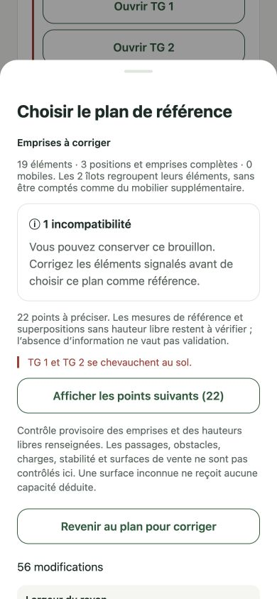

# M7 — canonical store footprint preflight

Workstream **6**, PR 269, following PRs 266–268. This is a derived runtime-neutral check of the recorded physical plan, not another plan datastore or an official installation approval.

## Rules covered

- Parse the canonical hierarchy first. Inspect all furniture (up to 128), all 32 possible assemblies and every relevant pair; no eight-object batching or silent truncation. Integer millimetres and all four supported orientations determine top-left bounding rectangles. Touching edges do not collide.
- Check room overflow, including provable impossibilities from partial data. A missing orientation is not replaced by zero: conservative lower/upper extents can establish an impossibility, otherwise the result remains incomplete.
- Check fixed elements against their own island envelope. Assemblies are groups, not extra physical furniture. Complete disjoint furniture does not collide merely because two group envelopes overlap. When actual member positions are unknown, envelope intersections flag uncertainty rather than a proven collision.
- Never import equal schematic drawing slots into physical checks. Unknown is not zero; reference values remain unconfirmed. Height, stock and product/surface loads are not demanded for a lateral footprint check.
- For each overlapping mobile/nonmobile pair, use the mobile's height and the other fixture's declared under-furniture clearance. Adequate known clearance permits projected overlap provisionally; missing/reference height data leaves it unverified, insufficient clearance blocks. A habitual host does not waive checks against another fixture or another mobile.
- Habitual host association is descriptive. Unknown host/mobile positions do not prove fit. A mobile partly/wholly outside its habitual host gets a notice; association alone is not an invented rule requiring full footprint containment. Every actual overlap still receives the vertical/lateral check above. The model does not represent supporting legs or prove structural safety.
- No expected fourth TG or one-mobile-per-element rule is invented. An empty inventory or empty assembly remains incomplete.

Result contract: `PROVISIONAL`, scope `FOOTPRINTS_AND_CLEARANCE`, status `CHECKED`, `INCOMPLETE` or `BLOCKED`; exact target IDs, qualified issues, counts and real recorded rectangles. All possible 8 128 pairs of 128 overlapping TG rectangles are returned/tested, within the explicit 12 000-issue result bound. Selling surfaces are not counted again as floor fixtures.

## Native and adoption behavior

The map page computes the current draft's report, with exact target buttons opening existing element/assembly/room sheets. Known incompatibilities appear first; other missing information is expandable. The adoption comparison shows its frozen report before the diff. It provides a return to correction without stacking two native modals. Background updates preserve edits and the existing CAS still rejects stale adoption.

Incomplete work can be saved and, after explicit review, used as an unconfirmed reference. A known incompatibility blocks **ADOPT_REFERENCE** in the UI, the atomic SQLite repository and the authenticated remote writer using the same deterministic calculation. No failed adoption appends a plan revision or Outbox mutation locally, or advances the canonical plan remotely. Immutable prior histories, command replay, draft saves and restoration are preserved; this is not a retroactive rewrite of old accepted versions.

No new migration or stored capability is introduced. Delivery remains grouped: compatible API including the new adoption refusal before the native SQLite-49 client. Native offline draft checks do not require an API or AI request. The existing eight-fixture conversational scenario checker remains hypothetical; it is not silently substituted for this store-scoped check.

## Verification

- **21 additional local tests**: complete 19-element fixture (16 fixed, three TG), unmeasured pilot, three nonzero orientations, edge/one-millimetre overlap, partial/unknown bounds, island containment, overlapping group envelopes, projected mobile fit, unknown/reference heights, second fixture, two mobiles, association without position, unknown inventory and the 128-object maximum.
- Real SQLite: an impossible draft saves; failed adoption leaves exact draft/history/Outbox unchanged. Existing offline/restart/replay/conflict suites remain required.
- **Seven real transactional Mongo tests** on a disposable database, including a forged incompatible adoption, durable rejection replay, no extra plan/history change and no pull publication of the refused revision. The other six canonical synchronization cases remain unchanged.
- Full structure/lint/typecheck/unit suite: **2 067 passed**, 484 environment-dependent cases skipped locally. Separate Mongo results above are not counted as those local skips passing. Formatting, package builds and iOS/Android Expo exports are also required.

Synthetic measurements are test fixtures, not a surveyed pilot. Local visual verification at **390 × 844** used production components in an isolated temporary in-memory Expo shell: create pilot; edit TG2 to overlap TG1; save invalid draft; compare with explicit collision and disabled adoption; return through the target correction; restore TG2's original position; adoption re-enabled while unconfirmed measures remain. The temporary shell/server were removed; persistence/refusal are proven separately on SQLite/Mongo.

## Remaining work

Passages/entrances/obstacles, usable surface dimensions/overhangs, declared product loads, structural stability and route connectivity are outside this scope. `CHECKED` means no incompatibility detected in the recorded footprint/clearance scope, never full store feasibility or regulatory compliance. Fixed/TG structural inventory editing, direct manipulation, refused-command repair, authorized Copilot tools, physical-revision-bound allocations/schematic/illustration and measured native pilot acceptance remain open. No paid EAS build, real model/image generation or production deployment is launched here.
