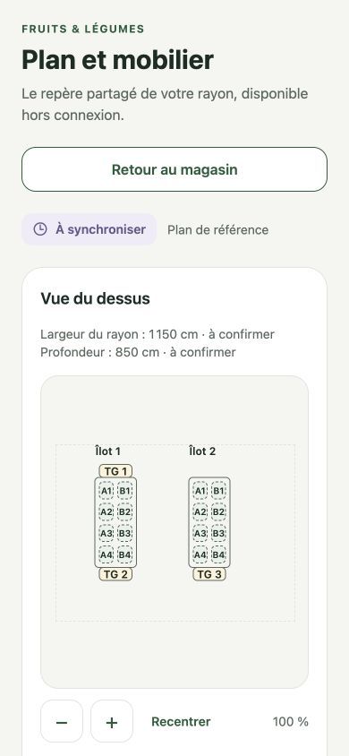
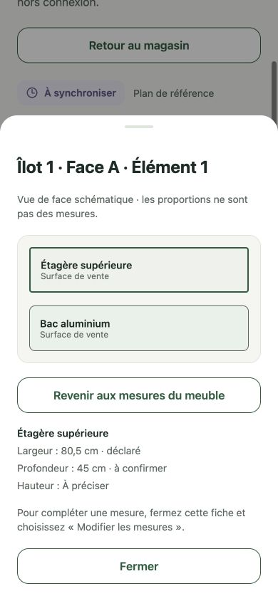

# M7 — consult the store plan and edit measurements

PR 267, workstream 6. Entry: **Plus → Mon magasin → Plan et mobilier**. Uses the canonical repository and synchronization from PR 266; no schema migration, new native module, API model or alternate datastore.

## Automated checks

Twenty new cases cover the 19-element drawing, separate group envelopes, all four assembly orientations, explicit positions and room overflows, optional hosted mobiles, viewport bounds, French centimetres, reference/declared/measured/unknown qualification, invalid input, edit/undo state anchored to a revision, comparison independent of array order, abandoned draft selection and exact historical snapshots scoped to their store. `pnpm check`: 2,027 local tests passed; 483 environment-dependent cases skipped locally. CI runs the transactional regressions and native exports.

The drawing-only fallback subdivides an assembly into face/order cells for selection. Those rectangles are not measured module dimensions, are visibly marked as schematic and never mutate stored furniture or surfaces. The room outline is shown only when its dimensions are known, retaining their displayed qualification. Neither the diagram nor adoption of a reference certifies fit, clearance or load capacity.

## Local browser evidence

Real production components were rendered at 390 × 844 in an isolated temporary verification route with an actual SQLite WASM file, the same migrations/repository and a browser transaction adapter. Its store/device/actor IDs were test-only; no production session, data, API request or email was used. The verification shell/route, WASM asset setting, server and viewport override were removed/reset after inspection. The application's existing web/native provider boundaries were not changed.

Observed through UI actions:

1. Explicit pilot initialization saves a draft and renders the 16 island elements plus 3 TGs.
2. Zoom to 140%, open an element and close its face sheet: the same selection and zoom remain.
3. Select its upper shelf; `0` is rejected at the width field. `80,5` cm applies to the draft, saves and remains after page reload as **declared**. The unchanged 45 cm source depth remains **to confirm**, height remains unknown.
4. Review and adopt the draft. History retains initial draft, edited draft and reference.
5. Review version 1, restore it as a new draft, then abandon it: the previous adopted reference remains active and its width survives.
6. Reader mode keeps consultation but exposes no edit button.

## Native acceptance still required

After compatible API delivery and a future grouped native binary: verify pinch/pan, stable selection on background sync, header drag dismissal and close/back controls, scroll with the keyboard/large text, Android back, iOS navigation gesture protection during edits and VoiceOver/list alternatives. Test an offline save, restart, reconnect and two-device comparison using the real native provider. Browser evidence does not replace these gates.

Physical placement/rotation editing, add/remove/duplicate furniture, mobile association editing, room/island measurements, refusal repair, complete hierarchical geometry checks, Copilot tools and reference-bound illustration remain workstream 6 tasks. This increment implements consultation and targeted furniture/surface measurements, not the entire physical editor or a measured pilot acceptance.
