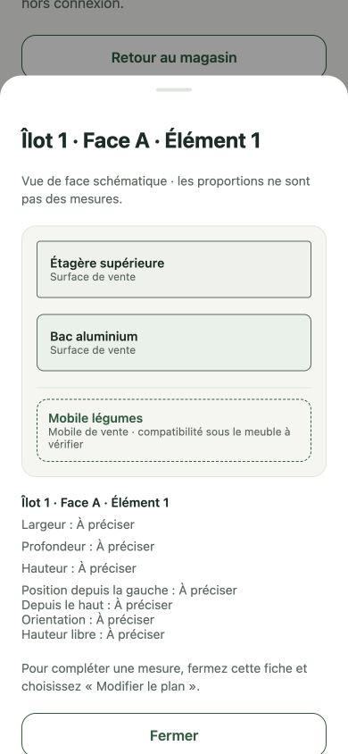
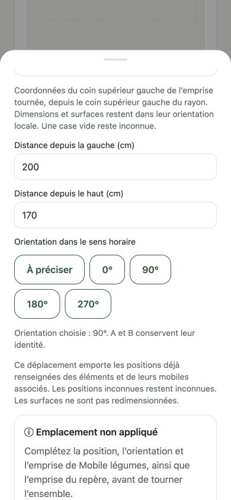

# M7 — physical layout editing

Workstream **6**, PR 268. Governed by `docs/specs/STORE_LAYOUT_SPEC.md`; builds on the canonical revision repository and native consultation in PRs 266–267. Code readiness does not mean delivery or iPhone acceptance.

## Scope and semantics

Enter **Mon magasin → Plan et mobilier → Modifier le plan**. Open the room or an island through its explicit button, or select furniture on the map/list. Edit identity, dimensions, absolute position and clockwise orientation. Coordinates identify the top-left of the rotated footprint from the department's top-left; dimensions remain local to each object. Unknown is blank, never zero; zero coordinates/clearance are valid, zero physical dimensions are rejected. Existing measurement qualifications remain unchanged unless the user changes or confirms a measurement.

Changing an island placement transforms the recorded positions of its elements and their hosted mobiles once; moving a fixed element/TG transforms its hosted mobiles. Changes to derived coordinates become declared values, never surveyed ones. Known child orientations turn even if their coordinates are unknown. An unchanged unknown parent orientation does not prevent a pure translation. Rotation with a located descendant requires the original/new orientation, complete descendant footprint and complete parent envelope. Missing requirements produce a targeted refusal without mutation. Negative/out-of-contract transformed coordinates are refused. A rename or association alone does not relocate anything. Resizing an envelope does not scale its children or selling surfaces.

**Ajouter un mobile de vente** records exactly one optional mobile and its independent selling surface, with fresh stable UUIDs and unknown dimensions/location. The manager can name it, associate/reassociate it with a fixed element/TG or detach it. Association does not establish coordinates, clearance, fit or capacity. Removal is confirmed inside the existing sheet, removes only that mobile and its surface from the current draft and can be undone. Previous revisions remain intact. No mobile is inferred from island count.

The UI edits the existing in-memory draft; **Enregistrer le brouillon** uses the unchanged atomic SQLite/history/Outbox repository. Adoption still requires the existing version comparison. Role loss/refusal/conflict disable application of changes; background snapshots do not replace the draft, selection or viewport. No new schema, native dependency, database, prompt or agent is introduced. API compatibility and migrations remain those of PR 266 (Mongo 43 before native SQLite 49).

## Automated evidence

- Shared deterministic cases: optional inventory/independent surface, identity/capacity limits, association without relocation, removal without historical mutation, exact translations and all three quarter-turn rotations, four-turn round trip, partially known coordinates/orientations, missing-geometry refusal and invalid transformed positions. No drawing fallback is used as input.
- Input parser: French centimetres, origin/zero clearance versus positive dimensions, preservation of unconfirmed reference qualification.
- Real SQLite file: initial save → mobile/placement edit → adopt → remove → close/reopen → restore exact immutable revision. Furniture/surface IDs, official reference and five pending commands persist.
- Existing repository, authorization, idempotency, conflict and sync tests run with the full suite. CI also runs transactional Mongo cases and native Expo exports.

## Local visual evidence

Production panel/sheets were exercised at **390 × 844** in an isolated Expo web export with a temporary in-memory fixture shell, no account, business data, remote synchronization or AI request. The shell is not production web support and was removed before commit. Persistence is proven by the real SQLite test above, not by this visual fixture.

Checked: initialization of 19 principal objects; explicit edit mode; addition of one mobile; rename and host selection; zero X with unknown Y; targeted rotation refusal for a partially positioned mobile; confirmed removal and undo; room width `1140,5` declared while depth remains reference; draft save and host front sheet showing the optional mobile. These are test values, not a measured store survey.

## Remaining gates

This lot does **not** claim full physical feasibility. The flat PR 264 checker still needs adaptation for all 19+ objects, hosted vertical overlap, group envelopes, bounds and collisions. Entrances/obstacles/passages, fixed/TG creation/duplication/removal and TG surface composition, direct object manipulation distinct from pan, refused-command repair, Copilot tools, allocation/schematic/illustration linkage and real pilot acceptance remain open.

Grouped native acceptance: numeric keyboards and errors; sheet dismissal/VoiceOver/large text; gestures that explore without accidentally moving furniture; save/restart offline; role loss and concurrent update while editing; two-device sync/explicit conflict resolution with mobiles; restored identities; adoption comparison after a move/removal. Existing revisions must retain old furniture/surfaces. No paid EAS build, production deployment, real AI call or image generation is initiated for this lot.
