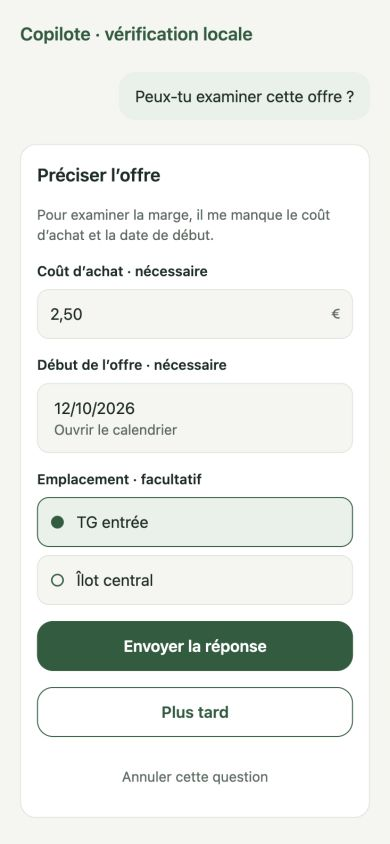

# Copilot manual-operation coverage inventory

Updated 11 October 2026. This inventory maps the current repository/service surface before chat activation. It is a wiring backlog, not a claim that all CRUD is available. `product.inspect`, `analytics.daily`, `waste.inspect`, `commercial.offers`, `store.events`, `substitution.lookup`, `store.week`, `source.reference` and `need.list` are executable internally; the model-facing envelope accepts no store, actor, role, SQL or credentials.

An internal WRITE registry now also includes `product.classify` for bounded category/nature/sales-unit corrections. It requires trusted user-intent authority and canonical local product/Outbox writes; native/model exposure remains pending. The additional catalogue WRITE registry now provides `product.save` (bounded full editor create/update and identifiers/aliases) and `product.retire` (canonical logical deletion). The need WRITE registry now provides `need.save`, `need.membership` and `substitution.save` for reviewed need maintenance and validate/reject decisions, with preserved learned fields and explicit refusal reversal. Dedicated alias/identifier validation/recovery/conflict tools, unconfirmed proposal producers and batch orchestration remain explicit follow-ups; this is not blanket CRUD coverage.

The field WRITE registry adds `store.event.capture`/`store.event.close`, using a distinct trusted capture capability and canonical USER observations; it does not grant catalogue permissions or mutate stock quantities.

## Authority and execution contract

- Reads use the authenticated store and private conversation owner, existing local repositories, and typed source snapshots with observed time and sync quality. Ordinary reads need no extra confirmation.
- Routine create/update tools require an explicit user intent bound to the proposed fields and current entity version. Trusted adapters resolve store, actor, device and command IDs; model arguments cannot grant authority. Canonical validation, prior human refusal and domain conflicts apply.
- Publication, corrected overlaps, critical ambiguous identity and retirement require the existing targeted preview/decision. Acceptance and execution stay distinct. No universal last-write-wins or physical DELETE is introduced.
- Each activated tool has its own strict versioned input/result schemas, trusted adapter and retry identity. Planned entries below cannot be invoked until those adapters and acceptance tests ship. One generic unvalidated JSON mutation tool is prohibited.
- Read results are device-local operation snapshots in SQLite migration 35. The same operation ID/input replays that snapshot after restart; use a new operation ID for fresh data. Revoked access or a foreign conversation blocks cached replay. Failed/cancelled reads do not persist a success. They do not create business Outbox commands.
- Write operation results must join the canonical local mutation/Outbox transaction in T20/T21; this read journal is not a remote writer or proof that mutations are exactly-once. Device result replication/context references and AI SDK binding are pending orchestration work.

## Existing public repository/service operations

Every listed method/function maps to the indicated tool family. `apply*`, persistence helpers and processing plumbing are internal synchronization/derived operations, never direct model tools. Existing public operations are inventoried even where not currently exposed as a button. Retention/history remain immutable according to their domain.

### products.product-editor-service

Adapter source: [`product-editor-service.ts`](../../apps/mobile/src/products/product-editor-service.ts). Target: **T20**.

Operations: `now`, `generateId`, `loadProductEditorSnapshot`, `saveProductEditor`, `productSnapshotToDraft`.

### products.product-master-repository

Adapter source: [`product-master-repository.ts`](../../apps/mobile/src/products/product-master-repository.ts). Target: **T20**. `getProduct`/`listIdentifiers`/`listAliases` are reused by active `product.inspect`.

Operations: `upsertProduct`, `upsertIdentifier`, `upsertAlias`, `rememberWasteReceiptAlias`, `retryWasteAliasDeletion`, `delete`, `getProduct`, `listProducts`, `getIdentifier`, `getAlias`, `listIdentifiers`, `listIdentifiersByStore`, `listAliases`, `listAliasesByStore`.

### documents.commercial-pdf-capture

Adapter source: [`commercial-pdf-capture.ts`](../../apps/mobile/src/documents/commercial-pdf-capture.ts). Target: **T23**.

Operations: `persist`, `remove`, `assertPdfHeader`, `captureCommercialPdf`.

### documents.import-verification-conflict-repository

Adapter source: [`import-verification-conflict-repository.ts`](../../apps/mobile/src/documents/import-verification-conflict-repository.ts). Target: **T23**.

Operations: `listOpen`, `getBySourceDocumentId`, `keepLocalTemporarily`.

### documents.mercalys-import-publication

Adapter source: [`mercalys-import-publication.ts`](../../apps/mobile/src/documents/mercalys-import-publication.ts). Target: **T23**.

Operations: `findExactDuplicate`, `analyzeOverlap`, `keepExisting`, `publish`.

### documents.source-document-repository

Adapter source: [`source-document-repository.ts`](../../apps/mobile/src/documents/source-document-repository.ts). Target: **T23**.

Operations: `createWithFile`, `createCommercialPdf`, `ensureCommercialPdfUploads`, `commercialPdfUploadJob`, `retryCommercialPdfUpload`, `listDocuments`, `addRecords`, `getDocument`, `getFileForDocument`, `listRecords`, `findDocumentByChecksum`.

### documents.waste-publication-validation

Adapter source: [`waste-publication-validation.ts`](../../apps/mobile/src/documents/waste-publication-validation.ts). Target: **T23**.

Operations: `validateWastePublication`, `wastePublicationWarnings`.

### documents.waste-receipt-capture

Adapter source: [`waste-receipt-capture.ts`](../../apps/mobile/src/documents/waste-receipt-capture.ts). Target: **T23**.

Operations: `persist`, `persistWasteReceiptCapture`, `persistWasteReceiptImport`, `resolveWasteReceiptImageExtension`.

### documents.waste-receipt-publication

Adapter source: [`waste-receipt-publication.ts`](../../apps/mobile/src/documents/waste-receipt-publication.ts). Target: **T23**.

Operations: `inspect`, `validate`, `publish`, `applyWastePublication`.

### documents.waste-receipt-repository

Adapter source: [`waste-receipt-repository.ts`](../../apps/mobile/src/documents/waste-receipt-repository.ts). Target: **T23**.

Operations: `createCapturedDraft`, `createDraft`, `getReceipt`, `listReceipts`, `listLines`, `getReceiptDetail`, `retryProcessing`, `resolveExactDuplicate`, `applyRemoteDuplicate`, `applyRemoteDraft`, `confirmCashierNumber`, `confirmWasteDate`, `updateLineValues`, `setLineExcluded`, `selectProductCandidate`, `insertSourceDocument`, `insertReceipt`, `insertLine`.

### commercial.comparison-repository

Adapter source: [`comparison-repository.ts`](../../apps/mobile/src/commercial/comparison-repository.ts). Target: **T21**.

Operations: `readCommercialComparison`.

### commercial.execution-repository

Adapter source: [`execution-repository.ts`](../../apps/mobile/src/commercial/execution-repository.ts). Target: **T21**.

Operations: `get`, `list`, `save`, `resolve`, `applyCommercialExecution`, `readCommercialExecutionPlan`.

### commercial.offer-choice-repository

Adapter source: [`offer-choice-repository.ts`](../../apps/mobile/src/commercial/offer-choice-repository.ts). Target: **T21**.

Operations: `list`, `get`, `save`, `resolve`, `applyCommercialChoice`, `readCommercialChoices`.

### commercial.review-repository

Adapter source: [`review-repository.ts`](../../apps/mobile/src/commercial/review-repository.ts). Target: **T21**.

Operations: `pages`, `decisions`, `review`, `reviewReadableGroup`, `useRemoteDecision`, `applyCommercialReviewEntity`, `reviewProgress`.

### commercial.substitute-repository

Adapter source: [`substitute-repository.ts`](../../apps/mobile/src/commercial/substitute-repository.ts). Target: **T21**.

Operations: `read`.

### commercial.validated-offer-repository

Adapter source: [`validated-offer-repository.ts`](../../apps/mobile/src/commercial/validated-offer-repository.ts). Target: **T21**.

Operations: `validate`, `readValidatedOffers`, `applyValidatedOffer`.

### commercial.version-decision-repository

Adapter source: [`version-decision-repository.ts`](../../apps/mobile/src/commercial/version-decision-repository.ts). Target: **T21**.

Operations: `get`, `save`, `resolve`, `applyCommercialVersionDecision`.

### commercial.visual-repository

Adapter source: [`visual-repository.ts`](../../apps/mobile/src/commercial/visual-repository.ts). Target: **T21**.

Operations: `applyCommercialVisualReading`, `readCommercialVisualReadings`.

### commercial.week-plan-repository

Adapter source: [`week-plan-repository.ts`](../../apps/mobile/src/commercial/week-plan-repository.ts). Target: **T21**.

Operations: `get`, `save`, `resolve`, `applyCommercialPlan`, `applyCommercialPlanRevision`, `readCommercialPlanRevisions`.

### commercial.week-preparation-repository

Adapter source: [`week-preparation-repository.ts`](../../apps/mobile/src/commercial/week-preparation-repository.ts). Target: **T21**.

Operations: `get`, `save`, `resolve`, `applyCommercialPreparation`.

### needs.evidence-repository

Adapter source: [`evidence-repository.ts`](../../apps/mobile/src/needs/evidence-repository.ts). Target: **T20/T21**.

Operations: `list`, `get`, `states`, `applySubstitutionEvidence`, `applySubstitutionEvidenceState`.

### needs.lookup-repository

Adapter source: [`lookup-repository.ts`](../../apps/mobile/src/needs/lookup-repository.ts). Target: **T20/T21**.

Operations: `read`, `readSubstituteSnapshot`, `substituteReadOnlyReader`. The exported snapshot reader remains an internal read adapter for the lookup tool.

### needs.membership-repository

Adapter source: [`membership-repository.ts`](../../apps/mobile/src/needs/membership-repository.ts). Target: **T20/T21**.

Operations: `list`, `get`, `save`, `saveBatch`, `resolve`, `applyNeedMembership`.

### needs.repository

Adapter source: [`repository.ts`](../../apps/mobile/src/needs/repository.ts). Target: **T20/T21**.

Operations: `list`, `get`, `save`, `resolve`, `applyNeedUnit`.

### needs.score-repository

Adapter source: [`score-repository.ts`](../../apps/mobile/src/needs/score-repository.ts). Target: **T20/T21**.

Operations: `list`, `applySubstitutionScoreHistory`.

### needs.store-event-repository

Adapter source: [`store-event-repository.ts`](../../apps/mobile/src/needs/store-event-repository.ts). Target: **T20/T21**.

Operations: `list`, `get`, `create`, `close`, `retry`, `resolve`, `applyStoreProductEvent`.

### needs.substitution-repository

Adapter source: [`substitution-repository.ts`](../../apps/mobile/src/needs/substitution-repository.ts). Target: **T20/T21**.

Operations: `list`, `forSource`, `get`, `save`, `saveBatch`, `resolve`, `applyProductSubstitution`.

### store.context-repository

Adapter source: [`context-repository.ts`](../../apps/mobile/src/store/context-repository.ts). Target: **T19/T21**.

Operations: `get`, `save`, `resolve`, `applyStoreContext`.

### store.weekly-context-repository

Adapter source: [`weekly-context-repository.ts`](../../apps/mobile/src/store/weekly-context-repository.ts). Target: **T19/T21**.

Operations: `get`, `save`, `contextIsStale`.

### reminders.repository

Adapter source: [`repository.ts`](../../apps/mobile/src/reminders/repository.ts). Target: **T21**.

Operations: `snapshotChanged`, `preferences`, `setEnabled`, `list`, `save`, `setStatus`, `subscribeReminders`, `subscribeReminderSnapshots`.

### analytics.local-recomputation

Adapter source: [`local-recomputation.ts`](../../apps/mobile/src/analytics/local-recomputation.ts). Target: **T19**.

Operations: `recomputeProduct`, `recomputeDepartment`, `process`, `enqueueAnalyticsRecomputationJob`.

### copilot.conversation-repository

Adapter source: [`conversation-repository.ts`](../../apps/mobile/src/copilot/conversation-repository.ts). Target: **T17/T19**.

Operations: `scoped`, `list`, `save`, `resolve`, `append`, `messages`, `saveDraft`, `draft`, `remove`, `applyCopilotRecord`.

Native owner actions support logical deletion of a message (including dependent replies/cards) or a complete conversation, with explicit confirmation, versioned private tombstones/history and atomic Outbox. A conversation uses swipe-left delete; a message uses a native long-press menu. Deleted exchanges are excluded from future generation/retrieval/checkpoints and cannot authorize new business actions. Original files, audit and independently saved shared memory/business actions remain; no physical erasure or automatic reversal is claimed. These are trusted native UI operations, not model mutation tools. Deletion-aware sync/history is capability-gated with schema-compatible archived projections for older clients. Native acceptance and grouped API/mobile delivery remain pending.

### copilot.priority-repository

Adapter source: [`priority-repository.ts`](../../apps/mobile/src/copilot/priority-repository.ts). Target: **T17/T19**.

Operations: `evaluate`, `read`.

## Screen journeys and planned tool families

- `products`, product editor: catalogue/detail, create/update, identifiers and aliases, retirement and conflict/retry → product catalogue tools (T20). Product selection in receipt/import uses the same master, not a second catalogue.
- `imports`, import-verification: source capture, matching/create missing product, confirm/reject associations, inspect quality, duplicate/overlap reconciliation, keep existing/publish corrected valid lines → Mercalys intake/reconciliation tools (T23) plus catalogue (T20).
- `waste`, waste-capture/import, waste-receipt: one/multiple photos of one ticket, source/processing retry, duplicate resolution, cashier/date confirmation, line quantity/unit/amount/price edits, exclude/restore line, select/create product, inspect/publish → receipt intake/validation/publication tools (T23/T20).
- `week`, commercial-review/offer/operation/comparison: original opening, source review/readable-group decision, offer validation, compare versions, retain/reject/apply version → commercial review tools (T19/T21/T23).
- `week-preparation`, commercial-plan: offer choices, preparation, four TG/plan fields, versioned plan revisions → planning tools (T21); commercial execution save/status/note/history stays a separate tool family.
- `need-units`, need-unit, need-memberships, product-substitution, substitutes, substitution-evidence/score: list/detail, create/update/retire need, validate/reject memberships and directed relations, batch save, lookups and evidence/score/history → need/substitution tools (T19/T20/T21). Deterministic scores/evidence are reads; the model cannot overwrite them.
- `store-events`, store-event: observed stockout/availability, create and explicitly close event, retry/conflict → field-event tools (T21). Unknown stock remains unknown.
- `store-settings`, reminder-settings: read/save store context; weather/calendar retrieval; enable/disable reminders, save/status/snapshot → store-context/reminder tools (T19/T21). Permission requests and OS notification settings remain device UX.
- `Aujourd’hui`, `Analyses`, priority detail: typed KPI/coverage/period reads, candidate eligibility/score/conflicts and evidence → analytical/priority tools (T19). No handwritten model arithmetic.
- Sync/conflict screens: domain-specific compare/use remote/keep local/retry → scoped entity resolution adapters (T20/T21/T23). Login/logout, manual sync, diagnostic XLSX and Sentry test are application infrastructure, not business tools for the model.

## Explicit remaining activation gates

T19 remaining: flexible quantitative periods beyond daily/J−7, product/category analysis, evidence/detail, public-web authenticated/persistent/native orchestration and original-source UI binding. The bounded OpenAI research adapter is implemented but deliberately not exposed as a paid route or advertised model tool; source.reference now resolves an opaque commercial-original action for the existing opener. Daily/J−7 reads, receipt inspection, paginated retained-offer/event reads, directed substitution lookup and cached weekly context now use the existing local services. T20/T21 remaining: dedicated catalogue identity validation/recovery/conflict tools, proposal/batch orchestration, event recovery/conflict and commercial adapters, native intent/review binding and valid reversals. The bounded classification adapter already binds exact user intent to atomic canonical writes/Outbox and local operation-result identity. T22: inline missing-information forms. T23: local attachment/intake orchestration and Resend verified reception. T24/T25: memory/compaction. Generation/native UI are later delivery blocks. This inventory does not approve omissions from V1; unmapped new manual operations must update it before chat acceptance.

## M7-T21b — internal weekly preparation tools (11 October 2026)

`commercial.preparation.inspect` reads the explicit Monday's local draft and sync state through the existing repository; absent data stays absent. `commercial.preparation.save` accepts a reviewed full draft plus its expected local version (null for creation). App code supplies store, deterministic week identity, command ID, clock and a distinct `canPrepareCommercialWeek` capability. It preserves creation time and advances the canonical revision.

The canonical preparation schema/repository enforce week boundaries, capacity, placements, offer versions/status/period and visual-source references. Changed offers and invalid TG sources return targeted French errors. Conflict/error drafts require dedicated recovery. Request/result identity, canonical history and Outbox save join one SQLite transaction; exact replay is checked only after current conversation/owner/permission authority. No publication, execution, calculated stock, paid AI call or native chat activation is added. Retain/withdraw choices, plan execution, recovery and native review binding remain separate T21 work.

Real SQLite tests cover offline save/read, exact replay after restart, revisions, reviewed permission, invalid capacity, changed choices, cancellation and failed commit rollback. No EAS build is required for these internal adapters.

## M7-T21c — internal commercial choice tools (11 October 2026)

`commercial.choice.inspect` reads an owned choice by ID, including withdrawals, with revision/sync state; missing data remains absent. `commercial.choice.save` records a reviewed, bounded full choice (create/update/withdraw), using the existing CommercialChoiceRepository. Store, deterministic source identity, clock and command ID are app supplied; `canManageCommercialChoices` is independent of catalogue permissions. A retained choice requires the associated active product's exact version, confirmed applicability/critical fields and the original reading's operation/item labels. Canonical mechanism validation and duplicate prevention remain in force.

Withdrawals require an existing exact-version choice and preserve its product, period and mechanism. Source/creation identity and all history remain canonical; withdrawal does not update a saved preparation or execute a plan. Conflicted/error records require separate recovery. Reviewed request authority, local mutation, history, Outbox and cached operation result join one SQLite transaction. Revoked/foreign authority cannot replay results. The adapter is internal: native chat/review binding, paid generation and dedicated recovery remain pending. No EAS build is required.

## M7-T21d — reviewed commercial plan tools (11 October 2026)

`commercial.plan.preview` reads an explicit week's preparation and canonical context, returning readiness issues or a deterministic candidate from `buildCommercialWeekPlan`. Its embedded VALIDATED-shaped candidate is provisional: the READ operation writes only its private result journal, never a business plan/Outbox. The app injects the digest function; it cannot be supplied by model input.

`commercial.plan.validate` accepts only the persisted preview operation ID. Trusted `canValidateCommercialPlan` authority must bind the exact request to a reviewed USER message in the same owner/store/conversation, dated at or after the preview. It rechecks the current plan revision, readiness and exact deterministic rebuild of the preview. Product/choice/preparation/reference changes require a fresh review. IDs, scope, version, clock and plan content come from canonical app services, never a model-authored plan. The final validation timestamp is the actual application time.

The existing CommercialPlanRepository atomically saves the plan, materialized operations/offers, canonical history and Outbox together with the tool result. Local history records the pending revision; remote revision snapshots arrive through normal synchronization. Exact replay after restart does not duplicate writes. No execution in rayon, AI generation, native chat activation or paid EAS build is introduced. Dedicated offer-validation tools, execution and conflict recovery remain follow-ups.

## M7-T21e — reviewed offer validation tool (11 October 2026)

`commercial.offer.validate` internally validates 1–25 exact retained choice revisions through the existing ValidatedOfferRepository. Model arguments contain only choice IDs, choice versions and expected product versions. App scope supplies a dedicated `canValidateCommercialOffers` permission, the exact reviewed USER request, device/command IDs and clock, plus trusted review attestations for every selected choice/version/reading/checksum. Model-supplied review booleans cannot grant authority. Native source-review UI binding remains pending; these internal attestations are not yet produced by a live chat.

The adapter checks active owned products, current versions and sync state; canonical source extraction preserves the original fields and evidence in immutable validation records. ERROR/CONFLICT require separate recovery. The complete batch, canonical history, Outbox and tool result share one SQLite transaction. A later unchanged request returns existing validation entities with null command IDs; exact operation replay retains its original result after restart, with permission/conversation and source-attestation checks still required. No plan or field execution is implicitly saved.

Real SQLite tests cover batch success/restart, unchanged no-op, stale versions, missing or mismatched source review, foreign/revoked authority, second-source failure, failed commit, cancellation and failed-record preservation. No paid AI call or EAS build is required. This completes the internal choice → offer validation → preparation → plan adapters; generation/native orchestration, execution and conflict/recovery tools remain pending.

## M7-T21f — internal commercial execution tools (11 October 2026)

`commercial.execution.inspect` returns the current explicit week's canonical signage/TG checklist, matching declarations, sync state and deterministic progress. Missing plans stay absent and tasks without declarations remain TODO. A DONE count is a user declaration, never automatic evidence of field execution; conflict/error states remain visible.

`commercial.execution.save` records a reviewed status/note for one current-plan target, with exact plan/task versions (null task version for creation). App code derives the target label, identity, revision/checksum and timestamps from the canonical checklist; model input cannot forge these or grant `canDeclareCommercialExecution`. DONE sets the application declaration time, a note-only edit preserves it, and explicit reopening clears it. Ignored/non-applicable tasks require a reason. Identical status/note is a no-op. Old plan targets cannot silently transfer to a new revision; historical-plan editing and dedicated conflict recovery remain follow-ups.

The existing CommercialExecutionRepository writes canonical history and Outbox in the same transaction as the private tool result. Exact replay survives restart without duplication and current authority is rechecked. Plans, offers, stock and analytics are not mutated; the tool does not print an actual sign. Tests cover checklist reads, declarations/restart/no-op, version chaining, date semantics, changed plans, authority, missing plans, conflicts, cancellation and failed-commit rollback. Native chat integration remains pending. No paid EAS build or AI call is required.

## M7-T21g — internal store settings tools (11 October 2026)

`store.settings.inspect` reads the owned store's canonical settings/version/sync state; missing configuration stays absent. `store.settings.save` accepts reviewed city/postal code/school-zone values and an explicit location policy (`CITY` or `KEEP`), with an expected local revision. Trusted `canManageStoreSettings` is distinct from catalogue/field permissions. IDs, country/timezone, versions and timestamps come from app code; model input cannot inject coordinates or claim a new DEVICE capture.

KEEP preserves a recorded point exactly; creation without prior settings uses CITY. An address change while keeping a DEVICE point requires explicit CITY selection or manual device recapture. CITY clears the old point through canonical settings save. Unchanged settings are a no-op. Conflicted/error settings require dedicated recovery. Canonical history/Outbox and the private operation result join one transaction; current authority is checked before exact replay after restart.

No GPS permission, OS setting, external geocoding/weather request or AI call is performed. A changed settings fingerprint excludes the previous weather/calendar cache from fresh `store.week` reads without deleting its history; provider refresh remains a separate operation. SQLite tests cover absence/read/save/restart/no-op, point preservation/explicit city selection, coordinate forgery rejection, revision chaining, cache isolation, stale versions, rights, conflicts, cancellation and commit rollback. Native chat/source/form binding remains pending and no EAS build is required.

## M7-T22a — contextual question schemas and local response drafts (11 October 2026)

Typed question definitions contain 1–8 unique contextual fields, a short explanation, reliable prefill candidates and parent USER/operation IDs. Supported fields are DATE, decimal NUMBER with explicit unit, bounded TEXT, enumerated CHOICE and opaque FILE source references. ISO calendar dates and available choices are checked; decimal strings accept a French comma and normalize without floating-point arithmetic. Partial/invalid values remain raw editable drafts and return field-keyed issues. Numbers with units and dimensions are facts to collect, not calculated business results.

SQLite migration 36 adds owner/store/conversation-scoped `copilot_forms`. The local repository checks an active owned conversation and parent USER before creation, preserves exact definition retry identity, and version-checks edits. Answer edits merge by field; null/empty clears a value. SAVE evaluates OPEN/READY, POSTPONE preserves answers and CANCEL terminates the question. A changed trusted app basis token marks the old question STALE while preserving its earlier answers. Tokens must be derived/rechecked by native orchestration, never accepted from model authority. Unknown or missing/deleted/foreign FILE references cannot become ready; attachment intake remains T23.

These are internal local drafts: READY does not publish observations, authorize a tool or prove verified financial data. No business Outbox/server record is generated; cross-device question replication, canonical answer consumption, actual chat resumption and inline rendering remain follow-ups. This increment does not claim the full T22 gate. SQLite tests exercise partial reply/restart, precise decimals, field errors, postpone/resume/cancel, obsolete questions, rights/version isolation, saved attachment scope, failed commit/cancellation and upgrade from schema 35 preserving pending sync/history. No EAS build or paid AI call is required.

## M7-T22b — submit a contextual response into private conversation history (11 October 2026)

The internal form submission service consumes only an exact READY form revision, with a trusted explicit submit confirmation bound to its ID/version and current app basis token. It rechecks owner/store/active conversation, readiness and live saved-source scope. It creates a canonical immutable USER reply linked to the original request, retaining exact normalized values (decimal strings, ISO dates, choice IDs and opaque source references) in the form's submission receipt. Human-readable text displays field labels, French dates and units; repeated source references produce a single attachment entry.

Message/history Outbox and ANSWERED receipt join the existing SQLite transaction. Exact retry after restart returns the same message/receipt, and a submitted form cannot be edited into a different answer. Existing migration-36 form payloads default to no receipt; no new migration or API business entity is required. Current permission/confirmation and basis are rechecked before replay. Wrong revisions, incomplete/obsolete answers or a deleted/foreign file return scoped errors and field issues without sending a message.

The canonical conversation append path adds an optional app-only `preserveDraft` flag: inline-form submission preserves an unrelated composer draft, while ordinary append retains its existing clearing behavior. This is conversation synchronization only; no product, observation, plan or financial figure is published. Source processing, automatic agent resumption and actual inline chat UI remain follow-ups, so T22's full gate is still pending. Tests use real SQLite for restart/replay, composer preservation, exact values, source revalidation/deduplication, stale/foreign authority, commit rollback, cancellation and old-payload compatibility. No paid AI or EAS build is needed.

## M7-T22c — reusable native inline question card (11 October 2026)

`CopilotInlineFormCard` renders the short explanation and only the declared fields, using existing design tokens/buttons and DateSelector. Decimal inputs carry units, choices are accessible radio options, field-keyed issues are announced and highlighted. The user can send, postpone or cancel. POSTPONED is collapsed with a resume action; ANSWERED/CANCELLED/STALE render a short state rather than repeating the whole form. The controlled host supplies drafts, pending/error state and authorized file intake; no source picker is guessed or added through a new native dependency.

The paired controller invokes the canonical form draft/submission services, evaluates the current basis before save and again before sending, and returns incomplete fields without creating a message. If sending fails after draft save, its typed error carries a freshly scoped persisted form so the host can keep the correct revision for retry. Real SQLite tests cover missing-field edits, submit, postpone/resume, cancelled send/retry and a context change between save/send.

Visual verification used the actual component in a temporary isolated Expo web harness at 390×844 with synthetic data: field errors, French decimal entry, the existing calendar, radio selection, postpone/resume preserving entries and collapsed confirmation. The harness/root layout and temporary theme workaround were removed/restored afterward; no test route/menu is shipped. Native exports and normal project checks validate the production tree. The browser fixture tests rendering only; SQLite service tests cover persistence separately. This is not full native-chat acceptance, and automatic generation/resumption/file intake remain pending. No EAS build or paid AI call was used.

### Classification proposal preparation

`product_classification_preview` is now an authorized server read/preparation tool for one exact owned product: category, nature and sales-unit before/after, current synchronized version, changed fields and fields requiring review. It uses the same shared comparison as `product.classify`, never writes or produces trusted user authority, and cannot replace local version/conflict checks. Native persisted proposal cards and exact user-intent confirmation remain pending; the internal WRITE adapter is not directly callable by the model.

The first native intent/review binding now supports typed persisted `product.classify` proposal TOOL cards for one product each. Explicit MANAGER confirmation uses the current SQLite profile and canonical mutation runtime, with version/conflict refusal and journal-based local replay. Model output, received tool messages and preview generation remain preparation only. Batch/partial editing, persistent dismissal, broader catalogue writes and cross-device operation-journal restoration remain separate gates.

`product_classification_batch_preview` now prepares up to ten explicit product patches as a complete owned selection, with per-item availability and version checks. The native grouped card confirms the whole prepared lot atomically through `product.classify`, with named stale members and no partial writes. Batch preview is not automatic product identity validation, catalogue-wide classification or publication authority.

`request_information` now prepares one bounded missing-information form (DATE/NUMBER/TEXT/CHOICE), with no model-supplied authority or prefills. A private compatible TOOL artifact drives the existing native form persistence/validation widgets. Explicit submission adds a USER declaration and one pending reply/Outbox atomically, preserving the composer. The server links a later answer to its exact owned original question, flags supersession/omitted text and keeps declarations separate from official facts and write authority. File/photo form intake and cross-device synchronization of incomplete private form drafts remain pending.

### Native conversation intake bridge (M7-T23)

The chat attachment menu now hosts conversation-bound Mercalys XLSX/ZIP manifests and reuses the existing native import review/publication screen. Retained lots can be reopened from their private conversation. An explicit post-publication action prepares a coverage-aware analysis question in the existing draft, preserving text and PDF references; the manager still sends that question. This is native intake UI, not a model-granted publication capability or a synchronized archive/manifest entity. Native grouped ready-line publication now previews and confirms through the same canonical writer; automatic missing-file-request resumption remains pending.

## M7-T25 continuity — private conversation context reads

`conversation_history` reads earlier USER/ASSISTANT entries only in the current authenticated active topic. Bounded timestamp/UUID pages, literal passage search, shared correction exclusion and whole-message budgets preserve original text and IDs. Attachment metadata is revalidated by existing source ownership rules; content reading remains the corresponding PDF/receipt tool. The model cannot supply tenant/topic scope. Conversation prose is not official KPI evidence, a confirmed business action or memory-write authority. Original local/display history is unchanged. Versioned semantic compaction remains separate work.

## M7-T25 extractive private context checkpoints

`compact_context` prepares a bounded selection of whole original paragraphs when recent history is incomplete. It retains source message identities and labels assistant text as proposals. The server verifies private scope, exact paragraph, role, time, supersession and source/parent fingerprints; immutable private TOOL snapshots commit with the reply and normal replication changes. No store memory or business action is confirmed by this tool. Existing source references carry forward under an explicit bound and are revalidated before reading content. `conversation_history.messageId` recovers exact original text under the same scope/time rules. Identical notes/files are a no-op; stale context is not reused. A native read-only expansion inspects the historical selection, with original paginated history preserved. This is the extractive path; full semantic-summary and end-to-end device quality remain acceptance work.

### Public research activation — 16 October 2026

T19 now connects the existing bounded public-research adapter to the authenticated Copilot loop for clients advertising native web-source support. `public_research` accepts only a screened public topic/purpose; the server selects private conversation scope and canonical USER-message identity. Mongo migration 37 journals one majority-reserved paid request per question, with exact completed replay and no automatic rerun of uncertain/failed calls. The adapter receives no appended store history, figures, memory or source files. Query screening is defense in depth, not a claim of complete DLP.

External findings retain their own provenance/access time and safe source links through the existing evidence and native source-sheet path, separate from official observed KPIs. Ordinary business writes remain unavailable to the research adapter. Older clients do not advertise this tool; native link opening and live research quality require the next grouped acceptance build. No paid build or live search is part of this implementation validation. See M7-T19d in `../progress/M7_COPILOT.md` for limits and test evidence.

### Flexible analytical exploration — 16 October 2026

`analytics_query` removes the requirement to enumerate products for an arbitrary-period ranking/comparison. A strict declarative plan chooses canonical monetary metrics, independent periods, filters, grouping, numeric group conditions, ordering and pages; the authenticated server builds Mongo reads and shared analytics-core performs exact grouping/comparison. PRODUCT/CATEGORY/NATURE/DAY/TOTAL and current catalogue metadata are explicit; name filters select analytical sets without identity validation or write authority. Missing days/values qualify useful figures, with no imputed zero, averaged margin rate or causal claim. Resource overflow never returns a ranking from a silently truncated sample. Existing text/table/source rendering supports this server increment without a new native binary. See M7-T19e in `../progress/M7_COPILOT.md` for scope, limits and validation.

### Reviewed execution declarations — 16 October 2026

`commercial_execution_preview` prepares a current-plan task declaration with exact target/revision and previous state, without a business write. Compatible clients receive a private typed proposal card; explicit MANAGER confirmation reuses the existing local reviewed `commercial.execution.save` runtime and its atomic declaration/history/journal/Outbox transaction. TODO/DONE/SKIPPED/NOT_APPLICABLE remain declarations, not physical printing/installation or plan edits. Stale/conflicted targets fail closed and completed local replay is idempotent. Older binaries do not advertise the tool. Native acceptance belongs to the next grouped build; see M7-T21h in `../progress/M7_COPILOT.md` for validation and limits.

## CRUD activation sequence — 16 October 2026

The implementation priority is now connecting existing manual business actions to the primary chat. An internal adapter alone is not counted as a live chat capability. Each family keeps canonical validation, exact review/version checks, local-first transactions and its own conflicts; original source binaries, audit history and derived KPI records are not editable CRUD targets.

| Delivery family | Chat coverage and remaining work |
| --- | --- |
| Product editor | Classification batches already connected. This increment connects full editor CREATE/UPDATE/RETIRE plus an exact full-fiche INSPECT, identifiers and aliases. Native review requires the next grouped binary. Dedicated child validation/rejection and conflict recovery remain separate. |
| Need units and directed associations | Reads and typed need/membership/directed-substitution proposals are connected. Native confirmation and explicit refused-relation reactivation require the next grouped binary; dependent batches and dedicated recovery remain separate. |
| Field observations and store settings | Typed capture/close and store-context proposals are connected through existing runtimes. Native confirmation requires the next grouped binary. Dedicated conflict recovery, device GPS/notification permissions and other settings remain outside this bridge. |
| Commercial choices, offers and plans | Existing canonical adapters need native source-review/confirmation orchestration. Task execution declarations are connected separately; no physical printing/installation. |
| Mercalys and photographed waste | Native intake/review/publication exists. Connect conversational corrections, matching and publication to the same services, with specific ambiguity and corrected-publication decisions. |

This sequence is an implementation backlog, not a claim of complete CRUD activation. Recovery, reversals and source-specific critical decisions remain visible acceptance gates for each family.

### Product catalogue chat bridge

`product_catalogue_preview` supports read-only INSPECT and prepares one explicit CREATE/UPDATE/RETIRE against the authenticated store. UPDATE contains only requested editor fields; the shared full-editor projection retains unrequested fields and children. Supplied child arrays are complete replacements and the native card displays previous/proposed lists. Existing child IDs, leading-zero codes, prior statuses/refusals and exact versions remain canonical. Partial UNKNOWN classification is allowed where the manual editor allows it. Retirement is logical and preserves history. No source identity, scope, permission, clock, operation ID or database command is model-supplied.

Private PRODUCT_CATALOGUE_PROPOSAL artifacts commit with the reply and private replication changes. Explicit MANAGER confirmation rechecks the exact synchronized artifact, assistant parent and current local product/child snapshot, then reuses `CopilotProductCatalogueRuntime` and the manual editor writer. Product/children, history/result journal, recomputation and Outbox remain atomic. Stale/conflicted state, duplicate identifiers and invalid/refused aliases use existing canonical guards. Exact completed local replay survives restart. Capability `x-copilot-catalogue-proposals: 1` keeps older binaries from receiving an unsupported action. This capability permits at most four SDK steps for search → inspect → preview → answer, retaining the existing three-distinct-read/five-invocation/time/input-byte limits; other clients retain their previous step bound.

Native confirmation acceptance is deferred to the next grouped build, with no paid EAS build in this increment. This is the full manual product-editor surface, not completion of all business CRUD families or dedicated identifier/alias validation/recovery.

### Needs, memberships and substitutions chat bridge

`need_mutation_preview` now exposes read-only INSPECT and reviewed PREPARE for the supported `need.save`, `need.membership` and `substitution.save` surfaces. Need creation/rename/description/status/deactivation, membership and directed-edge decisions/declared compatibility patches use the existing local repositories/runtime. The model cannot write learned values, scopes or versions, change an existing need code, or authorize reversal of a refusal. READY produces a private typed card; exact native manager confirmation rechecks current canonical snapshots. Reversing REJECTED needs the separate explicit reactivation button. Parent changes/conflicts block obsolete cards, and local replay survives restart without duplicate commands.

The native bridge requires the next grouped binary and advertises `x-copilot-need-proposals: 1`; it does not activate in older installed binaries. Read budgets permit need plus two-product discovery and one preparation, under four distinct reads/five invocations/four steps and the existing byte/time limits. At most three action cards are prepared. Chained dependent mutations, general relationship batches and dedicated conflict recovery remain separate orchestration work. See the M7-T20 needs/associations progress entry for validation and limits.

### Field observations and store-context chat bridge

`store_operations_preview` provides INSPECT for an exact observation/current store settings and PREPARE for supported field capture/closure and partial store-context save. Typed private cards require explicit native confirmation through the existing `CopilotFieldMutationRuntime` or `CopilotStoreSettingsRuntime`. Field and settings authority stay independent; versions, source/date restrictions, local history/result/Outbox atomicity and restart-safe replay remain canonical. A field declaration is not numeric stock or causal evidence, and a PDF instruction cannot be closed as a USER observation.

The visible settings projection excludes the recorded GPS point, capture timestamp and GPS-derived fingerprint. KEEP preserves it locally; explicit CITY can replace it, without new device capture. Address changes ask for location/zone clarification when needed. This bridge changes no OS permissions, notifications, geocoding/weather providers or country/timezone. Unsupported general event edits/deletes and dedicated conflict recovery remain separate. Native use requires the next grouped binary advertising `x-copilot-store-operations: 1`; no paid build is launched here. See M7-T21 field/store-context progress for scope and validation.

## M7 — conversational weekly preparation context (16 October 2026)

`commercial_preparation` now reads the requested Monday's synchronized draft through an authenticated, store-scoped server callback. It exposes declared TG capacity (null remains unknown), all saved TG labels/themes/assignments, the note and bounded selected-choice details in draft-reference order. `commercialPreparationOfferIssues` checks every selected reference, including choices outside the returned detail page: missing, withdrawn, changed and outside-week references remain distinct. Current offer values never overwrite the draft's pinned versions.

This is read-only planning context, not a source review, a product/offer validation or a readiness certificate. A missing synchronized draft does not erase local pending work or imply that no validated plan exists. Existing `commercial_offers`, `commercial_pdf` and `commercial_plan` remain the separate tools for other retained choices, original document instructions and the saved validated plan/execution checklist. The provider validates store/week/page scope before accepting evidence and uses the existing read/byte/time budgets and public document activity stage. No tool authority, new endpoint, migration, local mutation, provider configuration or paid extraction/build is introduced.

Native choice retention/source review, TG draft mutation cards and final offer/plan validation binding remain the next commercial action batch. This increment supplies the missing factual context before activating those writes; it does not claim that all commercial CRUD is live.

## M7 — native review of existing TG draft updates (16 October 2026)

Clients advertising `x-copilot-preparation-proposals: 1` can use `commercial_preparation_preview` after reading the explicit week's draft. Its strict model input patches declared capacity/note and an explicit subset of existing TGs by ID (label, theme, selected-offer assignments). Omitted TGs/fields, selected choice revisions, source-idea links and identities are preserved. Empty offerIds explicitly clears that TG's assignments. Creation/deletion of TGs, adding/retaining new choices, source review and final offer/plan validation remain separate activation work; the model cannot manufacture authority or versions.

The server reuses the bounded preparation context and shared offer-reference checks. READY/UNCHANGED/BLOCKED/UNAVAILABLE are distinct; capacity, unique names, existing TG IDs and assignment validation use canonical contracts. Only accepted, evidence-bound READY previews produce private immutable TOOL cards, latest per week and at most three, in the same fenced Mongo transaction as the assistant reply. Older clients receive no unsupported action tool or card.

The native controller verifies the exact synchronized private card and assistant parent, compares the complete local draft/current selected choices and sync states, then applies an explicit reviewed decision through `CopilotCommercialPreparationRuntime`. The existing atomic SQLite draft/history/result/Outbox path, permission and version checks, cancellation/rollback and restart replay remain authoritative. The card shows changed before/after values and local/pending/completed/stale/error states. A saved draft does not validate a plan or declare field execution; existing validated plans remain unchanged. No schema migration, provider change, paid model request or EAS build is required for implementation; native acceptance awaits the next grouped build.

Oversized complete TG review snapshots return `LIMIT_EXCEEDED` without a card and point to the weekly preparation screen; they are never truncated or allowed to violate the existing 16k private-message limit.

## M7 — native TG additions and removals (16 October 2026)

The existing preparation preview now supports explicit `tgAdditions` and `tgRemovals` for clients advertising both the existing preparation renderer and `x-copilot-preparation-layout: 1`. Legacy capable clients retain the edit-only JSON schema: creation/removal arguments are neither advertised nor accepted. Layout cards use artifact schema version 2; old edit cards remain version 1 and readable, while a version-1 artifact cannot authorize layout changes.

Additions contain only label/theme/already-selected offer IDs. The trusted persisted operation UUID and addition index deterministically derive new stable placement UUIDs; the model cannot provide IDs or invented PDF source links. New placements have no sourceIdea. Removals must name existing TG IDs, may not duplicate or also update the same TG, and require explicit intent. The native card names the removals, their prior theme/assignments and any removed source-idea link, with an explicit removal confirmation label. Selected offers, immutable originals, other TG/source links, canonical history and existing validated plans/execution declarations remain untouched. Retained TG identities remain stable.

Declared capacity is never increased implicitly. The full canonical draft schema checks the resulting placement count, distinct labels, selected-offer assignments and bounded capacity; stale/conflicted basis and changed offer references remain blocked. Both layout operations join the existing reviewed local draft/history/result/Outbox transaction, support cancellation/rollback and restart-safe replay, and preserve the complete review-size gate. New-week draft creation, retaining/validating new offers, final plan validation and dedicated recovery remain separate work. No paid EAS build or model call was launched; version-2 native card acceptance awaits the next grouped binary.

## M7 — initialize a new weekly draft from chat (16 October 2026)

Clients advertising preparation edit/layout plus `x-copilot-preparation-create: 1` may supply `create.choiceIds` to the preparation preview for an explicit missing Monday. The server resolves exact current owned retained choices, their revisions and week applicability through the bounded loader and shared commercial checks. Duplicate/missing/foreign/withdrawn/out-of-week selections are refused. Empty choiceIds deliberately starts an empty draft; unknown capacity stays null and new TGs still need sufficient declared capacity. Creation may set note/capacity/new TGs but cannot update or remove nonexistent TGs. Model input cannot supply store, expected revision, entity IDs/timestamps or validation authority.

A version-3 private review card binds absence of the week's draft and the complete selected-choice basis to the same owner/store/conversation. A synchronized existing week returns ALREADY_EXISTS; a local pending/error/conflict week invalidates the creation card rather than being overwritten. Confirmation uses the existing local canonical preparation runtime with expectedVersion null: stable week identity, actual application timestamps, revision 1 and atomic history/result/Outbox. Exact restart replay does not create duplicate drafts/TGs/commands. Older clients retain their strict edit/layout schemas and version-1/version-2 cards; new-week creation is not advertised to them.

The card distinguishes creating a draft, selecting already-retained offers, commercial validation, saved plan and field execution. No offer is retained or validated by this action, and originals/validated plans remain unchanged. Missing information and the complete-review size gate remain explicit. Source-review/retention of new offers, final commercial validation and dedicated recovery remain follow-ups. No paid model call, migration/provider/dependency change or EAS build; version-3 native UX acceptance remains in the grouped device build.

## M7 — amend an existing draft's offer selection (16 October 2026)

Clients advertising preparation edit/layout and `x-copilot-preparation-selection: 1` may explicitly add/remove retained choice IDs through `patch.offerSelection`. Version-4 private cards show named additions/removals and affected TG assignments before confirmation. Earlier clients retain their strict edit/layout/create schemas. This action neither retains nor withdraws offers and does not validate a plan.

The scoped bounded loader resolves the union of current references and requested additions (maximum 200). Kept references retain their pinned revisions; adding an already-selected ID never silently refreshes it. Full canonical checks apply to the resulting selection, including retained status and week applicability. Missing/withdrawn references can be explicitly removed; remaining invalid references still block. An offer assigned to a TG cannot disappear until the same reviewed patch explicitly reassigns/clears that TG or removes it. No implicit assignment deletion or capacity increase.

Native confirmation compares the complete local draft and current choice basis, checks current permission and private-card ownership, and reuses the atomic draft/history/result/Outbox runtime. Rollback and restart replay preserve choices and immutable originals. Oversized complete reviews remain blocked rather than truncated. Device acceptance awaits the next grouped native build; no paid build/model request or provider change.

## 17 October 2026 — explicitly refresh pinned draft-offer revisions

The preparation preview accepts `refreshChoiceIds` only for clients advertising edit/layout/selection plus `x-copilot-preparation-refresh: 1`. Earlier client schemas omit the argument. Version-5 private cards show each named offer's old/current revision, current commercial conditions/dates/note and a link to its offer/product screen. Historical terms are not invented when absent from the snapshot. Creation, offer retention/validation and final plan validation remain separate.

Only named already-selected references adopt current revisions. Unknown/duplicate/overlapping add-remove-refresh IDs, backwards revisions, missing/withdrawn/out-of-week choices and invalid remaining references are blocked. TG assignments, other references, source links, retained choices and saved plans remain unchanged unless another explicit patch says otherwise. No implicit bulk refresh. The same complete-basis/private-authority checks and atomic local draft/history/result/Outbox writer apply; stale choice changes require a fresh review. Completed replay remains exactly once after restart, with failed commits rolled back.

Tests cover strict legacy/new schemas and SDK mock transport, revision guards and card versioning, SQLite rollback/restart/replay/current permission/stale offers, Atlas scoped eligibility/no-op and transactional private-card persistence. Native visual acceptance awaits the grouped binary; no paid AI call, EAS build, provider/dependency change or schema migration.

## 17 October 2026 — exact current commercial-choice inspection

Added the read-only `commercial_choice` tool for an exact known choice ID, complementing period-based retained-offer discovery. It reads the authenticated store's synchronized current retained or withdrawn snapshot, including revision, confirmed stored terms, product ID and source references. It does not filter away a withdrawn/out-of-period choice or silently revive it. The provider checks both requested identity and authenticated store; the server query is one indexed owned record with a two-second bound, under existing read/byte/time budgets and evidence provenance.

Unavailable is not proof of no local choice/PDF instruction. A stored choice does not prove current product/source validity, commercial validation, plan membership or field execution. Notes remain untrusted data. No mutation, private write card, source fetch, schema migration, provider change or paid model/device build. SDK mock-transport scope failures and disposable Atlas retained/withdrawn/missing/foreign reads verify behavior and absence of business writes. Choice-retention/update/withdrawal chat confirmation remains the following activation batch; the existing local canonical runtime stays authoritative. Under the approved batched release policy, merge is not production activation.

## 17 October 2026 — reviewed withdrawal of an existing commercial choice

Added `commercial_choice_withdrawal`, exposed only to clients advertising `x-copilot-choice-withdrawal: 1`. The strict model input contains only an exact choice ID. The authenticated bounded preview returns READY/UNCHANGED/UNAVAILABLE/LIMIT_EXCEEDED; no source/product identity, terms, revision, scope or authority can be supplied by the model. Retained choices yield a private immutable review card, latest per choice and at most three, committed atomically with the assistant reply and private replication changes. Already-withdrawn choices produce no new action. Oversized full snapshots require the manual offer screen rather than truncation. Discovery → exact inspection → preparation fits four SDK steps under the existing read/invocation/byte/time bounds.

The native manager confirmation verifies the synchronized private artifact and assistant parent, compares the complete current local choice and conflict state, then constructs the canonical `commercial.choice.save` withdrawal with all other fields preserved. The existing `CopilotCommercialChoiceRuntime` and manual repository own version checks, immutable source checks, history, result journal and Outbox in one SQLite transaction. Product validation is not silently changed or required anew for withdrawal. Failed commit/cancellation leaves no partial action; exact completed replay survives restart. Changed terms invalidate the review and current permission is required even on replay.

The card names the offer, dates and mechanism, shows Retenue → Retirée, and explicitly preserves originals, saved validated plans, past execution and TG assignments. Drafts referencing the withdrawn choice may then require review; withdrawal never silently removes those references or erases history. Re-retention, creation/update of choices and final plan validation remain separate follow-ups, not implicit effects of this card.

Validation includes strict authority/version binding, SDK mock transport and capability isolation, real SQLite confirmation/rollback/restart/replay/stale choice/revoked permission/forged card/cancellation, and disposable Atlas read-only previews plus transactional reply/card persistence, replay and foreign-scope rollback. No paid model request or EAS build. Native visual acceptance awaits the next grouped binary; under the release policy this merge is not a production deployment.

## 17 October 2026 — reviewed partial updates of retained commercial choices

Clients advertising `x-copilot-choice-update: 1` can prepare changes to an existing retained choice's sale dates, complete customer mechanism and note. Strict model input rejects source/product/status/revision/scope/confirmation injection. Omitted fields, source provenance, product and applicability remain fixed. A mechanism is replaced in full and must preserve conditions not explicitly changed; missing intent or terms require clarification. Withdrawn choices cannot be reactivated by this update action. Creation, reassociation and re-retention remain follow-ups.

The bounded authenticated preview resolves the current owned choice and active product, validates the complete canonical choice and the shared price/product unit rule, and distinguishes READY/UNCHANGED/BLOCKED/UNAVAILABLE/LIMIT_EXCEEDED. UNKNOWN product units retain the shared rule's existing semantics. Evidence is accepted only after store/input/product-basis checks. Typed private cards, latest per choice and at most three, persist atomically with the assistant reply. The native before/after review includes dates, price/ceiling/threshold/card/lot conditions, card scope and note, names the preserved associated product and warns that prior validation/draft references may become stale. Source documents, saved plans, TGs and execution are not changed.

Native manager confirmation verifies the exact private artifact/assistant parent and complete current local choice/product snapshots and sync states, then uses the existing `commercial.choice.save` runtime. That canonical runtime now also enforces the existing shared product/price unit rule for retained writes. Source checks, current product revision, operation/version authority, atomic history/result/Outbox, cancellation/rollback and exactly-once restart replay stay authoritative. Product or choice changes invalidate the card instead of silently adopting new facts. Completed replay remains bound to the reviewed request and original choice.

Validation covers strict contracts/preserved fields/invalid dates and mechanisms/foreign or withdrawn basis; SDK mock-transport gating and foreign-product rejection; SQLite confirmation/rollback/restart/replay/permission/forged card/cancellation/product staleness/unit mismatch; and disposable Atlas preview/no-op/unit blocking/current product plus atomic card persistence/replay and foreign-scope rollback. No paid AI call or EAS build. This batch is merged for a grouped release; native visual acceptance is still pending, and merge does not imply production activation.

## 17 October 2026 — reviewed product reassociation of retained commercial choices

Added the separate `commercial_choice_reassociation` capability (`x-copilot-choice-reassociation: 1`), without widening the earlier price/date/note update schema. Model input contains only the exact inspected choice and target product IDs. Identity must be explicit or resolved unambiguously; uncertain search results require a human choice. Source, dates, terms, applicability, notes and retained status are preserved. Withdrawn choices are never reactivated. The bounded read-only preview checks the authenticated store, active target, canonical choice validity, shared product/price unit compatibility and existing duplicate key. READY/UNCHANGED/BLOCKED/UNAVAILABLE/LIMIT_EXCEEDED remain distinct; no mutation authority comes from the model.

Private latest-per-choice cards (maximum three) persist atomically with the assistant response. The native review displays the old product label when available, the exact target label/unit and preserved complete terms. An unavailable old profile is explicitly qualified and does not prevent repair; the target must remain valid. Full choice/target/available-old-profile snapshots and conflict states are checked against SQLite before explicit manager confirmation. The canonical choice writer owns version checks, source validity, duplicate detection, atomic history/result/Outbox, rollback/cancellation and exactly-once restart replay. Prior validation/draft references may require review; sources, saved plans, TGs and execution remain unchanged.

Tests cover strict contracts and private binding, SDK mock transport/capability/scope rejection, real SQLite rollback/restart/replay/revoked permission/forged artifacts/cancellation/stale old and target products, disposable Atlas no-op/unit/duplicate/inactive/foreign/missing checks and atomic card persistence/replay/foreign rollback. No paid model request, provider change, migration or EAS build. Merged changes await a grouped release; native visual acceptance is pending.

## 17 October 2026 — explicit re-retention of a withdrawn commercial choice

The separate `commercial_choice_retention` tool is available only to clients advertising `x-copilot-choice-retention: 1`. Its sole input is an exact existing choice ID. A new explicit user request to reverse withdrawal is required; the earlier retention request or a model recommendation does not authorize reactivation. READY prepares the full owned withdrawn choice and current active product for native manager review. The strict deterministic request changes only WITHDRAWN → RETAINED; source, product, dates, complete terms, note and applicability stay fixed. It cannot create a choice, modify withdrawn terms or reactivate a product. Missing/inactive/foreign products, incompatible units and new duplicates block preparation. Already-retained choices return UNCHANGED with no action, while unavailable and oversized reviews remain qualified.

The private card names the product, dates, complete mechanism/card scope and note and explicitly offers “Retenir à nouveau cette offre”. Latest-per-choice bounded cards are persisted in the assistant reply transaction. Confirmation rechecks the exact private artifact, current role, complete local choice/product basis and conflict states, then reuses the canonical local choice save runtime. Source checks, expected choice/product revisions, duplicate rules, immutable history, result journal and Outbox stay in one transaction. Cancellation or failed commits preserve the withdrawn state; exact completed replay remains once after restart. Existing validated plans, TGs, execution and source originals are unchanged; previous validations and draft references require renewed review.

Validation covers strict authority/terms injection and no-op suppression, SDK mock transport/capability/foreign-scope/no-op handling, real SQLite explicit new user decision/rollback/restart/replay/revoked permission/forged card/cancellation/stale product, and disposable Atlas active-product/unit/duplicate/unavailable checks plus transactional card persistence/replay/foreign rollback. Initial retention from source and final commercial/plan validation remain follow-ups. No paid model call, dependency/provider change, migration, deployment or EAS build. Native visual acceptance awaits the grouped release.

## 17 October 2026 — exact source-offer discovery before initial retention

Inspection showed that `commercial_pdf` intentionally returns week-scoped narrative entries/citations, without reliable operation/item coordinates for a new choice. Added the separate read-only `commercial_source_offers` bridge before activating initial retention. It takes one authorized source document, explicit business date, page and bounded cursor. The authenticated two-second queries select the current-checksum READY visual reading. Returned OFFER entries preserve original reading/checksum/operation/item coordinates even after filtering or paging, with complete operation/item fields, confidence, citation regions and TEXT_SUPPORTED/VISUAL_TO_VERIFY flags. Each remains TO_VALIDATE. The existing shared proposal parser supplies dates/mechanisms; missing dates/ambiguous terms remain null. This does not establish a product match, current store applicability, existing retention state, human offer validation, a plan or execution.

Only offers whose parent and item match the requested ISO week are returned. Out-of-period and unknown-period offer counts stay explicit; non-offer instructions are never silently converted to offers. Pagination and counts apply to the requested page; callers must inspect other pages and disclose incomplete coverage. Unavailable/unconfirmed/foreign documents and missing/checksum-obsolete extraction are qualified, not interpreted as an empty commercial brief. No new paid extraction is started.

The result keeps whole entries under a 14 KB UTF-8 bound. An oversized leading entry is not skipped or truncated: LIMIT_EXCEEDED preserves its cursor and asks for the original source. Oversized warning details are explicitly marked incomplete, with their full count, rather than hidden as a complete clean reading. Evidence remains source instructions with quality qualifiers, not official business KPIs. SDK request/input/store/source/reading/checksum/page/coverage checks reject mismatched results under the existing read/time/token budgets.

Validation includes strict scoped contracts/paging/readiness/warning coverage, SDK mock transport and foreign-result rejection, disposable Atlas original-index/pagination/canonical parser/week filtering/missing/foreign/checksum and oversized-offer/warning checks, and absence of business writes. Initial retention/confirmation remains the next activation batch. No native UI, migration, provider/dependency change, paid model call, deployment or EAS build. This merge waits for the grouped API release.

## 17 October 2026 — reviewed initial retention from an exact PDF offer

Clients advertising `x-copilot-choice-create: 1` can prepare initial retention of one explicitly requested source OFFER discovered by `commercial_source_offers`. Strict model input accepts exact source coordinates/checksum, an explicitly identified active product, sale dates, complete mechanism and optional note value; it cannot supply labels, status, scope, revisions or human-confirmation flags. Operation/product-source labels and the complete extracted comparison come from the owned immutable visual reading. A shared runtime-neutral projection now serves both source inspection and native revalidation; the existing shared parser and full canonical choice schema own dates/mechanism coherence and unit rules.

The bounded read-only preview checks the confirmed current-checksum source, exact READY reading/OFFER, active owned product, complete terms and duplicate key. Existing choices return ALREADY_EXISTS with current retained/withdrawn state, never overwritten or silently reactivated. READY produces a private immutable latest-per-source card (maximum three); unavailable, blocked and oversized full reviews remain distinct. No paid extraction or business write occurs during preparation.

The native card names the source offer and selected product, dates, full mechanism/card scope and note. Source details are expandable and the existing offer/source screen is linked. Two initially-unchecked controls distinguish verification of product/dates/conditions from store applicability. Only explicit manager confirmation with both checks can call the existing local canonical choice writer. It rechecks exact private artifact/assistant binding, source projection, complete current product and absence of any local choice, including pending/conflicted/withdrawn ones. The writer creates the stable source-derived ID with actual application timestamps and expectedVersion null, with history/result/Outbox in one transaction. Failed commit/cancellation leaves no choice, stale basis requires renewed review, and completed restart replay stays once. Original extraction remains TO_VALIDATE; retaining an offer does not validate a commercial offer/plan, select a TG or declare execution.

Validation includes strict input/authority/source/product/full-mechanism checks; SDK mock transport/capability/scope and mechanism JSON schema; real SQLite both-review/current-permission/rollback/restart/replay/forged/cancelled/missing-source/stale-product/existing-choice checks; and disposable Atlas source/product/date/unit/duplicate/existing-retained-or-withdrawn previews, plus transactional private-card persistence/replay/foreign rollback. Final offer/plan validation remains separate. No migration, provider/dependency change, paid model call, deployment or EAS build. Native visual acceptance waits for the grouped release.

## 17 October 2026 — reviewed commercial offer validation from native chat

Clients advertising `x-copilot-offer-validation: 1` can prepare validation of an explicit selection of 1–25 retained choice IDs. The model cannot supply store, actor, versions, terms or source-review authority. Bounded, batched, read-only queries assemble complete owned choices, active products, exact READY source offers and any existing immutable validations. Missing, withdrawn, unavailable, changed-source or incompatible-unit entries block the entire selection and identify the affected offer. Already validated revisions are preserved; an entirely validated selection returns UNCHANGED with no card. Reviews above the 14 KB UTF-8 bound return LIMIT_EXCEEDED without truncation or silent row omission. No paid extraction or business write occurs during preparation.

Only the final complete batch preview creates one private card, atomically persisted with the assistant reply and incrementally synchronized. The native card shows each product, French dates, complete commercial mechanism/card scope, note and existing-validation state. Extracted fields expand for comparison and each offer links to its source. An initially unchecked source/conditions review control and explicit manager confirmation invoke the existing canonical local validation runtime. The controller rechecks the exact private record/assistant, full current choices/products/source projections, local conflict states and existing-validation snapshots. Stale reviews must be renewed. Canonical validation, immutable history, result journal and Outbox stay in one SQLite transaction; rollback leaves no partial batch and completed replay does not duplicate writes. Shared unit compatibility now also protects direct local validation and server synchronization.

Validation covers strict input/authority/scope and latest-card/no-op contracts; mocked SDK transport/capability and foreign READY/UNCHANGED rejection; real SQLite explicit review, revoked role, mixed existing/new batch, failed-commit rollback, repeat replay and changed product/choice/source/validation checks; and disposable Atlas complete previews, existing revisions, actionable blockers, foreign isolation, oversized complete reviews and transactional private-card persistence/replay/foreign rollback. Commercial offer validation does not validate the weekly plan, select a TG, declare physical execution or rewrite source extraction. Final plan validation remains a separate follow-up. No migration, provider/dependency change, paid model call, Vercel deployment or EAS build. Native visual acceptance awaits the grouped release.

## Synchronized plan readiness before final native validation (17 October 2026)

`commercial_plan_readiness` reads one explicit Monday's complete synchronized draft dependencies. Canonical `commercialPlanIssues` checks selected revisions/status/period, immutable commercial validations, active products, exact source/TG references and PDF-version preference; the shared price-unit rule checks compatibility. Result states READY/BLOCKED/NO_DRAFT/LIMIT_EXCEEDED remain distinct. Labelled French blockers carry exact choice/placement IDs; dependency and UTF-8 output bounds fail closed rather than truncating an apparently ready review. The authenticated model adapter checks store/week and preserves existing budgets/progress/evidence grounding.

This tool has no mutation authority and never creates a provisional VALIDATED entity. READY cannot replace current local synchronization/conflict checks or explicit native plan confirmation. The existing internal `commercial.plan.preview`/`commercial.plan.validate` runtime remains the authority for future native final-review activation; that activation is still outstanding. Saved plan/execution reads remain separate. No paid processing or new phone build is required for this read.

## Native final weekly-plan review and validation (17 October 2026)

`commercial_plan_validation` is advertised only with `x-copilot-plan-validation: 1`. The model supplies an explicit Monday and receives READY/UNCHANGED/BLOCKED/NO_DRAFT/LIMIT_EXCEEDED from the existing deterministic builder and complete owned synchronized dependencies. No model-supplied plan, revisions or review authority is accepted. An unchanged saved plan creates neither card nor revision; an oversized review is never truncated into a confirmation. Latest complete previews persist privately with the assistant response.

The native `CopilotPlanValidationController` proves the exact synced private record/assistant and rebuilds the complete candidate against local dependencies. The card presents all offers/conditions and TG assignments; manager review starts unchecked. Explicit confirmation atomically appends a new owned USER acceptance after preview time, retains the exact preview journal, and invokes the existing `commercial.plan.validate` runtime. Current permission, private deletion, versions, conflicts, source/validation/product/unit changes, cancellation, result identity and once-only restart replay remain enforced. Canonical plan materialization/history/Outbox remain unchanged. This activates final plan validation from chat; source originals, composer drafts and previously confirmed business actions remain intact, and field execution stays separate. Native gesture/visual acceptance awaits grouped delivery rather than an automatic paid build.

## Compare commercial PDF originals in chat (17 October 2026)

`commercial_document_comparison` reads two exact owned confirmed commercial PDFs for an explicit date's ISO week. The existing shared comparator retains complete group counts, strict mechanisms/raw conditions, literal-identity ambiguity and original source coordinates; the optional week filter preserves operation/item indices. Current-checksum/latest-public-reading page selection, complete/partial coverage, out-of-week/unknown periods, extraction-warning counts and whole-detail paging remain explicit. Scope/date/source/coverage validation and existing SDK call/input budgets reject foreign or inconsistent results. Work above sixteen pages/thousand offers per source or a whole oversized result fails closed; no silent row skip or truncated conditions. Both cited originals use the existing authorized PDF opener.

This read compares extracted offers, not the whole visual document. TG ideas/other instructions remain available from `commercial_pdf` and original sources. A not-found entry is not an established removal when coverage or period is unknown. No product identity, source-reference preference, offer retention, plan validation or execution is inferred or written. Source-reference selection and its native reviewed writer remain follow-ups; existing manual comparison and version-decision services stay authoritative. No paid extraction or EAS build is needed for activation in a grouped API release.

## 17 October 2026 — reviewed commercial PDF reference choice in chat

Clients advertising `x-copilot-commercial-reference: 1` enable the read-only `commercial_reference_preview` tool. Explicit ordered original/corrected source IDs and KEEP_PREVIOUS/PREFER_NEW prepare a bounded review from complete current-checksum source readings and the existing pair-scoped decision. An omitted note preserves the existing note; an explicit empty note clears it. Unavailable, incomplete, oversized, same-binary, reversed-orientation and changed-reading states cannot produce a ready card. Business-identical choices return UNCHANGED. Model inputs cannot supply store, revision, actor or review authority; only the latest complete preview persists privately with the assistant response.

The native card links both authorized originals and the full comparison, shows preference, note, complete comparison counts and extraction warnings, and requires an initially unchecked comparison/source review plus explicit manager confirmation. The controller and runtime prove the exact private artifact/assistant and original USER parent, current permission, source snapshots, comparison counts, previous decision and local conflict state. The existing canonical version-decision repository writes decision/history/Outbox with the operation journal atomically. Rollback/cancellation leaves no partial write; restart replay remains once. Deleted/forged/stale cards cannot initiate writes. Choosing a reference does not automatically change retained offers, TG drafts, saved plans, field execution or immutable originals.

Validation covers strict contracts and note semantics; capability-gated mocked SDK calls and foreign results; real SQLite create/update, explicit review, role revocation, rollback/cancellation/restart/replay, source/count/prior-version/conflict staleness and private-artifact forgery/deletion; and disposable Atlas exact previews, no-op/note handling, source confirmation/completeness/store isolation and reversed orientation. The comparison loader regression suite also passes. No migration, paid model call, environment/dependency change, Vercel deployment or EAS build accompanies this increment. Grouped API/mobile delivery and native visual acceptance remain pending.

## 17 October 2026 — retrieve synchronized PDF reference choices in chat

Added read-only `commercial_reference_inspect` for two exact commercial PDF IDs in either request order. It resolves the canonical unordered pair while preserving the saved original/corrected orientation and returns the recorded preference, note, revision and timestamp with links to both authorized originals. This allows another conversation to retrieve the store's synchronized choice instead of asking the user to choose again. No synchronized decision and unavailable original remain distinct; pending local work may not yet be visible remotely.

The recorded choice remains historical. Exact current-checksum/latest-reading ID sets plus the shared snapshot validator distinguish matching snapshots from review-required sources/readings. Matching snapshots never constitute a new human review; bounded work overflow remains explicit. Full oversized results fail closed. The tool does not select a PDF, rewrite a decision, refresh retained offers or establish plan validation/execution. Strict input/store/pair/evidence/result validation, scoped time-limited queries, existing read budgets and streamed document progress apply. No global prompt instructions or paid extraction are added.

Validation covers reversed request order without reversing the saved choice, source citations, absent/foreign originals, changed checksum/new or missing reading/extra page, work/output bounds, no business writes, strict result states and mocked SDK capability/scope rejection. This read awaits the grouped API release and uses existing chat/source rendering without a new phone binary. No API deployment, EAS build, provider/dependency/environment change or production-data mutation accompanies implementation.

## 17 October 2026 — deterministic counter-promotion contribution calculator (M7-T14)

Added the versioned pure `calculatePriceScenario` engine in analytics-core and strict shared input/result contracts. Given current/proposed unit selling prices, a known unit purchase cost and current volume, it calculates theoretical unit contributions, the current contribution target and the volume threshold needed to preserve that target. Decimal arithmetic owns calculations; an exact integer-rational ceiling prevents a rounded division from understating the rounded-up quantity. The result separates a six-decimal approximate threshold from an upward-rounded output (0.001 kg or one piece/conditioned unit) and their percentage changes. This is an explicit numerical display increment, not an assertion about a weighing device, stock availability or attainable demand.

All prices/costs must be explicitly excluding VAT in EUR and use the same known sales unit as volume. No VAT rate, unit conversion, cost, elasticity or uplift is inferred. Missing values, unknown/estimated cost, unknown/incompatible units, tax-basis ambiguity, zero volume, fractional count quantities, or non-positive current/proposed contribution return targeted field issues with no partial numeric recommendation. Canonical decimal inputs are bounded; malformed/localized/exponential/negative numbers and unknown injected fields are rejected instead of coerced. The full supplied assumptions accompany the result; known zero cost stays distinct from missing cost. The mandatory French label is theoretical contribution excluding VAT and the warning is “Ce seuil n’est pas une prévision de demande.” No realized margin or observed store KPI is manufactured.

Validation includes unchanged/higher/lower prices, kg/piece/conditioned quantities, fractional weight, explicit zero versus unknown/estimated cost, tax/unit guards, precise missing-field errors, rounded negative zero, large and near-integer boundaries, and a deterministic matrix proving the rounded-up threshold preserves the contribution target while the preceding output step does not. This increment is the shared engine prerequisite, not model activation: a future conversational adapter must bind verified/explicit assumptions and targeted missing-information forms; a model-authored KNOWN flag is not authority. No chat tool, business write, provider call, dependency/migration/environment change, API deployment or EAS build is introduced.

## 17 October 2026 — counter-promotion scenarios through existing chat forms

Activated `counter_promotion_scenario` as a bounded read-only tool with an object-root strict input. PREPARE accepts only a declared KG/PIECE/PACK unit; CALCULATE accepts only a private form-answer message reference (null means the current USER reply). The model cannot supply prices, purchase cost, volume or a KNOWN flag. The server produces canonical four-field forms for current/proposed prices, explicitly known unit purchase cost excluding VAT, and reference volume. Unit and excluding-VAT labels remain visible. This first adapter uses explicit form declarations; it does not infer amounts or tax semantics from free prose, product records, PDFs or realized sales averages.

Scenario questions reuse the existing immutable MISSING_INFORMATION_REQUEST artifact, local draft/submission/Outbox, generic native form renderer and reply resumption. Server-owned compact basis tokens retain the displayed declared assumptions and targeted repair-field set; no new message fields, migration, renderer or client capability are required. Initial forms ask the complete declared scenario; blocked results ask only relevant fields while displaying retained assumptions. Non-positive contributions review the price/cost pair, not just one price. Cost uncertainty still permits qualitative discussion or postponing the form; no replacement cost is invented.

Calculation rereads the owned active private conversation and exact USER answer, canonical question, original USER question and assistant binding. Deleted, superseded, future, foreign, free-text/forged-form and assistant-origin inputs fail closed. It verifies the actual native form wire format, normalizes French decimals without financial floats, then invokes the shared engine. Invalid values yield targeted field issues with no partial numeric scenario. Evidence separates declared inputs from derived mathematical thresholds, preserves the mandatory non-forecast warning and supplies existing grounded tables/citations. No observed KPI, price, cost, catalogue, plan or execution is written.

Only the latest successful scenario form is persisted atomically with its assistant response; ordinary missing-information forms are suppressed when that scenario form is present. A verified scenario form is also retained when final prose fails numeric grounding; rejected prose does not erase the usable question. Mock SDK tests verify object-root schema, absence of model-controlled amounts/authority, capability omission and foreign-result rejection. Disposable Atlas tests cover all units, no business writes, source/deletion/correction/time guards, targeted repairs and transactional form persistence/replay. A real native SQLite form submission and its once-only retry are consumed by the server test to verify existing French-number and conditioned-unit wire compatibility. No paid provider call, dependency/environment change, API deployment or EAS build accompanies implementation. This server-only feature awaits the grouped API release; live dialogue/device acceptance remains distinct.

## M7 — existing product identity decisions (18 October 2026)

The previous dedicated child-decision gap is partly closed by `product_identity_review`: one existing alias VALIDATE/REJECT or existing identifier VALIDATE, through a scoped preview and explicit native manager card. Full editor INSPECT discovers exact child IDs; this tool never creates, renames, retargets or removes a child. Previously rejected aliases require explicit native reactivation; confidence/source are preserved. Identifier rejection is not a canonical status and is not invented. Ambiguous mappings, bounded-read overflow, changed local values and sync conflicts block validation. The same shared alias policy runs remotely and locally; this is a snapshot check, not a new global alias-uniqueness guarantee across offline devices.

Canonical repository/Outbox and private before/after result journal remain one SQLite transaction, with the existing remote versioned commands and restart idempotency. Parent fiche, other children and historical observations are unchanged. Capability `x-copilot-identity-review: 1` reserves the new renderer/tool for compatible native clients; grouped API/native release and acceptance remain pending. Dedicated import/ticket publication/correction, general recovery/conflict actions and the other explicit inventory gaps remain open. Progress is reported against [the fixed seven workstreams](../progress/M7_WORKSTREAM_STATUS.md).

## M7 — reviewed waste receipt publication (18 October 2026)

`waste_receipt_publish_preview` prepares one explicitly requested publication review for an exact uploaded receipt source. It reuses existing extraction/publication reads without a paid job. Its model schema contains only sourceDocumentId. The native private card requires `x-copilot-receipt-publication: 1`, shows the complete current local review and canonical blockers/warnings, links to the existing photo/editor, and requires initially unchecked review plus explicit publication confirmation. The remote extraction never replaces unpublished human corrections.

A trusted native fingerprint includes source checksum, receipt, all lines and referenced current products; source/privacy/role/version/conflict checks run again in the same transaction as the existing canonical publication writer. That writer owns immutable aggregate/observations, source records, analytics and Outbox semantics. Before-confirmation changes require a new review; restart replay is idempotent. A local publication already performed from another screen is reported without a duplicate command. Unknown catalogue metadata does not become a new blocking prerequisite, unknown cost/quantity stays unavailable, and no Mercalys sale is modified. Review bounds are explicit (100 lines); larger tickets retain the existing screen path, not a sampled publication.

This closes native chat publication for the supported single-ticket review; chat-side draft correction, duplicate/processing recovery, larger-ticket chat review, Mercalys publication/correction and domain conflict recovery remain open inventory items. Code is pending grouped API/native delivery and device acceptance, with no paid build in this lot. See [the fixed M7 workstreams](../progress/M7_WORKSTREAM_STATUS.md).

## M7 — native draft receipt correction (18 October 2026)

`waste_receipt_correct_preview` plus `x-copilot-receipt-correction: 1` activates an explicit native before/after confirmation for date, cashier, line label/quantity/unit/weight/prices, exclusion/restoration and an existing candidate match. The model proposes only requested fields; the current local draft supplies all retained values. Complete source/receipt/line/product fingerprints and current candidate snapshots are rechecked atomically with canonical editor writes and an idempotent private result journal. Omitted and explicit-null fields remain distinct. Published tickets cannot be corrected through this tool; arithmetic warnings remain visible and publication retains its own canonical checks.

The bounded lot covers at most ten distinct corrections in a complete hundred-line receipt review. It does not create/rename products or aliases, select an arbitrary noncandidate, publish automatically or rewrite source evidence. Draft edits remain LOCAL_ONLY exactly as in the manual editor until the separate receipt publication synchronizes the aggregate; remote extraction/chat context is not immediately refreshed with device-only edits. General matching/creation, larger-ticket chat review, processing/duplicate recovery and Mercalys correction/publication remain open coverage. Grouped API/native delivery and device acceptance are pending; no paid build or model run is required for code validation. Progress remains tracked against [the same seven workstreams](../progress/M7_WORKSTREAM_STATUS.md).

## M7 — direct conversational Mercalys import (18 October 2026)

The composer delegates XLSX/ZIP treatment to the existing native capture/parse/match/publish services without opening the full importer for the normal path. Its immutable USER import record binds a versioned native automation policy to the exact owned manifest. Unique new source identities and unknown-only classification completion are covered; whole unambiguous files publish automatically. Semantic category assistance is a bounded read-only remote adapter, with persisted provenance/cache and a batch request budget. Units/nature require literal source support; AI cannot manufacture quantities or financial values. Existing confirmed fields/identities remain unchanged.

Grouped questions and candidate/distinct-product choices remain in the chat. Corrected-source comparisons show full before/after financial values, with explicit keep/apply decisions and current fingerprints. Canonical local repositories, Outbox and once-only journals own all writes. Partial files with remaining ambiguities wait; unsupported arbitrary matches/line edits/conflict decisions keep the detailed path and remain open inventory items. Device-observed outcome pages inform later dialogue but never replace canonical remote evidence. Private binaries/manifests still need cross-device restoration coverage; email/photo intake remains open. Code awaits grouped API/native delivery and device acceptance; the seven workstreams stay unchanged.

## M7 — explicit Mercalys catalogue selection beyond matcher candidates (18 October 2026)

Native pending-import cards support local search of existing active store products, including string identifiers and validated aliases. Discovery does not change the automatic matcher or authorize model-driven arbitrary associations. A strict native selection plus source/target comparison and explicit confirmation permits a non-suggested target; existing candidate choices remain available. The shared target guard and current exclusive-transaction catalogue fingerprint reject foreign/inactive targets, owned codes, unvalidated identities, refused/conflicting aliases and synchronization errors/conflicts. Canonical identity writers, private mapping receipt and Outbox commit together; replay is once-only after restart and still checks current private-import permission.

The normal non-suggested existing-product gap is covered. Reassigning an already owned identifier, reactivating a refused alias, unsupported source edits and broader conflict/recovery still require their domain-specific flows. Whole unambiguous files continue to publish through the existing importer; no partial-file append protocol or remote business contract changes. This native lot awaits grouped delivery and device acceptance, without paid AI or EAS work.

## M7 — finish a previously partially published Mercalys source (18 October 2026)

Conversational native intake distinguishes a complete exact duplicate from an existing publication with unresolved source records. The same owned native import proof authorizes completing only that exact original. Historical published mappings are retained; pending mappings reuse current suggestions/catalogue search and canonical identity decisions. After all remaining parsed records are unambiguous, the controller appends their observations through the canonical publisher, retaining source and source-record IDs. No original/source-number editing, automatic initial partial publication, ownership reassignment or overlap replacement is authorized.

Pending and in-flight source snapshots remain immutable and synchronize in source order. Cached/restarted treatment does not append twice; old acknowledgements cannot downgrade newer records. Partial source/date references and device-observed published/remaining counts inform later chat context without becoming synchronized KPI evidence. General conflicts, parse-error repair and cross-device original/manifest restoration remain separate gaps. This native lot awaits grouped delivery/device acceptance.

## M7 — progressive native Mercalys publication (18 October 2026)

New native intake references use `policyVersion: 2` for progressive conversational XLSX/ZIP publication. Existing version-1 references keep their whole-file wait policy; reopening a conversation does not widen the earlier authorization. The authorized native file action publishes canonical AUTO_MATCH rows immediately when parsing is clean and there is no corrected overlap. Unknown or ambiguous identities remain WARNING source records and inline questions; they never produce observations until resolved. After each explicit canonical identity decision, newly ready rows complete the same stable source without waiting for unrelated doubts. Retry identity includes current summary and aggregate snapshot, and the trusted transaction rechecks both. Existing source/Outbox/authority safeguards remain unchanged.

Device-observed REVIEW status carries the actual partial source and committed counts. Department money values retain the available sum with source-channel PARTIAL availability locally and remotely; pending records are scoped to store/date and superseded originals do not block a replacement. These statuses qualify completeness, not confidence in AI-authored figures. Parser repair, corrected overlaps/conflict recovery, identity ownership reassignment and cross-device original restoration remain open inventory items. No model schema/tool instructions are added. Grouped API/native delivery and device acceptance remain pending.

## M7 — explicit receipt processing/duplicate recovery (18 October 2026)

`waste_receipt_recover_preview` accepts only sourceDocumentId and RETRY_PROCESSING / KEEP_BOTH / CONFIRM_DUPLICATE. The authenticated server reads an owned confirmed-upload receipt source and publication status; no extraction, job or business write occurs. A maximum of three private per-source proposals is supported, with the last result replacing earlier actions. Compatible native clients advertise `x-copilot-receipt-recovery: 1` and independently review the current SQLite state.

The card binds both originals/task state and the exact current receipt to an explicit manager confirmation. It delegates to the canonical retry/duplicate repositories and stores the idempotent result in the same SQLite transaction. Retry is limited to interrupted empty drafts and reuses the upload task. Active jobs, human lines, completed/processing analysis, publication, changed proof, revoked authority and conflicts block. Duplicate decisions require a retained local exact-checksum candidate and preserve all originals. Neither operation publishes observations or changes Mercalys sales; until separate publication it retains existing local-only draft semantics.

This closes the supported uploaded-source/local-review path only. New unuploaded duplicate discovery, remote-only comparison, unavailable original restoration, larger tickets, general conflicts and the other documented manual gaps remain open. Code awaits grouped API/native delivery and device acceptance, without a paid call/build.

## M7 — reviewed store workflow conflicts (18 October 2026)

`store_conflict_review` takes only `{ kind: FIELD_EVENT | SETTINGS, entityId: UUID | null }`; SETTINGS requires null because store scope comes from authentication. It reads an existing synchronized target and returns a private native comparison proposal. It cannot discover device-only conflicts or choose KEEP_LOCAL / ADOPT_REMOTE. Native capability `x-copilot-store-conflicts: 1` gates model exposure; the device verifies its own current conflict and role before either comparison or confirmation. Store settings retain their coordinate-free model projection.

An explicit selected option plus initially unchecked comparison confirmation delegates to canonical event/settings resolution. An event cannot rewrite its initial capture: retaining the local value requires a matching USER capture and closure. Settings retain one previously recorded configuration, with no device permission request. Canonical history, retired commands, conflict status, optional Outbox and the private once-only result share one local transaction. Fresh local/remote/command snapshots, original private USER/ASSISTANT binding and current authorization are rechecked. Server reply/card persistence and native restart idempotency are covered; final-prose fallback retains an independently checked card.

The covered conflict families are field events and store settings, with an available synchronized target, one open local conflict and at most 100 relevant active/failed command records. Catalogue, identities, needs/associations, commercial conflicts, generic failed-command retry, absent remote targets and unavailable original recovery remain separate inventory gaps. Grouped API/native delivery and device acceptance are pending; no paid build/call is part of code verification.

## M7 — need-family conflict extension (18 October 2026)

`store_conflict_review` adds NEED / MEMBERSHIP / SUBSTITUTION only for capability `x-copilot-store-conflicts: 2`. Model input remains the strict kind/entityId object, with no winner, scope, versions, permissions or reactivation flag. Version-1 clients retain their original FIELD_EVENT/SETTINGS schema and artifact shape. New private comparison artifacts are schemaVersion 2; existing artifacts remain readable.

Native manager confirmation delegates to the existing need/membership/substitution `.resolve` writers. Current identities, parents, open conflict and command snapshots are fingerprinted. Need code, deterministic membership IDs and ordered substitution IDs cannot be rewritten by a conflict decision. Active/proposed/learning/rejected parent rules remain explicit; a blocked local choice does not prevent adopting a valid remote version. Synchronized learned score/confidence/evidence fields survive retaining local substitution declarations. A non-learning relation cannot be promoted into LEARNING by this path. Selecting an outcome that reverses either side's REJECTED status requires separate native reactivation consent; comparison alone does not authorize it.

This covers the three need families with an available synchronized target and one complete bounded local conflict. Unknown remote targets, catalogue/identity and commercial conflicts, generic failed-command retry and other source-specific gaps remain open. Code readiness, grouped delivery and iPhone acceptance remain distinct.

## M7 — reviewed commercial workflow conflicts (18 October 2026)

`store_conflict_review` capability 3 adds COMMERCIAL_CHOICE / COMMERCIAL_PREPARATION / COMMERCIAL_PLAN, still with strict kind/entityId input and maximum three private comparisons. Capabilities 1 and 2 retain their exact older input enums and artifact versions. New commercial cards use version 3. The model reads only the authenticated synchronized target and cannot know or resolve a device-only conflict.

Native role-specific comparison delegates to the existing choice/preparation/plan resolvers. One current local conflict and exact remote fingerprint are required; relevant commands and complete bounded commercial dependencies enter the proof. Shared identity, units, offer/reference/plan validation and source checks prevent silent reassignment or refresh. Two recorded versions remain visible, and reversing a withdrawn offer requires separate consent. Plan projections may be rebuilt, but no physical execution is declared and no official sales/waste observations change. Restart replay is exactly once; stale proof, revoked authority, malformed binding, cancellation and failed commit preserve the previous state. PDF preference/execution-task conflicts and catalogue/identity conflicts remain separate inventory gaps. Code awaits grouped API/native delivery and iPhone acceptance.

## M7 — PDF reference and execution conflicts (18 October 2026)

Capability `x-copilot-store-conflicts: 4` adds COMMERCIAL_REFERENCE / COMMERCIAL_EXECUTION to the same strict kind/entityId model tool. Earlier capabilities keep their exact earlier enums; new artifacts require schemaVersion 4 while earlier kinds keep their existing version/serialization. Server reads only the authenticated synchronized preference/task through existing serializers and existing bounded read budgets. The device remains authoritative for the actual open conflict, permission and decision.

PDF local retention preserves the chosen original across reversed before/after ordering and verifies both source-reading orientations with the shared engine. Native labels identify each original, even with identical filenames, and link to its existing original-file reader. Execution retention verifies the exact immutable plan revision/checksum/target using the canonical archived/current/history lookup and checklist. It retains the chosen recorded completion date and does not declare a new physical action, relink a task or change a plan. A valid remote adoption can remain available when supporting local sources are missing or exceed the complete-review bound. Both paths reuse canonical resolution/history/Outbox plus atomic private once-only results and current role checks. Catalogue/identity conflicts, absent remote targets and source-specific recovery remain open; code readiness is separate from grouped delivery/iPhone acceptance.

## M7 — catalogue conflict resolution (18 October 2026)

`store_conflict_review` capability 5 adds PRODUCT / IDENTIFIER / ALIAS by known entity ID. The strict model input remains kind/entityId: no winner, owner, revision, code, alias text or reactivation authority. Earlier capability 1–4 schemas stay frozen and earlier artifact versions/serialization remain unchanged. New catalogue artifacts require schemaVersion 5, and server reads use existing owned product-master serializers and bounded lookup budgets.

The new canonical native catalogue conflict repository also powers the manual Synchronisation screen. Live same-entity edits are compared in full, preserving sibling identities and stored observations. Local retention checks current code ownership, normalized active-product/validated-alias ambiguity and parent eligibility. Child parent/source changes are blocked rather than silently reassigned; valid remote adoption can remain available when local dependencies/collisions prevent resending local. Alias confidence comes from the synchronized version on local retention. Separate native consent is required to reverse alias rejection or product inactivity. Latest pull/ack/bootstrap snapshots, current commands, private binding, role, cancellation/rollback and restart replay remain authoritative; sources/plans/observations are not rewritten, and deterministic recomputation stays queued.

Deleted snapshots, absent remote targets, cross-parent/source ownership decisions, oversized complete review and other source/failed-command recovery remain explicit inventory gaps. The previous safe waste-alias deletion retry is retained. Code readiness does not count as grouped API/native delivery or iPhone acceptance.

## M7 — document retry and failed-command inspection (18 October 2026)

The native Mercalys file sheet used by chat now exposes the same safe source-upload recovery as Synchronisation. It can expedite the existing owned immutable-source upload task, including clearing transient backoff, without re-importing/re-publishing rows or creating another job. Current live private intake, exact source/file/task references, current role, cancellation and stale-review checks guard the write. The weekly PDF button shares the repository. This is a local explicit action in the existing sheet, **not a new model-callable tool** and not remote analysis restart/source restoration. It adds no model instructions.

Failed-command inspection now exposes scoped paginated diagnostics and fixed business-area examination links in Synchronisation, while superseded failures stay hidden. A stored server rejection cannot be repaired by replaying its command UUID, so generic automatic failed-command correction remains open. Existing pending network retries and domain conflict/correction tools keep their separate responsibilities. Remaining workstream-1/3 gaps include deleted/remote-absent target recovery, corrected overlap/parse repair, physical source/manifest restoration, remote analysis recovery and authorized inbound email/photo-batch completion. Code readiness remains separate from delivery and acceptance.

## M7 — recover a missing Mercalys/PDF original (18 October 2026)

The chat's existing file sheet and manual sync dashboard can now reselect the exact missing original for a known unconfirmed source. Current task/source/file/manifest ownership is checked again after selection; actual checksum/size/media identity and the existing publication/conflict state guard attachment. A new private copy, local location journal and existing upload task are used; source IDs, frozen intake/chat references, records, observations and Outbox packets are retained. Batch examination and canonical preparation resolve the verified restored copy without rewriting the immutable intake request.

This is an explicit native recovery action, not a new AI tool or a source-content instruction. It adds no model prompt, paid provider call or remote mutation protocol. Generic failed-command correction, absent/deleted remote entities, parse/corrected-overlap repair, missing manifests, receipt/multi-photo/remote-only original recovery, remote analysis retry and remaining intake channels are still open. Workstream 3 advances but is not complete; grouped delivery and device acceptance remain pending.

## Commercial PDF analysis recovery — existing chat attachment action (18 October 2026)

A PDF already confirmed by the remote store can expose “Suivre l’analyse” and, for a current manager with a verified eligible state, “Reprendre les étapes interrompues” directly beneath its chat attachment and in Ma semaine. This is an explicit user operational action using a durable owner/store-scoped local job, not a new generative tool or additional global instructions. It does not create another source, publish observations, validate an offer or replace received extraction. Three stages (text, offer extraction, visual reading) and last-known observation time remain cached offline; refresh is deliberate rather than periodic.

Replays preserve the operation ID, source checksum, processing attempts, frozen model/schema and received results. Current leases/backoff, permanent failures, exhausted/unprovable budgets and source drift are blocked. Dispatch acknowledgements and completed analysis remain distinct. Other document channels, genuinely lost source/manifests, full generic command correction and unsupported conflicts remain explicit workstream gaps. Code readiness does not imply grouped API/native delivery or device acceptance.
